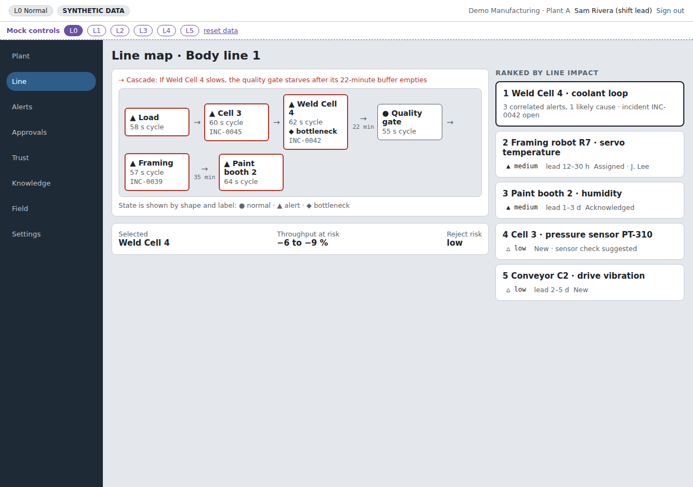
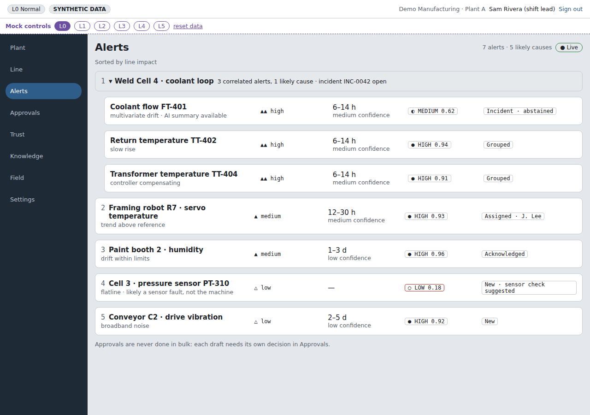
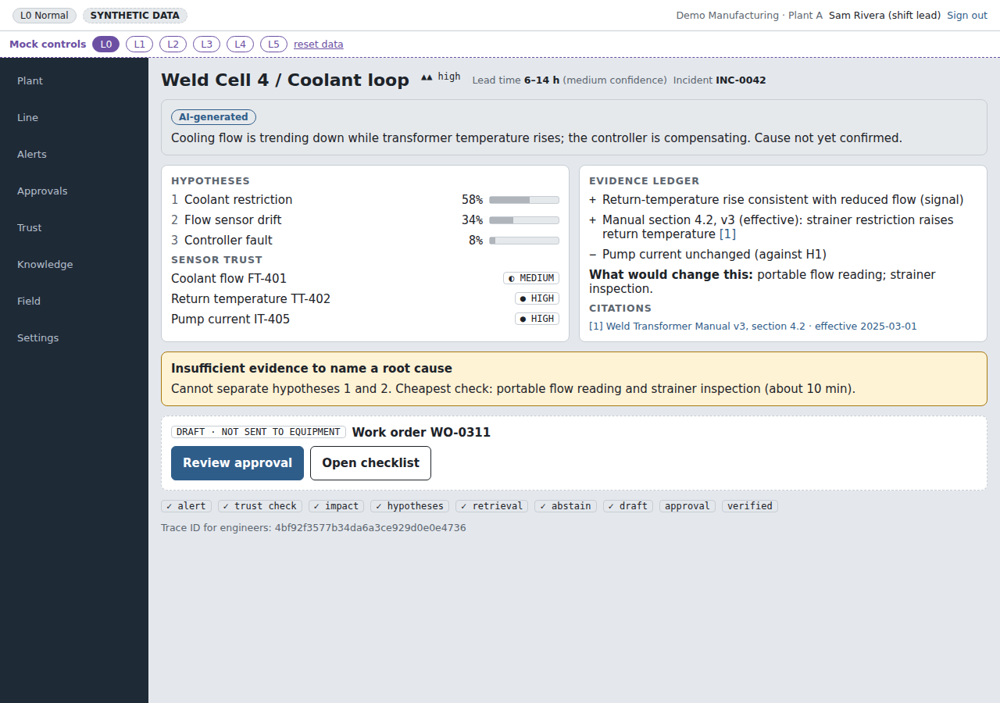
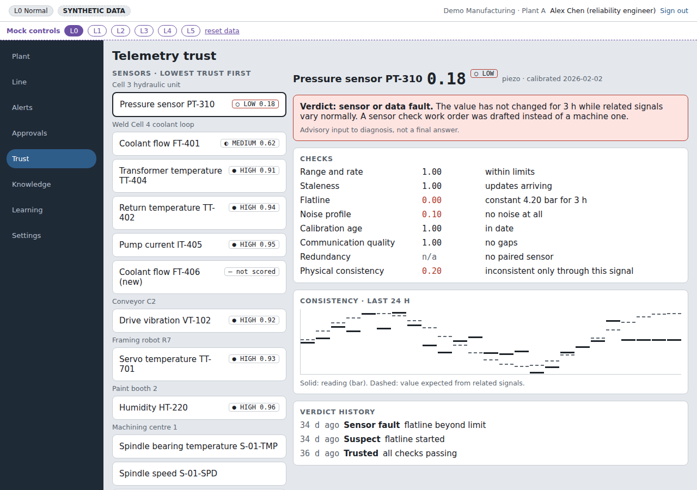
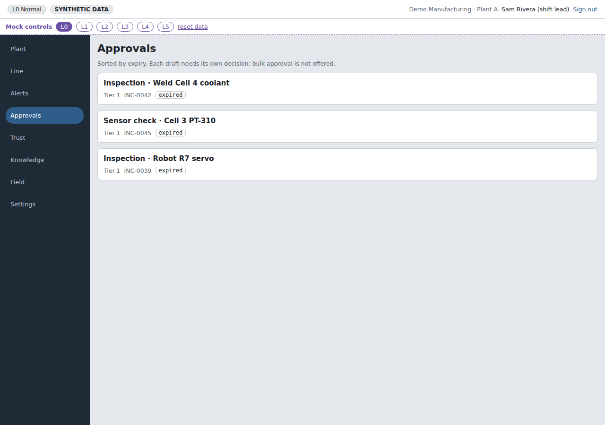
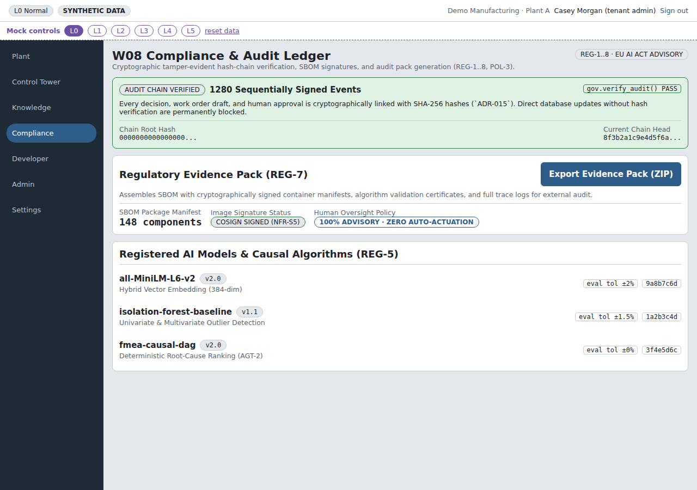

# AuraPrime FactoryPulse

[](LICENSE)
[](../../actions/workflows/ci.yml)
[](#status)

**AuraPrime FactoryPulse** is an advisory maintenance-intelligence platform for manufacturing lines, built end to end as an IoT and AI system: plant telemetry over MQTT, a deterministic real-time detection path, a causal diagnosis engine, cited retrieval with a language model that only narrates, an MCP tool server, and human-approved work orders. It never touches the equipment itself.

All data in this repository is synthetic.

Author and maintainer: **Srinivasulu Soma**.



## Demo

A narrated walkthrough of the hero scenario (a slow coolant drift on a weld cell, from first signal to an approved draft work order) is recorded from the running app with `pnpm demo:video`: Playwright drives the screens, offline text-to-speech narrates, and ffmpeg composes the video. Prerequisites are in [`tools/demo`](tools/demo/narration.json).

## IoT: from sensor to alert

- **The plant first.** The first screen maps every line, station, machine and sensor from an ISA-95-style equipment registry, with each sensor's normal range, its live value and its health: OK, out of range, flatline, stale or no data, plus each machine's running, idle or stopped state. Limits live in the registry, never in documents. A 10-station CNC line template seeds the registry and drives the simulator.
- **Edge to backbone.** A fault-injection simulator publishes sensor telemetry over MQTT (Mosquitto) using a versioned tenant/site/line/station/asset topic namespace, and an OTLP/HTTP JSON receiver accepts OpenTelemetry metrics from device API keys. The ingest gateway is the only bridge to Kafka: it validates each envelope with a schema, checks timestamp skew, rejects sensors not registered at the named place, takes the tenant from the authenticated sender only, adds W3C trace context and routes rejects to a dead-letter topic.
- **Streaming features.** A stream processor turns raw readings into windowed features on Kafka; telemetry lands in a TimescaleDB hypertable.
- **Deterministic detection.** Threshold rules and a multivariate drift detector that flags coordinated drift across signals before any single threshold breaches.
- **Telemetry trust before diagnosis.** Each sensor gets a trust score, so a failing sensor produces a sensor work order instead of a false machine fault.
- **Line impact.** Alerts are ranked by predicted throughput and reject impact across the line, not by machine health alone.
- **No LLM on the alert path.** Ingest, stream processing, detection, trust and line impact never call a language model or MCP tool. Alerts are never dropped under back-pressure.

## AI: the engine decides, the model narrates

- **Causal engine.** An FMEA-style probabilistic engine ranks root-cause hypotheses and proposes discriminating checks. Routing is deterministic.
- **Agent orchestrator.** A deterministic incident workflow: role steps share one incident record in PostgreSQL rather than messaging each other.
- **Grounded narration.** Retrieval is hybrid (keyword plus pgvector) over equipment manuals and SOPs, with citation verification and a provenance ledger. The narration must cite its sources or abstain. The bundled embeddings are a deterministic hashing stand-in, not a learned embedding model.
- **Claude, Gemini or no model at all.** Narration goes through one model port with a Claude adapter (official Anthropic SDK), a Gemini adapter and a deterministic local template, chosen by configuration. The default is the local template, so the project runs with no API key. Every provider gets the same guards: restricted documents, degraded levels, missing evidence, timeouts and errors all fall back to the cited template.
- **Defences.** Prompt-injection screening on inbound text, redaction before any model call, and a degradation ladder (L0–L5) when models, retrieval or budgets fail. Paid model calls pass a budget breaker: spend is recorded per tenant in a cost ledger, a daily or total budget moves narration to shorter answers and then to the cited template, a failing provider is cut off by a circuit breaker, and if spend cannot be checked no paid call is made.
- **MCP tool server.** Served over streamable HTTP on the official MCP TypeScript SDK, with the caller taken from a bearer token. Read-only, default-deny Model Context Protocol tools (`get_alerts`, `get_incident_timeline`, `get_line_impact`, `search_knowledge`, `explain_alert`, `get_health`, and `draft_work_order`, which only drafts). Each caller needs a grant, and each grant sets its audit mode.
- **Human in control.** Policy tiers decide who may approve. Approval needs a human session; API keys and agent tokens cannot approve. A hash-chained audit log is written by a single database function (`gov.append_audit`).

## Platform

- **Tenant isolation everywhere.** Every record, event and query carries a tenant ID; PostgreSQL row-level security is forced on.
- **Role-based screens.** Six roles from line operator to tenant admin each get hidden, view or use access per screen. The API checks it on every route and refuses any route without a rule; the menu follows the same permissions. Tenant admins assign roles and adjust access in an audited Admin module that cannot grant approval authority or lock admins out.
- **Document ingestion that refuses junk.** Uploads follow a template for manuals, procedures or troubleshooting guides and are tied to registered equipment. A deterministic check lists every problem (too short, repetitive, missing a section), a second person approves before answers can cite it, and documents are deleted when never cited or withdrawn when cited, all audited.
- **Config first.** Thresholds, timeouts, ports, topics, model IDs and labels are schema-validated configuration keys ([doc/config/keys.md](doc/config/keys.md)).
- **One codebase for web and mobile.** An Expo universal app (MVVM via hooks) against a contract-first OpenAPI API with a generated TypeScript SDK.

## Architecture

```
 Plant edge                 Real-time path (deterministic, no LLM)                  Advisory path
┌────────────┐   MQTT   ┌──────────────┐ Kafka ┌───────────────┐   ┌────────────────────────────┐
│ Simulator /│ ───────► │ Ingest       │ ────► │ Stream proc.  │──►│ Detection · Trust · Impact │──► Alert
│ edge agent │          │ gateway      │       │ (features)    │   └─────────────┬──────────────┘
└────────────┘          └──────────────┘       └───────────────┘                 │ incident
                                                                                 ▼
                         ┌──────────────────────────────────────────────────────────────────────┐
                         │ Agent orchestrator: causal ranking → cited retrieval → draft actions │
                         └───────────────────────────────┬──────────────────────────────────────┘
                                                         ▼
                                  Policy tiers → human approval → hash-chained audit
```

The design is documented TOGAF-style in [`doc/`](doc/README.md): requirements, architecture definition, data, application, technology, messaging and configuration architecture, an ADR log, runbooks, rendered diagrams and low-fidelity wireframes.

## Repository layout

```
.agents/skills/      Claude Code role skills (see Built with Claude Code)
apps/
  app/                Expo universal app (web and mobile), MVVM via hooks
  ingest-gateway/     MQTT and OTLP/HTTP ingest, validation, registry check, Kafka bridge
  stream-processor/   Windowed features
  intel-core/         Detection, multivariate drift, telemetry trust, line impact, causal ranking
  agent-orchestrator/ Deterministic incident workflow
  knowledge-svc/      Hybrid retrieval, citation checks, injection defences, model gateway adapter
  governance-svc/     Policy tiers, approval, audit verification
  case-svc/           Case memory and resolution verification
  mcp-server/         Read-only, default-deny MCP tools
  api-gateway/        API keys, quotas, metering
  mock-api/           Contract-driven mock backend for the UI
  simulator/          Synthetic plant and fault injection
packages/
  config/             Layered, schema-validated configuration
  db/                 Migrations, row-level security, seeding
  synthetic-data/     Deterministic synthetic dataset
  sdk-ts/             Client generated from doc/api/openapi.yaml
infra/                Local Docker stack (TimescaleDB with pgvector, Kafka, Mosquitto); cloud smoke spec
doc/                  Architecture documents, ADRs, runbooks, diagrams, wireframes
screenshots/          Captured app, end-to-end and wireframe screens
```

## Quickstart

Prerequisites: Node.js 22+, pnpm 12 (pinned in `packageManager`), Docker with Compose. On Windows, use WSL2 and keep the checkout in the Linux filesystem.

```bash
pnpm install
pnpm local:init     # generates per-machine secrets and app env (never committed)
pnpm local:up       # TimescaleDB, Kafka, Mosquitto
pnpm db:reset       # migrate and seed synthetic data

pnpm dev:api        # mock API (port from config key api.port)
pnpm dev:app        # Expo web app
```

Checks:

```bash
pnpm typecheck
pnpm test           # needs the local stack
pnpm test:e2e       # Playwright on desktop and phone sizes; needs dev:api and dev:app
```

## Screens

| Line overview | Alert queue | Incident detail |
|---|---|---|
|  |  |  |
| **Telemetry trust** | **Approvals** | **Audit chain** |
|  |  |  |

More in [`screenshots/`](screenshots/README.md).

## Status

Pre-release showcase. What has been run and observed (2026-11-07), not just designed:

| Check | Result |
|---|---|
| `pnpm typecheck` (16 workspaces) | pass |
| `pnpm test` (16 workspaces, local stack up) | 348 passed |
| `pnpm test:e2e` (Playwright, desktop and phone sizes) | 44 passed (2 desktop-only journeys skipped on phone) |
| Live pipeline: simulator over MQTT and OTLP replay through the ingest gateway, Kafka and the stream processor to the plant view | observed |
| API contract (OpenAPI vs mock API) | in sync |
| CI on push: typecheck and tests against the Docker stack | pass |
| CI on push: api-gateway image build, Syft SBOMs, Trivy scan failing on any HIGH or CRITICAL finding, keyless Cosign signature on the SBOM files | pass |

Not yet built: OAuth 2.1 for MCP (platform bearer tokens stand in) and rate limits on MCP calls. Not yet run, so not claimed: scenario scoring, chaos, performance and latency targets, and signing of the container images themselves (CI signs the SBOM files only). Design targets in `doc/` are labelled as targets. No external security audit or legal review has been done.

## Built with Claude Code

AuraPrime FactoryPulse is designed, written and maintained by Srinivasulu Soma with [Claude Code](https://www.anthropic.com/claude-code), Anthropic's coding agent, used as an AI pair programmer. How the work was organised:

- **The owner decides; the agent drafts.** Scope, architecture decisions and releases are the owner's. Each decision is recorded as an ADR in [`doc/`](doc/README.md) before code depends on it. Claude Code drafted code, tests, documents and tooling, and the owner reviewed and approved the changes.
- **Role skills.** The agent worked through project-specific Claude Code skills, one per role, published in [`.agents/skills/`](.agents/skills/README.md): chief architect, architecture guardian, engineering principles, documentation sync, QA lead, UX designer, project manager, independent human-eye review and legacy code review. Each skill carries that role's rules, such as raising a deviation to the owner instead of working around an ADR.
- **Written rules, enforced by permissions.** The safety invariants in [CONTRIBUTING.md](CONTRIBUTING.md), a config-first rule, a docs-first rule (decide in `doc/`, cite document IDs in code) and a typecheck before every push. [`.claude/settings.json`](.claude/settings.json) lets the agent build, test and commit locally, and denies `git push`, `git tag`, the cloud CLI, `rm -rf` and reading local secret files, so pushes stay with the owner.
- **Evidence over assurance.** A change counts when its checks have been run: the results above, CI on every push, and regression tests written to fail on the defect before it is fixed (for example [`apps/agent-orchestrator/src/entrypoint.test.ts`](apps/agent-orchestrator/src/entrypoint.test.ts)).
- **Demo tooling.** The walkthrough video is recorded with Playwright and narrated with offline text-to-speech (the Apache-2.0 Kokoro model via sherpa-onnx), then composed with ffmpeg; see [`tools/demo/`](tools/demo/narration.json).

The top-level agent instruction file and the delivery plan are internal and not part of this repository. No claims are made here about development speed or effort; none were measured.

## Contributing and security

See [CONTRIBUTING.md](CONTRIBUTING.md) and [SECURITY.md](SECURITY.md).

## Licence

Apache License 2.0. See [LICENSE](LICENSE) and [NOTICE](NOTICE).

AuraPrime FactoryPulse is advisory decision-support software. It does not control, actuate or replace any safety function of industrial equipment.
