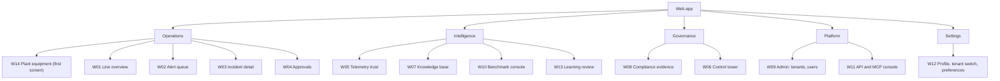
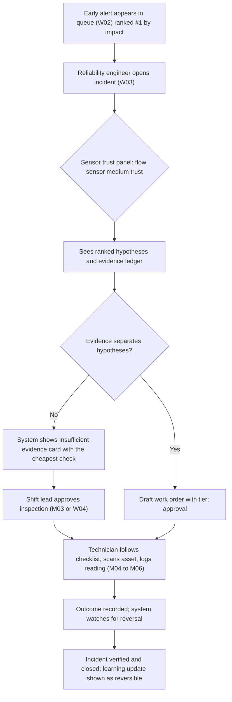
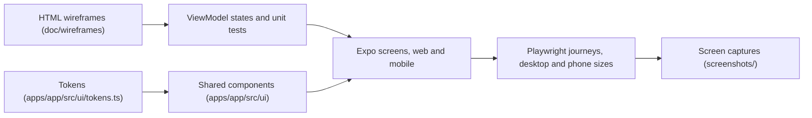

# 02. UI Design: AuraPrime FactoryPulse v2

| Field | Value |
|---|---|
| Status | DRAFT v0.1 |
| Date | 2026-09-30 |
| Owner | Sri Soma |
| TOGAF ADM phase | Phase C: Application Architecture (user-facing applications APP-22 and APP-23) |
| Inputs | Requirements UI-1 to UI-9; 01 Business (personas, services, rules); 03 Technical Design (API, states) |
| Principle | Interactive HTML wireframes are reviewed and approved by the owner (UI-1, ADR-034); the Expo app is the visual source of truth |
| Convention | Wireframes are low-fidelity HTML pages in `doc/wireframes/` (ADR-027 amendment 2026-10-03) that fix structure and content, not final visuals; the ASCII sketches in section 7 are their starting point. Final visuals live in the Expo app (`apps/app/src/ui/`, ADR-034). Accessibility and standards references are targets to verify, not certifications. |

---

## 1. Purpose and scope

Design the operator, technician, engineer, manager, admin and API-consumer experiences for the web app (APP-22) and mobile app (APP-23), both built from one Expo (React Native) codebase (ADR-029), and define the design system, wireframes and front-end architecture that carry the design into code.

Out of scope: control or actuation interfaces (advisory only, ADR-001), and any customer-specific branding.

---

## 2. UX principles

| ID | Principle | What it means in practice |
|---|---|---|
| UXP-1 | Clarity under stress | The most important thing on each screen is obvious in seconds; low visual noise |
| UXP-2 | Trust made visible | Every AI output shows label, citations, confidence or abstention; sensor trust is visible |
| UXP-3 | Degradation is never hidden | The current fallback level is always visible; degraded results are marked |
| UXP-4 | Humans decide | Approval is explicit; the interface never implies the system acts on equipment |
| UXP-5 | Impact first | Ranking and emphasis follow line impact, not the loudest signal |
| UXP-6 | Honest uncertainty | Ranges, probabilities and "insufficient evidence" are shown plainly |
| UXP-7 | Plant-floor ready | Large targets, high contrast, glare tolerance, one-handed mobile use, offline tolerance |
| UXP-8 | Calm real-time | Live updates never reorder what the user is reading; no alert fatigue |
| UXP-9 | Synthetic data is labelled | Demonstration data is always marked (BR-12) |
| UXP-10 | Same meaning everywhere | One design system, shared tokens and components across web and mobile |

---

## 3. Users, contexts and jobs to be done

| Persona | Primary device and context | Top jobs |
|---|---|---|
| Line operator (ACT-1) | Wall display or shared terminal, glare, distance | See line status and degraded state at a glance |
| Technician (ACT-2) | Phone, gloves, noisy, intermittent connectivity | Understand what to check, perform checklist, log outcome, approve tier-1 if permitted |
| Shift lead (ACT-3) | Phone and web | Approve tier-1 actions; see queue |
| Reliability engineer (ACT-4) | Desktop web | Review cited RCA and evidence ledger; approve tier-2; tune and give feedback |
| Plant manager (ACT-5) | Desktop and tablet | See impact, trends, incident status |
| Security and compliance admin (ACT-6) | Desktop | Audit, evidence pack, RBAC, tenancy, keys |
| External developer (ACT-7) | Desktop, docs and console | Get keys, test in sandbox, manage webhooks and tool grants |
| Project owner (ACT-8) | Desktop | Control tower, cost, benchmarks |

---

## 4. Information architecture

### 4.1 Web sitemap



### 4.2 Mobile navigation

Bottom tabs at phone width (below 900 px): **Plant** (W14), **Line** (W01), **Alerts**, **Approvals**, **Field** (scan, checklist, offline queue and sync) and **More**, which lists the remaining screens the role may open (section 4.4) and **Settings** (Me). Six tabs keep every label readable; the web sidebar shows every screen. Detail views open in a stack above the tabs (ADR-039).

### 4.4 Role-based screens (ADR-040)

Screen access per role: **use** (read and act), **view** (read only; actions disabled) or **–** (hidden; the API refuses it). These are the defaults in `rbac.screens`, approved by the owner on 2026-11-05; tenant admins change them in W09. Approval decisions still follow `policy.role_max_tier` and invariant 2.

| Screen | Operator | Technician | Shift lead | Reliability engineer | Operations manager | Admin |
|---|---|---|---|---|---|---|
| Plant (W14) | use | use | use | use | use | use |
| Line (W01) | use | use | use | use | use | – |
| Alerts and incidents (W02, W03) | use | use | use | use | use | – |
| Approvals (W04) | – | view | use | use | use | – |
| Field and work orders (M04 to M07) | – | use | use | – | – | – |
| Knowledge (W07) | – | use | use | use | – | use |
| Trust (W05) | – | – | view | use | – | – |
| Learning (W13) | – | – | – | use | view | – |
| Control tower (W06) | – | – | – | – | view | use |
| Compliance (W08) | – | – | – | – | view | use |
| Developer (W11) | – | – | – | – | – | use |
| Admin (W09) | – | – | – | – | – | use (locked) |
| Settings (W12) | use | use | use | use | use | use |

### 4.3 Global elements

| Element | Behaviour |
|---|---|
| Fallback banner | Persistent bar showing level L0 to L5 with plain-language impact; expands to details |
| Synthetic-data badge | Persistent when the tenant or source is synthetic |
| Tenant and site switcher | Top bar |
| Global search | Assets, alerts, documents |
| Notification centre | Alerts, approval requests, system events |
| Trace link (engineer roles) | Opens the incident's trace in the control tower |

---

## 5. Core journeys

### 5.1 Hero journey: slow drift in Weld Cell 4



### 5.2 Other journeys (summary)

| Journey | Key screens |
|---|---|
| Sensor lie: sensor work order instead of machine work order | W02, W03, W05, M02, M03 |
| LLM outage: degraded banner, template RCA still cited | Global banner, W03 |
| Poisoned note flagged as security event | W07, W06 |
| External agent via MCP with tool grants | W11 |
| Compliance review: evidence pack download | W08 |

---

## 6. Screen specifications

### 6.1 Web screens

| ID | Screen | Purpose | Key elements | Data (API) | States to design | Requirements |
|---|---|---|---|---|---|---|
| W14 | Plant equipment (first screen, `/`) | See every line, station, machine and sensor, its limits and whether it reports, before alerts | Health summary by status; line selector; stations in line order with machines (tag, model, state) and sensor rows (value, normal range, health by symbol and label, silence); attention-only filter | /v1/plant (polled at app.poll_interval_ms) | Loading, error, empty (no equipment), no telemetry, live | ING-7, ING-12, UI-4, UI-6 |
| W01 | Line overview (`/line`) | Understand line status and impact | Station graph map with bottleneck, cascade paths, impact-ranked queue rail, fallback banner | /v1/lines/{id}/impact, SSE stream | Loading, empty (no alerts), degraded (impact unknown), stale, synthetic | LIM-4, UI-4, UI-7 |
| W02 | Alert queue | Triage all alerts | Table with impact, lead-time range, trust badge, status, asset; filters; grouping of correlated alerts | /v1/alerts | Empty, filtered-empty, live update, bulk select disabled for approvals | LIM-3, DET-3 |
| W03 | Incident detail | Cited RCA and decision | Header (asset, impact, lead-time), hypothesis list with probabilities, evidence ledger, citations with document versions, trust panel, timeline, abstention card, work-order draft, approval status, "what would change this" | /v1/incidents/{id}, /evidence | Loading, abstained, verified, degraded (template narrative), citation blocked, reopened | AGT-5, RAG-6, RAG-7, UI-8 |
| W04 | Approvals | Decide pending actions | Pending list, tier, rationale, evidence summary, approve or reject with reason, escalation timers | /v1/approvals | Empty, expired, escalated, permission denied | POL-2, POL-4 |
| W05 | Telemetry trust | Inspect sensor reliability | Per-sensor trust scores, check breakdown, consistency plots, verdict history | /v1/sensors, trust endpoints | Empty, insufficient data | TRU-4 |
| W06 | Control tower | Platform health, cost, evaluation, security events | Fallback level history, pipeline lag, RAG quality, budget burn, MCP calls and denials, link to traces | Observability APIs | Loading, partial data, alerting state | OBS-1 to OBS-11 |
| W07 | Knowledge base | Search and manage documents | Ask with citations; add a document by type, equipment and template, with every refused reason shown at its field; list filtered by pending review, approved and withdrawn; approve (second person), delete or withdraw with a reason (ADR-041) | /v1/knowledge/query, /v1/knowledge/documents, /v1/knowledge/templates, /v1/knowledge/upload | loading, error, empty, ready; upload refused, pending review, withdrawn | RAG-1, RAG-5, RAG-10, RAG-12, RAG-13 |
| W08 | Compliance evidence | Assemble and download evidence | Evidence pack builder, SBOM status, model register, audit-chain verification result | Governance APIs | Generating, failed, verified | REG-7, POL-3 |
| W09 | Admin | Manage users, roles and screen access | Users with role assignment (not own role, not API keys); screen access per role with default, override and reset; lockout guard; audit reference per change | /v1/admin/users, /v1/admin/permissions | Loading, error, view only, permission denied | API-2, NFR-S6, UI-10 |
| W10 | Benchmark console (owner and Full) | Run scenarios and view scores | Scenario picker, run status, metrics, comparison across versions | Simulator API | Running, failed, compare | SIM-4 |
| W11 | API and MCP console | Keys, scopes, tool grants, usage, webhooks | Key creation (shown once), scopes, ToolGrant matrix, kill switches, usage charts, webhook log | /v1/usage, /v1/webhooks | Empty, revoked, over-quota | API-3, MCP-4, MCP-5 |
| W12 | Profile and settings | Preferences | Theme mode, density, notifications, tenant switch | | | UI-6 |
| W13 | Learning review | Approve lessons and see learning batches before they take effect | Lesson drafts with their source case and AI label, approve or reject with reason; similar-case index; learning batches with benchmark and golden-set results against tolerance, status (staged, active, rejected, reverted), revert | /v1/lessons, /v1/learning-batches (to add to the contract) | Empty, draft, approved, rejected, batch staged, batch rejected by gate, reverted, permission denied | LRN-5, LRN-6, LRN-7 |

### 6.2 Mobile screens

| ID | Screen | Purpose | Key elements | Requirements |
|---|---|---|---|---|
| M01 | Alerts | Triage on the go | Impact-ranked list, trust badge, lead-time range, fallback banner | UI-5, UI-7 |
| M02 | Alert summary | One-screen understanding | Asset, plain-language summary with AI label, top hypothesis or abstention, proposed check, citations expandable | UI-8 |
| M03 | Approval | Approve or reject | Action, tier, why, evidence summary, large approve and reject buttons, reason field, expiry | POL-4 |
| M04 | Work checklist | Guided steps | Steps with completion, photo and reading capture, safety reminders from approved procedures (cited, versioned) | UI-5 |
| M05 | Scan asset | Confirm the right machine | QR scan, asset confirmation | UI-5 |
| M06 | Capture | Record reading and photo | Numeric input with unit, photo attach, notes | LRN-1 |
| M07 | Queue and sync | Offline handling | Pending items, sync status, conflict resolution | UI-5 |
| M08 | Notifications | Preferences | Channels, quiet hours (safety-critical alerts never silenced) | |
| M09 | Sign in | Authentication | Identity provider flow, device binding | |

---

## 7. Key wireframes (structure only)

HTML wireframes in `doc/wireframes/`, each with a switch for every screen state, fallback level and, where a screen has Full-only parts, the edition: [W01 Line overview](wireframes/W01-line-overview.html), [W02 Alert queue](wireframes/W02-alert-queue.html), [W03 Incident detail](wireframes/W03-incident-detail.html), [W04 Approvals](wireframes/W04-approvals.html), [W05 Telemetry trust](wireframes/W05-telemetry-trust.html), [W06 Control tower](wireframes/W06-control-tower.html), [W07 Knowledge base](wireframes/W07-knowledge-base.html), [W08 Compliance evidence](wireframes/W08-compliance-evidence.html), [W09 Admin](wireframes/W09-admin.html), [W10 Benchmark console](wireframes/W10-benchmark-console.html), [W11 API and MCP console](wireframes/W11-api-mcp-console.html), [W12 Profile and settings](wireframes/W12-profile-settings.html), [W13 Learning review](wireframes/W13-learning-review.html), [W14 Plant equipment](wireframes/W14-plant-equipment.html), [M01–M03 Mobile triage and approval](wireframes/M01-M03-mobile-triage.html), [M04 Work checklist](wireframes/M04-work-checklist.html), [M05–M09 Mobile companion](wireframes/M05-M09-mobile-companion.html). The ASCII sketches below were their starting points.

### 7.1 W03 Incident detail

HTML wireframe with every screen state, fallback level and session type: [wireframes/W03-incident-detail.html](wireframes/W03-incident-detail.html).

```
+----------------------------------------------------------------------------------+
| [L0 Normal]  [SYNTHETIC DATA]                          Tenant: Demo   Site: Plant A |
+----------------------------------------------------------------------------------+
| Weld Cell 4 / Coolant loop        IMPACT: #1 (high)   Lead time: 6-14 h (medium)  |
| [AI-generated summary]  Cooling flow trending down while transformer temperature  |
| rises; controller compensating. Cause not yet confirmed.                            |
+---------------------------------------+------------------------------------------+
| HYPOTHESES                            | EVIDENCE LEDGER                          |
| 1 Coolant restriction     58%  ####   | + Return-temp rise consistent (signal)   |
| 2 Flow sensor drift       34%  ###    | + Manual sec 4.2 v3 (effective) [cite 1] |
| 3 Controller fault         8%  #      | - Pump current unchanged (against H1)    |
|                                       | What would change this: portable flow    |
| SENSOR TRUST                          | reading, strainer inspection             |
| Flow sensor      MEDIUM  (details)    |                                          |
| Return temp      HIGH                 | CITATIONS                                |
| Pump current     HIGH                 | [1] Weld Transformer Manual v3, s4.2     |
+---------------------------------------+------------------------------------------+
| INSUFFICIENT EVIDENCE: cannot separate hypotheses 1 and 2.                        |
| Cheapest check: portable flow reading + strainer inspection (about 10 min).        |
| [Draft inspection work order]   Tier 1: shift lead approval required               |
+----------------------------------------------------------------------------------+
| Timeline: alert > trust check > impact > hypotheses > retrieval > abstain > draft  |
| [Open trace]                                                       [Give feedback] |
+----------------------------------------------------------------------------------+
```

### 7.2 W01 Line overview

```
+----------------------------------------------------------------------------------+
| [L0 Normal]                                                    [SYNTHETIC DATA]  |
+-----------------------------------------------------------+----------------------+
| LINE MAP                                                  | IMPACT QUEUE         |
| [Load]--[Cell 3]--[Cell 4*]==>[Quality gate]--[Framing]   | 1 Cell 4 coolant     |
|                    ^ bottleneck                           |   impact high        |
|   cascade: Cell 4 -> Quality gate (buffer 22 min)         | 2 Conveyor noise     |
|                                                           |   impact low         |
| Legend: state by shape and label, not colour alone        | 3 Sensor fault C3    |
+-----------------------------------------------------------+----------------------+
```

### 7.3 M03 Approval (mobile)

```
+-------------------------------+
| [L0]  [SYNTHETIC]             |
| Approve inspection?           |
| Weld Cell 4 - coolant loop    |
| Tier 1 - your role can decide |
| Why: cannot separate two      |
| causes; 10-minute check       |
| [AI-generated]  Evidence >    |
| Expires in 25 min             |
|                               |
| [   REJECT   ] [  APPROVE  ] |
| Reason (optional)             |
+-------------------------------+
```

### 7.4 Fallback banner states

| Level | Banner text pattern | Interaction |
|---|---|---|
| L0 | Hidden or subtle "Normal" | |
| L1 | "Reduced explanation quality: smaller model in use" | Expand for details |
| L2 | "Explanations use templates; alerts and evidence unaffected" | |
| L3 | "Knowledge search unavailable: guidance is unverified; higher approval tier required" | Approval screens show the tier change |
| L4 | "Basic detection only (thresholds)" | |
| L5 | "Offline: edge alerts only; changes will sync" | |

---

## 8. Component inventory

| Level | Component | Variants and states | Notes |
|---|---|---|---|
| Atoms | Button, icon button | Primary, secondary, destructive; large touch variant; disabled, loading | Approve and reject are clearly differentiated |
| | Badge and chip | Status, tier, trust (high, medium, low, unknown), synthetic, AI-generated | Text plus shape plus colour |
| | Input, select, numeric with unit, toggle | Error, disabled, read-only | Units always visible |
| | Confidence meter and range bar | Point, range, unknown | Ranges preferred over single values |
| Molecules | Citation chip | Verified, blocked, superseded | Opens source chunk with document version |
| | Alert card | Compact, expanded, degraded | |
| | Impact bar | Relative units with confidence band | |
| | Hypothesis row | Probability, direction of evidence | |
| | Evidence ledger row | Supports, opposes, neutral; source type | |
| | Trust badge with breakdown | Popover of checks | |
| | Approval card | Tier, why, expiry | |
| | Toast and inline message | Info, warning, error | Rate-limited |
| Organisms | Fallback banner | L0 to L5 | Always present |
| | Line map | Station nodes, edges, bottleneck, cascade | Keyboard navigable |
| | Incident timeline | Steps with spans links | |
| | Abstention card | Known, missing, proposed check | Distinct from errors |
| | Data table | Sort, filter, group, live rows | Row stability during updates |
| | Time-series chart | Multi-series, threshold lines, incident markers | Colour-blind-safe palette |
| | Checklist | Step states, capture inputs | |
| | Key manager and tool-grant matrix | Reveal-once secrets | |
| Templates | Web shell, mobile shell | Responsive, modes | |

Every shared component lives once in `apps/app/src/ui/`, and its states are verified by ViewModel unit tests and Playwright journeys (UI-9, Section 15).

---

## 9. Design system

### 9.1 Tokens (semantic; values in `apps/app/src/ui/tokens.ts`)

| Group | Tokens |
|---|---|
| Colour roles | surface, surface-raised, text-primary, text-secondary, border, accent, status-normal, status-warning, status-critical, status-unknown, ai-label, synthetic, focus |
| Data-viz palette | Categorical set (colour-blind-safe) and sequential set; line styles and markers as secondary encodings |
| Typography | Font families, size scale, weight, line-height; tabular numerals for data |
| Spacing | Base unit scale; density modes (comfortable, compact) |
| Radius and elevation | Small set |
| Motion | Short durations; reduced-motion variants; no motion for critical state changes |
| Touch and hit targets | Standard and glove-friendly minimums |

### 9.2 Modes

| Mode | Use |
|---|---|
| Light | Office |
| Dark | Control rooms, low light |
| High-contrast plant-floor | Glare and distance; larger type and targets |

Tokens have per-mode palettes in `apps/app/src/ui/tokens.ts` (light, dark, high contrast), selected by `apps/app/src/ui/theme.tsx`. Density modes are independent of colour modes.

### 9.3 Alarm and status semantics

- Status is never conveyed by colour alone: always icon or text or shape as well.
- Use a small, consistent set of severity levels and avoid colour overuse to limit alarm fatigue. Review industrial HMI guidance (for example ISA-101) when finalising the palette; this is a review item, not a compliance claim.
- Critical alerts are rare by design; grouping and de-duplication reduce noise (UXP-8).

---

## 10. State design catalogue

| State | Design rule |
|---|---|
| Loading | Skeletons that match final layout; no layout jump |
| Empty | Explain why and next step; distinguish "no data" from "no alerts" |
| Error | Human-readable message, retry, trace id for engineers |
| Degraded | Fallback banner plus inline markers on affected elements |
| Abstained | Dedicated card; neutral tone, not an error |
| Stale data | Timestamp and age badge; warn beyond a threshold |
| Offline (mobile) | Queue indicator; actions saved locally; sync status |
| Permission denied | Explain missing role; offer request path |
| Synthetic | Persistent badge |
| Unverified (L3) | Guidance flagged "unverified"; approval tier raised |
| Reopened incident | Timeline shows why; prior hypothesis confidence reduced |

---

## 11. AI-specific UX patterns

| Pattern | Design |
|---|---|
| AI label | Every generated block carries an "AI-generated" chip (AGT-7, UI-8) |
| Citations | Inline chips open the source chunk with document version and effective date; blocked or superseded citations are visibly flagged |
| Confidence | Probabilities and ranges with plain-language wording; avoid false precision |
| Abstention | Positive framing: what is known, what is missing, cheapest next check |
| Falsifiers | "What would change this" always visible for diagnoses |
| Human control | Approve and reject are explicit; no auto-approval; the system never says it acted on equipment |
| Feedback | Simple useful/not useful and correction capture on diagnoses and citations, feeding the outcome loop |
| Learning transparency | When a learning batch is staged, show what would change and its benchmark result; only batches that pass the gate activate; offer revert (LRN-4, LRN-7) |
| Similar cases | Diagnoses show similar past verified cases as cited evidence ("seen before: INC-xxxx, strainer blocked"), never as the decision (LRN-5) |
| Lessons | Model-drafted lessons carry the AI label and their source case, and appear in retrieval only after a person approves them (LRN-6) |
| Safe rendering | AI text is sanitised; links restricted; no rendering of raw HTML from model output (injection defence) |
| Security events | Detected injection attempts appear as security events in the control tower, not in user-facing content |

---

## 12. Mobile-specific design

| Topic | Design |
|---|---|
| Offline | Local store for the alert list, checklists and pending actions; queue with clear sync states; conflict resolution rules (server wins for approvals, merge for notes) |
| Push | Alert and approval notifications with deep links; safety-critical alerts never suppressed by quiet hours; store distribution deferred (cost), so development and internal distribution first |
| Camera and scanning | QR asset scan; photo capture with compression |
| One-handed and glove use | Bottom navigation, large targets, minimal typing, voice-input friendly fields |
| Security | Device binding, biometric unlock optional, no secrets in local storage, screen lock timeout |
| Performance | Fast cold start; list virtualisation; small image payloads |

---

## 13. Accessibility, internationalisation and responsiveness

| Topic | Target |
|---|---|
| Accessibility | Aim for WCAG 2.2 AA conformance; keyboard operable; screen-reader labels; focus management; contrast checks per mode; reduced motion (verify against the current standard version) |
| Touch targets | Larger than typical defaults in plant-floor mode |
| Internationalisation | English first; text externalised; units and time zones explicit; layout tolerant of longer text |
| Breakpoints | Wall display, desktop, tablet, phone; W01 and W03 have defined layouts for each |
| Charts | Textual alternatives and data tables for every chart |

---

## 14. Real-time behaviour

| Rule | Detail |
|---|---|
| Transport | Server-sent events for the queue, banner and incident updates; fallback to polling |
| Stable lists | New items are indicated and inserted without reordering the row under the user's pointer; option to apply reordering |
| Rate limiting | Batch notifications; collapse repeated alerts for the same asset |
| Stale indicator | If the stream disconnects, show a "live updates paused" chip and last-updated time |
| Alarm fatigue | Group correlated alerts; show unique-cause counts |

---

## 15. Wireframes and design-to-code pipeline

ADR-034 retired the design tool of ADR-027. The artifacts below replace it.

### 15.1 Design artifacts

| Artifact | Location | Role |
|---|---|---|
| Interactive wireframes | `doc/wireframes/` (W01 to W14, M01 to M09) | Layout, screen states and fallback levels, approved by the owner (UI-1) |
| Design tokens | `apps/app/src/ui/tokens.ts` | Palettes for each mode, spacing, radius, type, touch target |
| Shared components | `apps/app/src/ui/` | The single implementation for web and mobile (ADR-029) |
| Screens and ViewModels | `apps/app/src/app/`, `apps/app/src/features/` | MVVM via hooks (ADR-028) |
| Screen captures | `screenshots/` | Generated evidence (`pnpm capture:screens`), not a source of truth |

### 15.2 Tokens and modes

Light, dark and high-contrast palettes share one `Palette` shape, so a screen reads roles and never a raw colour. The touch target token follows UI-2.

### 15.3 Rules

- Screens and components use tokens, not hard-coded values.
- Each wireframe names its states as ViewModel states (ADR-028).
- A design change updates the wireframe and the code together.

### 15.4 Design-to-code flow



### 15.5 Definition of "design approved for build" (UI-1)

1. Wireframes exist for every screen, with a switch for each screen state and fallback level.
2. Tokens cover all three modes, with a 44px touch target (UI-2).
3. ViewModel unit tests and Playwright journeys pass on desktop and phone sizes (UI-9).
4. The owner has reviewed and approved the wireframes (UI-1).

### 15.6 Cost and tooling

There is no design-tool spend. Wireframes are plain HTML in the repository, and verification uses the project's test tools.

---

## 16. Front-end architecture

| Topic | Decision or approach |
|---|---|
| Pattern | MVVM via hooks, organised by feature, one-way data flow (ADR-028): View (presentational), ViewModel hook per screen (view state, derived screen states, intent actions), Model (SDK, query cache, SSE, offline queue), client ports for edition adapters |
| Repository | Shared monorepo (`apps/app` for web and mobile, `packages/ui-tokens`, `packages/ui-kit`, `packages/sdk-ts`, `packages/schemas`, `packages/ports`); the app has `features/<screen>/view` and `features/<screen>/model` |
| Web | Web build of the universal Expo app (React Native Web, Expo Router, static export) (ADR-029); single-page app, no server rendering; web-specific Views for dense tables and charts |
| Mobile | iOS and Android builds of the same Expo app, with a development client for native modules (ADR-029) |
| Cross-platform code | Shared components and navigation abstraction; platform-specific components where UX differs (tables, maps) |
| Styling | Universal styling library chosen by a one-day spike (TO-5): compare Tamagui-style compiler approach and utility-class approach on both platforms |
| Data | Generated TypeScript SDK from OpenAPI; runtime validation with shared schemas; query cache for server state |
| Real-time | SSE client with reconnect and last-event id |
| State | Server state through the cache; small client store for UI state; both reach Views only through the screen ViewModel |
| Charts | Canvas-based time-series for web; Skia-based or lightweight charts on mobile; shared data adapters |
| Offline (mobile) | Local persistent store; action queue with idempotency keys (matches API design) |
| Edition handling | One shell; the edition profile in configuration decides which screens and adapters load (ADR-007, ADR-036). Full-only screens resolve to no access in the Community profile (ADR-040) |
| Security | Content Security Policy; safe rendering of AI text; token storage in secure storage; no secrets in the client bundle |
| Performance budgets | Targets for time to interactive, list render time with 1,000 alerts, and mobile cold start; measured in CI |
| Testing | ViewModel unit tests (Vitest); Playwright journeys on desktop and phone sizes (UI-9, ADR-034) |
| Observability | Web and mobile OpenTelemetry instrumentation with privacy filters; trace ids shown to engineers |
| Distribution | Web deployment; mobile through internal builds first; store publishing deferred (cost) |

---

## 17. UI analytics and privacy

Collect only operational telemetry (screen timing, errors, feature usage counts). No content of AI outputs or documents in client telemetry by default. Respect tenant privacy settings. Usage feedback on AI outputs is stored as domain data with consent (LRN).

---

## 18. UI acceptance criteria

| ID | Criterion | Traces to |
|---|---|---|
| UI-AC-1 | Hero journey can be completed on web and mobile using only designed screens | AC-H1 to AC-H7 |
| UI-AC-2 | Alert queue ranks by impact; the hero alert appears first | AC-H3, LIM-3 |
| UI-AC-3 | Incident detail shows hypotheses, evidence ledger, verified citations and falsifiers | AC-H4, AGT-5 |
| UI-AC-4 | Abstention state is shown with the proposed check instead of a root-cause claim | AC-H5, RAG-7 |
| UI-AC-5 | Approval requires an explicit human action; API tokens cannot approve | AC-H6, AGT-4 |
| UI-AC-6 | Fallback banner changes correctly for L0 to L5 in scenario runs | UI-7, FBK-2 |
| UI-AC-7 | Every AI block has an AI label and citations or abstention | UI-8, AGT-7 |
| UI-AC-8 | Synthetic-data badge visible in all demonstration views | BR-12 |
| UI-AC-9 | Accessibility checks pass in all three modes | Section 13 |
| UI-AC-10 | Mobile approval works offline-tolerantly and syncs without duplicates | UI-5 |
| UI-AC-11 | Screens use the design tokens in `apps/app/src/ui/tokens.ts`, in all three modes, with 44px touch targets | UI-2 |
| UI-AC-12 | ViewModel unit tests and Playwright journeys cover the screen states on desktop and phone sizes | UI-9 |
| UI-AC-13 | Lessons are visible to users only after human approval and always show their source case and AI label; similar cases appear as cited evidence | LRN-5, LRN-6 |

---

## 19. Design timeline (aligned with 04 ADD)

| ADD transition | UI design activity |
|---|---|
| TA-1 | Personas, journeys, information architecture (Mermaid in `doc/diagrams/`), initial principles and token exploration |
| TA-2 | Foundations, tokens, core components; HTML wireframes for the hero journey; styling-library spike |
| TA-3 | Working Expo screens, usability walkthroughs; owner approval of the wireframes (UI-1) |
| TA-4 | Accessibility and performance tuning; Playwright verification (UI-9); mobile internal distribution |

Changed 2026-10-04 (ADR-030): the UI is implemented now as a working prototype against a mock backend with synthetic data, ahead of the rows above. UI-1 still gates release.

---

## 20. Open items

| # | Item |
|---|---|
| UO-1 | Resolved 2026-10-06: Penpot retired; HTML wireframes and the Expo app (ADR-034), OQ-7 |
| UO-2 | Styling library spike result (TO-5) |
| UO-3 | Final brand name and identity, OQ-8 |
| UO-4 | Confirm hero screens with a domain reviewer for terminology and safety wording |
| UO-5 | Decide push notification service and mobile distribution path (deferred for cost) |
| UO-6 | Validate accessibility target and alarm-semantics guidance against current standards |
