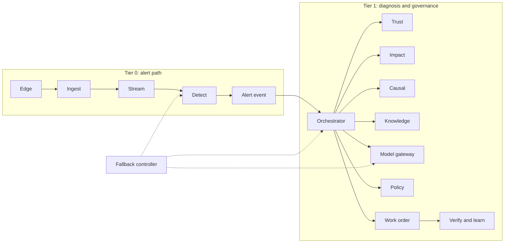
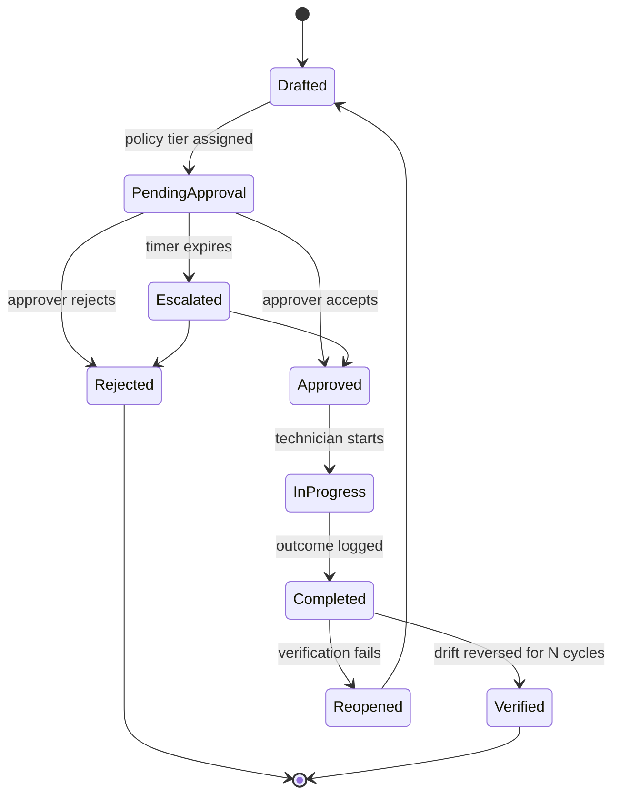

# 03. Technical Design: AuraPrime FactoryPulse v2

| Field | Value |
|---|---|
| Status | DRAFT v0.1 |
| Date | 2026-09-30 |
| Owner | Sri Soma |
| TOGAF ADM phase | Phase C and D detailed design (implementation-level design within the architecture) |
| Inputs | Requirements; 00, 03, 04, 05, 06 |
| Convention | No source code. Algorithms are described at design level; specific methods are chosen by benchmark (SIM-4). Numeric thresholds are placeholders tuned on the simulator. Physical models are illustrative and need review by a manufacturing engineer before being described as realistic. |

---

## 1. Design overview

The alert path (Tier 0) and the diagnosis path (Tier 1) are separate. Detection must always be able to raise an alert without the LLM, retrieval or UI being available.

Rendered view with per-stage failure behaviour and the degradation ladder from section 13: [diagrams/alert-path.html](diagrams/alert-path.html). The Mermaid source above stays the source of truth; update both together.

---

## 2. Event and message standards

### 2.1 Event envelope (all bus messages)

| Field | Purpose |
|---|---|
| event_id | Unique id (idempotency and dedupe) |
| event_type, schema_version | Routing and evolution |
| tenant_id, site_id | Isolation and routing |
| produced_at, source_ts | Time of production and of the underlying observation |
| trace_context | W3C trace context for propagation |
| is_synthetic | Data label (BR-12) |
| causation_id, correlation_id | Links events to causes and incidents |
| payload | Typed body |

Rules: consumers ignore unknown fields; changes are additive within a major version; breaking changes require a new topic version.

### 2.2 Telemetry envelope (ingest)

| Field | Notes |
|---|---|
| message_id | Client-generated idempotency key; unique per sensor reading batch |
| sensor_id, asset_id | Must exist in the registry, else dead-letter with reason |
| source_ts, ingest_ts | Skew checked; late window configurable |
| readings | One or more values with units and quality flags |
| sequence | Per-sensor sequence for ordering and gap detection |

### 2.3 Delivery semantics

At-least-once delivery, idempotent handlers, ordering guaranteed per partition key (tenant and asset) only. Late or out-of-order data is admitted within a configurable window and reflected through aggregates.

---

## 3. Ingestion and stream design

| Step | Design |
|---|---|
| Receive | REST, gRPC or MQTT endpoint authenticates the source (mTLS or key), validates the envelope shape |
| Idempotency | Look up message_id in the idempotency table; duplicates return the stored result |
| Validate | Registry existence, unit and range checks, timestamp skew |
| Publish | Write to `tel.raw` after durable acknowledgement; reject with retry-after when back-pressure is active |
| Dead letter | Invalid or repeatedly failing messages go to `tel.dlq` with reason and original payload pointer; replay tool re-injects after fixes |
| Normalise | Stream processor converts units, applies calibration offsets from the registry, assigns quality flags |
| Persist | Batched writes to the time-series table; aggregates maintained by continuous aggregation |
| Publish validated | `tel.validated` for detection, trust and impact consumers |
| Back-pressure | Bounded queues with watermark signalling; producers receive retry-after; edge agent slows and buffers |
| Edge behaviour | The edge agent buffers to disk when the platform is unreachable and replays in order with original message_ids |

---

## 4. Detection design (APP-04)

### 4.1 Strategies

| Strategy | Purpose | Edition |
|---|---|---|
| Threshold and control charts | Deterministic fallback (DET-4); uses LimitSpec | C |
| Baseline anomaly model (Isolation Forest) | v1 continuity (DET-1) | C |
| Multivariate drift detector | Detect coordinated slow change before any single limit (DET-2) | F |

### 4.2 Multivariate drift detector: design approach

1. **Feature windows:** rolling statistics per sensor (level, slope, variance) and pairwise relationships, from continuous aggregates.
2. **Reference behaviour:** learned per asset and operating regime (for example load state), refreshed on a schedule and versioned.
3. **Residual monitoring:** compare actual relationships with the reference; monitor residuals with sequential change detection so slow, correlated drift accumulates evidence even when each signal stays in range.
4. **Regime awareness:** ignore expected changes (production mode, shift patterns) using context signals.
5. **Lead-time estimate (DET-3):** extrapolate the drift trend with an uncertainty band to a limit or failure criterion; report a range and confidence, never a single certain number.
6. **Alert lifecycle:** open, updated (with new evidence), merged (deduplicated across correlated signals), resolved, reopened.

The specific algorithms are selected on the benchmark from a short list (for example principal-component residuals, cumulative-sum style detectors, and learned relationship models) and versioned in the registry.

### 4.3 Outputs

Alert (id, asset, contributing signals with weights, lead-time range, confidence, model version, trace id) published as `alert.created` or `alert.updated`.

### 4.4 Failure behaviour

If the drift service or registry is unavailable, APP-04 falls back to thresholds and control charts and marks alerts `degraded_detection` (fallback level L4 semantics).

---

## 5. Telemetry trust design (APP-05)

### 5.1 Checks per sensor

| Check | Meaning |
|---|---|
| Range and rate | Value or slope outside physical limits |
| Staleness | No update within expected interval |
| Flatline | Suspiciously constant value |
| Noise profile | Noise far above or below the sensor's normal profile |
| Calibration age | Beyond the calibration interval |
| Communication quality | Dropped or delayed packets, gaps in sequence |
| Redundancy | Disagreement with a redundant or paired sensor |
| Physical consistency | Agreement with relationships implied by physics or process design (for example an energy balance across related signals) |

### 5.2 Scoring and verdict

Each check yields a score with a weight; the per-sensor trust score combines them with a documented rule (weighted, with hard floors for critical checks such as staleness). The verdict is derived from a decision table:

| Suspect signal trust | Related signals trust | Physics consistent with nominal? | Verdict |
|---|---|---|---|
| Low | High | Inconsistent only through that signal | Sensor or data fault |
| High | High | Inconsistent | Machine fault likely |
| Mixed or several low | Low | Unknown | Undetermined; escalate and request check |
| High | High | Consistent | No fault; anomaly likely false or benign |

Trust scores are exported as telemetry (TRU-4) and feed the orchestrator. Verdicts are advisory inputs, not final classification, and the agent must surface uncertainty.

### 5.3 Hero-scenario example (illustrative)

Coolant heat balance links flow, supply and return temperatures, and load. If measured flow drops but pump current and pressure do not show the expected change, and the temperature rise is consistent with a real restriction, flow drop is credible (machine fault). If temperature and current behave normally while only the flow reading drifts, sensor fault is likely. Model details need expert review.

---

## 6. Line-impact design (APP-06)

### 6.1 Model

| Element | Content |
|---|---|
| Station graph | Nodes with nominal cycle time, availability, quality yield; edges with buffer capacity and transport delay |
| Bottleneck | Station with the lowest effective rate under current conditions |
| Alert effect model | For each alert type and asset: distribution of slowdown, stoppage or reject-rate change over a horizon, derived from the hypothesis probabilities and the lead-time estimate |

### 6.2 Estimation approach

- Compute expected effective line throughput with and without the predicted effect using a simple flow model with buffers (analytical bottleneck approximation, escalating to a small discrete-event simulation for cascades).
- Add reject-risk impact from quality-related hypotheses.
- Produce **impact = expected lost good units over a horizon**, reported in relative units with a confidence band; monetary conversion is out of scope.
- Rank open alerts by impact then confidence; ties broken by time to predicted threshold.
- Cascade paths list downstream stations affected and the buffer time available.

### 6.3 Guardrails

Impact figures use only the line model and registry; missing model data yields "impact unknown", falling back to machine-severity ranking (Community behaviour) rather than guessing.

---

## 7. Knowledge and RAG design (APP-07)

### 7.1 Ingestion pipeline

| Stage | Design |
|---|---|
| Intake | Document arrives with asset scope, type, classification, effective dates; requires approval before indexing (RAG-10) |
| Scan | Injection-pattern and malware checks; suspicious content quarantined |
| Parse | Layout-aware text extraction; tables and figure captions preserved where possible |
| Chunk | Structure-aware chunks (section paths), size and overlap tuned on the golden set; each chunk keeps section path, page, version id |
| Enrich | Metadata: asset, component, failure-mode tags, effective range, ACL |
| Embed | Embedding model id and version recorded; index built through APP-26 |
| Version | New version supersedes older; old chunks marked superseded, never deleted (audit) |
| Publish | `kb.doc.changed` event; index becomes queryable |

### 7.2 Retrieval

1. **Filter first:** tenant, site, role, document status (approved and effective at query time), asset scope.
2. **Hybrid candidate generation:** keyword (full-text) plus vector similarity; results fused (rank fusion).
3. **Graph expansion (Full):** add chunks connected through the fault knowledge graph (component to failure-mode to procedure).
3a. **Similar cases (Full, LRN-5):** retrieve verified CaseRecords and approved Lessons similar by asset class, signal pattern and failure mode; they carry citation handles like documents and count as evidence, not decisions.
4. **Rerank:** cross-encoder reranker over the top candidates.
5. **Return:** chunks with document version, section path, scores and a citation handle.
6. **Guards:** embedding or index version mismatch blocks retrieval (RAG-9); numeric limits are never sourced from here (RAG-11).

### 7.3 Citation verification (RAG-6)

For every claim in a generated diagnosis narrative, the system checks that:

- A cited handle exists in the retrieved set for this incident.
- The claim is supported by the cited chunk (a lexical-overlap check plus an entailment-style check by a small model or rules).
- The cited document version is approved and effective.

Any failing claim is removed or the whole output is blocked, per configuration. At L2 the narrative is template-based and every field is populated from structured data with citation handles, so verification is largely deterministic.

### 7.4 Abstention criteria (RAG-7, AGT-3)

Abstain when any of the following holds (thresholds tuned on the benchmark):

- Top hypothesis probability is below T1, or the margin over the second is below T2.
- Retrieval confidence (top reranked score, agreement between sources) is below T3.
- Citation coverage for required claims is below 100 percent.
- A key sensor's trust verdict is undetermined.
- Sources conflict without a resolving effective-date rule.

An abstention returns: what is known, what is missing, the cheapest discriminating check (from the causal engine), and an escalation route.

### 7.5 Provenance ledger (RAG-8)

Each answer stores query, filters, candidate ids, final ids, scores, document versions, model ids and versions, and the citation verification result under one incident and trace id.

### 7.6 Evaluation

Golden dataset (carried from v1 and extended through the simulator): retrieval hit rate, groundedness or faithfulness, citation coverage, abstention correctness, latency. Regression gates block releases (OBS-4).

---

## 8. Causal engine design (APP-08)

| Aspect | Design |
|---|---|
| Model | FMEA-derived probabilistic graph: failure modes as causes; observable signals and trust verdicts as evidence; priors from FMEA occurrence and history, updated by verified outcomes |
| Inputs | Detection contributors, trust verdicts, recent maintenance events, asset context |
| Inference | Posterior probability per failure mode given evidence; sensitivity to uncertain inputs |
| Discriminating check | Rank candidate checks by expected information gain divided by cost and time (for example a portable flow reading, a strainer inspection); propose the cheapest that best separates top hypotheses |
| Output | Ranked hypotheses with probabilities, key evidence for and against, falsifiers, suggested check |
| Calibration | Track calibration on the benchmark; recalibrate on versioned schedule |
| Versioning | Model and prior versions recorded; prior updates arrive only through learning batches that passed the evaluation gate (LRN-7) and are reversible (LRN-4); similar cases add evidence but never change probabilities directly |

The LLM never changes probabilities; it only renders the structured result into text.

---

## 9. Agent orchestrator design (APP-09)

### 9.1 State (persisted per incident)

| Group | Fields |
|---|---|
| Identity | incident_id, tenant_id, trace_id, opened_at |
| Detection | alert summary, contributing signals, lead-time range |
| Trust | per-sensor scores and verdicts |
| Impact | rank, cascade path, confidence |
| Hypotheses | list with probabilities, versions |
| Evidence | retrieved chunk handles, similar-case and lesson handles (LRN-5, LRN-6), verification results |
| Decision | abstained flag, proposed check, ledger |
| Governance | policy tier, decision id, approval status |
| Resolution | outcome, verification counters |
| Control | fallback level, budget used, step count, deadlines |

### 9.2 Nodes

| Node | Input | Output | Timeout and failure handling |
|---|---|---|---|
| Detect intake | alert event | incident opened | Idempotent by alert id |
| Trust check | alert, sensor ids | verdicts | Timeout returns "trust unknown"; route to undetermined |
| Impact | alert, verdicts | rank and cascade | Timeout returns "impact unknown" |
| Hypothesise | signals, verdicts | ranked hypotheses | Failure falls back to rules table from FMEA |
| Retrieve | hypotheses, asset context | cited chunks, similar verified cases and approved lessons | Failure sets level L3 semantics; flag unverified |
| Verify citations | narrative draft, chunks | verified narrative or block | Failure blocks narrative; use template |
| Discriminate or abstain | posteriors, evidence | decision | Deterministic, no LLM |
| Narrate | structured result | text with handles | LLM via APP-26; failure falls back to template (L2) |
| Draft work order | decision | work-order draft | Draft-only |
| Policy gate | draft | tier and decision | Deterministic; failure holds at highest tier |
| Await approval | decision | approval outcome | Timer and escalation |
| Await outcome | approval | technician outcome | Timer and reminders |
| Verify closure | outcome, telemetry | close or reopen | Requires N good cycles |
| Record case | verified outcome | CaseRecord (LRN-5) | Only from verified outcomes; idempotent by incident |
| Draft lesson | CaseRecord | lesson draft awaiting human approval (LRN-6) | LLM via APP-26, asynchronous; failure leaves no lesson; never auto-approved |
| Stage learning | verified outcome, case | updates added to a LearningBatch (LRN-3, LRN-7) | Activated only after the evaluation gate passes; otherwise stays inactive |

### 9.3 Routing rules

| Condition | Route |
|---|---|
| Trust verdict is sensor fault | Draft sensor work order; skip machine hypotheses |
| Trust undetermined | Request check before diagnosis |
| Abstention criteria met | Propose discriminating check; wait for result; loop |
| LLM unavailable | Narrate with template |
| Retrieval unavailable | Mark unverified; do not cite; escalate |
| Policy tier above the requester's | Escalate approval |
| Verification fails | Reopen; revise hypotheses with new evidence |
| Budget exhausted | Force L1 or L2 |

### 9.4 Prompt and output design principles (no prompt text)

- Structured input (JSON-like sections) with untrusted content clearly delimited as data.
- Output schema enforced; free text limited to narrative fields with citation handles.
- No tool that actuates; tool list is read-only plus draft creation.
- Prompts contain no secrets; system instructions are not relied on for security (OWASP: enforce controls outside the model).
- Prompt and model versions are recorded per run.

### 9.5 Resumability

Workflow state is persisted after each node. On restart, the orchestrator resumes from the last completed node with idempotent operations; human waits survive restarts.

---

## 10. Policy engine design (APP-10)

| Aspect | Design |
|---|---|
| Inputs | Action type, asset criticality, line impact, requester role, confidence, fallback level, tenant policy |
| Rules | Declarative rule set, versioned; evaluated deterministically; unit-tested with a table of expected decisions |
| Outputs | Tier, required approver role, expiry, rationale, rule ids |
| Defaults | Unknown or missing input yields the highest tier |
| Examples (illustrative) | Inspection request: tier 1 (shift lead). Component replacement or line-stopping action: tier 2 (reliability engineer). Any action while in L3 to L5: at least tier 2 |
| Audit | Each decision written through APP-20 as an audit event with policy version |
| Testing | Policy simulation against historical incidents and the benchmark before activation |

---

## 11. Work order and approval flow (APP-11)

Saga rules: each step is idempotent; compensation for rejected or expired orders returns the incident to diagnosis; external CMMS synchronisation (adapter) is best-effort and reconciled.

---

## 12. Learning and verification design (APP-12)

| Aspect | Design |
|---|---|
| Verification criteria | Signals return to reference behaviour within tolerance for N consecutive good cycles (configurable); trust of key sensors adequate |
| Reopen rule | If drift recurs before N cycles, reopen and lower confidence in the previous hypothesis |
| Learning inputs | Only verified outcomes (finding, readings, action) |
| Updates | Bayesian-style prior adjustments with caps; knowledge-graph edge weights; retrieval feedback |
| Safeguards | Updates queued for review above a change threshold; version every update; one-click revert; no learning from unverified or rejected outcomes (limits poisoning) |
| Evidence | Each update references the outcome, approver and trace id |
| Case memory (LRN-5) | Verified closure writes a CaseRecord; APP-07 indexes it for similarity search by asset class, signal pattern and failure mode; diagnosis cites retrieved cases as evidence alongside documents |
| Lesson synthesis (LRN-6) | Model drafts a lesson from a CaseRecord through APP-26; status draft, approved or rejected; only approved lessons are retrievable; decisions audited via APP-20 |
| Evaluation gate (LRN-7) | Updates accumulate in a LearningBatch; the batch replays the benchmark (SIM-4) and golden set in Tier 1; activation only within configured tolerances; rejected batches stay inactive; active batches revert via LRN-4 |

---

## 13. Fallback controller design (APP-13)

### 13.1 Inputs

Service health probes, latency and error rates from OTel metrics, cost and budget signals from APP-26, cloud connectivity status, index freshness, model registry status.

### 13.2 Behaviour by level

| Level | Trigger | Detection | Trust and impact | Retrieval | Narration | Approvals |
|---|---|---|---|---|---|---|
| L0 | Healthy | Full | Full | Hybrid with graph | LLM | Normal tiers |
| L1 | Primary LLM down or budget warning | Full | Full | Full | Smaller local model, shorter output | Normal |
| L2 | No LLM or budget exhausted | Full | Full | Full | Template with citations | Normal |
| L3 | Retrieval down or stale index | Full | Full | None (last-known-good procedures flagged unverified) | Template, unverified flag | Minimum tier 2 |
| L4 | ML services down | Thresholds and control charts | Basic checks | None | Template | Minimum tier 2 |
| L5 | Cloud link lost | Edge rules and buffer | Basic | None | Local alert text | Local acknowledgement only; sync later |

### 13.3 Transitions

- Escalation to a lower level is immediate on a trigger.
- Recovery goes up one level at a time after a hysteresis window of continuous health.
- Each transition emits `fallback.level`, a span event, an audit event, and updates the UI banner.
- Manual override is possible for testing and is audited.

### 13.4 Budget breaker

Budgets: per-incident, per-day and total. At a warning threshold move to L1; at exhaustion move to L2. The breaker never disables detection or alerting.

Built (2026-11-07): the Model Gateway (APP-26, `apps/knowledge-svc/src/narration/budget.ts`) enforces the per-day and total budgets per tenant from the CostLedger (`ops.cost_ledger`), so a restart cannot reset spend. Keys: `model.budget.*`, `model.breaker.*`, `model.pricing`, `model.unknown_model_price` (doc/config/keys.md). L1 shortens the output ceiling; a smaller model is not configured yet. If spend cannot be read, no paid call is made. Interim until APP-13 (DU-09) exists: the gateway itself publishes its level to `ops.platform_state` with an audit event, escalating at once and recovering only levels it set, one step after `model.breaker.recovery_hysteresis_ms`. Per-incident budgets are not built yet, because narration does not carry an incident ID.

---

## 14. Model Gateway design (APP-26)

| Function | Design |
|---|---|
| Routing | Local model by default; paid API only if enabled for the environment; policy by request class |
| Budgeting | Per-run token caps; per-day caps; cost recorded in CostLedger; publishes cost metrics |
| Caching | Response cache keyed by structured input hash where safe |
| Redaction | Remove personal identifiers and configured sensitive fields before external calls |
| Reliability | Timeouts, bounded retries with jitter, circuit breaker per provider, fallback to alternative provider or level |
| Safety | Output schema validation; refusal of instructions embedded in data; length limits |
| Observability | One span per call with model, tokens, cost, latency, outcome, using the attribute layer |
| Embeddings and reranking | Same gateway, same budgets and version recording |

---

## 15. Public API design (APP-17)

### 15.1 Conventions

| Topic | Rule |
|---|---|
| Style | REST with JSON; OpenAPI is the source of truth; SDKs generated |
| Versioning | Major version in the path (`/v1`); additive changes only within a major; deprecation window documented (API-8) |
| Auth | OAuth 2.1 client credentials or scoped API keys; scopes per resource and action |
| Tenancy | Tenant derived from the credential; never from client-provided fields |
| Idempotency | `Idempotency-Key` required on create operations |
| Pagination | Cursor-based |
| Errors | Problem-details format with stable error codes and trace id |
| Rate limits | Per key and per plan; headers expose remaining quota |
| Real-time | Server-sent events for alert queue and fallback level |
| Webhooks | Signed payloads, retries with backoff, delivery log |

### 15.2 Resource catalog (initial)

| Method and path | Purpose | Scope | Requirement |
|---|---|---|---|
| POST /v1/telemetry | Ingest readings | telemetry:write | ING-1 |
| GET /v1/alerts, /v1/alerts/{id} | List and read alerts | alerts:read | DET-3 |
| GET /v1/lines/{id}/impact | Line impact and queue ranking | impact:read | LIM-3 |
| GET /v1/incidents/{id} | Incident with timeline | incidents:read | AGT-5 |
| GET /v1/incidents/{id}/evidence | Evidence ledger and citations | evidence:read | RAG-8 |
| POST /v1/knowledge/search | Cited hybrid search | knowledge:read | RAG-2 |
| POST /v1/work-orders | Create a draft (never executes) | workorders:draft | AGT-4 |
| POST /v1/approvals/{id}/decision | Human approval | approvals:decide (human roles only) | POL-2 |
| GET /v1/assets, /v1/sensors | Registry | registry:read | ING-7 |
| GET /v1/health, /v1/fallback | Health and level | health:read | FBK-2 |
| GET /v1/usage | Metered usage | usage:read | API-5 |
| POST /v1/webhooks | Manage endpoints | webhooks:manage | API-6 |

Approval decisions require a human session; API keys and agent tokens cannot approve.

---

## 16. MCP design (APP-15, APP-16)

### 16.1 Tools exposed (server)

| Tool | Effect | Scope | Notes |
|---|---|---|---|
| get_alerts | Read | alerts:read | Filters by asset, status |
| get_line_impact | Read | impact:read | |
| explain_alert | Read | evidence:read | Returns cited, AI-labelled explanation |
| search_knowledge | Read | knowledge:read | Permission-aware |
| get_incident_timeline | Read | incidents:read | |
| get_health | Read | health:read | |
| draft_work_order | Draft only | workorders:draft | Cannot approve or execute |

Resources: asset registry and approved document versions (read-only).

### 16.2 Authorisation and safety model

| Control | Design |
|---|---|
| Authentication | OAuth 2.1; tokens bound to this server as audience; current specification requirements for issuer validation and client identification followed; token passthrough forbidden |
| Authorisation | Default-deny per call by principal, tenant and action (ToolGrant) |
| Internal calls | Token exchange to a narrowly scoped internal token |
| Input and output | Schema validation; outputs treated as untrusted by clients; tool descriptions static and versioned (protects against description poisoning) |
| Controls | Rate limits, quotas, per-tool and per-tenant kill switch |
| Audit and trace | Every call audited with identity and linked to the trace |
| Human-in-the-loop | No destructive tools exist; drafts require human approval elsewhere |

### 16.3 Consuming external servers (APP-16)

Allow-listed servers only; pinned versions and hashes; egress restricted to the allow-list; tool descriptions reviewed on change; responses treated as untrusted; per-server quotas and kill switches; all calls traced.

---

## 17. Observability design (APP-14)

### 17.1 Span taxonomy (internal names mapped to GenAI and MCP conventions through the attribute layer)

| Span | Key attributes |
|---|---|
| fp.ingest.receive | tenant, sensor count, duplicate flag, result |
| fp.stream.process | batch size, lag, quality-flag counts |
| fp.detect.score | strategy, model version, alert produced, lead-time range |
| fp.trust.assess | sensors, verdict counts |
| fp.impact.estimate | model version, impact rank, confidence |
| fp.causal.rank | model and prior versions, top-1 probability, margin |
| fp.rag.retrieve | filters, candidate count, final count, top score, index version |
| fp.rag.verify_citations | claims, verified, blocked |
| fp.llm.call | model, tokens in and out, cost, latency (via GenAI attributes) |
| fp.agent.node.* | node name, level, outcome |
| fp.policy.decide | policy version, tier |
| fp.approval.wait | approver role, wait time |
| fp.verify.cycle | cycles, result |
| fp.learn.update | update type, version |
| fp.fallback.transition | from, to, reason |
| mcp.server.call and mcp.client.call | tool, principal, tenant, outcome |

All spans carry `tenant_id`, `incident_id` when known, and `is_synthetic`.

### 17.2 Metrics catalog (selected)

| Metric | Use |
|---|---|
| ingest_lag_seconds, drop_rate, dlq_rate | Pipeline health (OBS-7) |
| detect_latency_seconds, alert_lead_time | Detection performance |
| trust_score_distribution, sensor_fault_share | Trust layer monitoring |
| retrieval_hit_rate, citation_coverage, abstention_rate, index_staleness | RAG quality (OBS-3) |
| llm_tokens_total, llm_cost_total, budget_remaining | Cost (BR-09) |
| fallback_level, fallback_transitions_total | Degradation |
| approval_wait_seconds, escalations_total | Governance |
| mcp_calls_total, mcp_denied_total, injection_detected_total | MCP and security |
| model_drift, prior_update_total | ML and learning |

### 17.3 Evaluation events

Evaluator results are emitted as telemetry events (faithfulness, groundedness, citation check) attached to the incident trace and aggregated into dashboards and release gates.

### 17.4 Dashboards and alerts

Dashboards: pipeline health, detection quality, RAG quality, cost and budget, fallback and resilience, security events, MCP usage, tenant usage. Alert rules feed the fallback controller and the status view.

---

## 18. Security design

### 18.1 Threat model summary

| Asset | Threat | Control |
|---|---|---|
| Telemetry ingress | Spoofed or replayed data | mTLS or keys, idempotency, sequence checks, plausibility via trust layer |
| Knowledge base | Poisoned or malicious documents | Approval gate, scanning, versioning, provenance, injection tests |
| Agent and LLM | Prompt injection through documents, tickets, tag names, tool output | Data delimiting, output schemas, no actuating tools, policy engine outside the model, budgets |
| API and MCP | Broken authentication, token passthrough, over-permissioned tools | OAuth 2.1, audience binding, default-deny, scopes, kill switches |
| Multi-tenant data | Cross-tenant access | Row-level security, tenant from credential, isolation tests |
| Audit chain | Tampering | Hash chain, append-only, anchor export, verification job |
| Supply chain | Malicious or vulnerable dependency or MCP package | Pinning, SBOM, scanning, signing, allow-list |
| Public demo | Abuse, scraping, extraction of prompts or models | Rate limits, extraction defences, terms, budget kill switch |
| Secrets | Leakage in logs, traces or prompts | Secrets manager, redaction, scanners |

### 18.2 Authentication and authorisation flows

- Users: OpenID Connect through an identity provider; short-lived sessions; roles from tenant assignments.
- External apps: OAuth client credentials or scoped keys.
- Agents via MCP: OAuth 2.1 with audience-bound tokens.
- Services: workload identities with mutual TLS; network policies default-deny.

### 18.3 Security testing

Injection suite (poisoned manuals, tickets, tag names, tool output), cross-tenant tests across API, MCP and retrieval, MCP misuse cases, dependency and image scans, fuzzing of ingest, and periodic hash-chain verification (NFR-S10).

---

## 19. Resilience design

| Mechanism | Design |
|---|---|
| Outbox | Service writes state and outbox row in one transaction; relay publishes with retry; consumers dedupe by event_id |
| Timeouts | Every outbound call has a timeout shorter than its caller's budget |
| Retries | Bounded, with exponential backoff and jitter; only for idempotent operations |
| Circuit breakers | Per dependency; open on error rate or latency; half-open probes |
| Bulkheads | Separate deployables and resource limits by tier; separate connection pools |
| Back-pressure | Bounded queues, watermarks, retry-after signals |
| Health | Liveness and readiness distinguished; readiness reflects dependency state where useful |
| Graceful shutdown | Drain in-flight work; persist workflow state |
| Restore | Base backup plus log archive; scripted restore drill |

### 19.1 Latency budget for the alert path (initial p95 target 5 seconds; validate by measurement)

| Hop | Budget |
|---|---|
| Edge to ingest | 0.5 s |
| Ingest validation and publish | 0.5 s |
| Stream processing and persist | 1.0 s |
| Detection scoring | 2.0 s |
| Alert publish and UI push | 1.0 s |

Diagnosis (L0) has a separate time budget (target under 60 seconds) and never blocks the alert.

---

## 20. Simulator and benchmark design (APP-21)

### 20.1 Scenario format (public, SIM-2)

| Field | Content |
|---|---|
| id, version, title | Identity |
| topology | Line, stations, assets, sensors with units and noise profiles |
| generators | Signal models (baseline, seasonality or load regimes, noise, drift) |
| faults | List of injected faults: type, target, start time, shape (ramp, step, intermittent), severity |
| sensor faults | Drift, stuck, spike, dropout, miscalibration |
| context events | Maintenance events, shift changes, production mode changes |
| ground truth | True cause, true onset, true machine or sensor classification, expected lead time window |
| documents | Reference documents and versions for RAG scenarios |
| expected behaviour | Acceptance checks for the agent (for example, should abstain and propose check X) |
| labels | Marked synthetic |

### 20.2 Hero scenario model (illustrative, needs expert review)

- Coolant loop: pump, strainer with progressively increasing restriction, transformer heat load with slight variation.
- Signals: coolant flow, supply and return temperature, transformer temperature, pump current, weld current (controller compensation raising current as temperature rises), quality-gate reject rate rising with lag.
- Fault shapes: slow restriction ramp (real fault) and, in the companion scenario, flow-sensor drift with healthy machine.
- Consistency relationships used by the trust layer come from the heat balance.

### 20.3 Scoring definitions (SIM-4)

| Metric | Definition |
|---|---|
| Detection lead time | Time between first correct alert and the ground-truth threshold breach or failure |
| False alarm rate | Alerts not linked to a ground-truth fault per simulated period |
| Sensor-fault catch rate | Correct sensor-fault classifications over all sensor faults |
| RCA top-1, top-3 | Ground-truth cause in the top 1 or 3 hypotheses |
| Citation coverage | Verified cited claims over claims required |
| Abstention correctness | Correct abstentions plus correct non-abstentions over cases |
| Time to resolution | Alert to verified closure in simulated time |
| Cost per incident | Tokens and compute cost |
| Fallback coverage | Scenarios passed at each level |
| Learning gain (LRN-7) | Change in RCA top-1, abstention correctness and time to resolution when a learning batch is applied, measured on replay before activation |
| Case recall (LRN-5) | A repeated fault retrieves the earlier verified case among the top cited evidence |

### 20.4 Chaos catalog (SIM-5)

Learning batch poisoning: a batch built from a mislabelled outcome must be rejected by the evaluation gate (LRN-7). Kill each service; drop network between edge and platform; inject latency and errors on the model gateway; corrupt an index version; exhaust budget; flood ingest; revoke a token; simulate a poisoned document; fail database primary (restore drill).

---

## 21. Test design

| Level | Scope | Examples | Gate |
|---|---|---|---|
| Unit | Functions and modules | Trust checks, policy rules, causal inference, chunking | Every commit |
| Contract | Ports and APIs | Adapters pass port contract tests; OpenAPI schema tests; event schema tests | Every commit |
| Integration | Service pairs and data stores | Ingest to bus to persist; outbox relay; RLS behaviour | Every PR |
| Scenario | End-to-end on the simulator | Hero and companion scenarios with ground-truth scoring | Every merge to main |
| Evaluation | RAG and agent quality | Golden set: retrieval, faithfulness, abstention | Release gate |
| Learning gate | Self-improving loop (LRN-5 to LRN-7) | Benchmark and golden-set replay per learning batch; case recall on a repeated hero fault (AC-H10) | Every learning batch |
| Resilience | Chaos runs | Service kill, partition, latency, budget exhaustion | Nightly or per release |
| Security | Injection, tenancy, MCP misuse, scans | Poisoned inputs; cross-tenant attempts | Per PR and release |
| Performance | Load and latency | Ingest stress; alert latency budget | Per release |
| UI | Component, visual regression, accessibility, end to end | ViewModel unit tests; Playwright journeys on desktop and phone sizes against the contract-driven mock API (ADR-030); accessibility checks | Per PR |
| Mock backend | Contract and safety rules before the real backend (ADR-030) | OpenAPI lint; RLS and audit-chain tests on local PostgreSQL; API safety tests (human-only approval, tier by fallback level, idempotency) | Per PR |
| Cloud validation | ENV-C | Deploy, smoke, scenario subset, cost check, teardown | Once per release candidate |

Requirement traceability: every requirement ID is referenced by at least one test or evaluation; the mapping is generated into the evidence pack.

---

## 22. Configuration and edition management

| Topic | Design |
|---|---|
| Configuration | Layered, schema-validated configuration per 10 Configuration section 4 (defaults, edition, environment, site and line, tenant, runtime). Environment-specific values live in the environment profile layer, not in ad hoc environment variables. Secrets are injected at runtime from the secrets manager by name, never from config files |
| Feature flags | Enable edition adapters, experimental strategies, public demo limits |
| Edition selection | Plugin registry loads adapters by name; Community build ships baseline adapters only |
| Thresholds | Tunables (abstention, hysteresis, budgets) kept in versioned config with change audit |
| Reproducibility | Each run records config hash, model versions, prompt versions |

---

## 23. Design risks and spikes

| ID | Question | Spike |
|---|---|---|
| TD-1 | Which drift algorithms beat baseline on the hero scenario | Benchmark three candidate methods |
| TD-2 | Adequate citation verification with a small local model | Compare rule-based and entailment-based checks on the golden set |
| TD-3 | Chunking and fusion parameters | Grid over golden set |
| TD-4 | Causal model construction effort for the hero asset | Build a small FMEA graph; assess maintainability |
| TD-5 | Line-impact model fidelity versus complexity | Compare analytical approximation and small discrete-event simulation |
| TD-6 | Policy engine approach | Compare a rules module and an existing runtime |
| TD-7 | Workflow persistence and resume behaviour under chaos | Kill orchestrator mid-incident tests |
| TD-8 | Hash-chain write throughput and verification cost | Measure on desktop |

---

## 24. Requirement coverage summary

| Design section | Requirement groups covered |
|---|---|
| 2, 3 | ING |
| 4 | DET |
| 5 | TRU |
| 6 | LIM |
| 7 | RAG |
| 8 | AGT-2, AGT-3 |
| 9 | AGT |
| 10, 11 | POL |
| 12 | LRN |
| 13, 14 | FBK, AGT-6, NFR-C |
| 15 | API |
| 16 | MCP |
| 17 | OBS |
| 18 | NFR-S, REG |
| 19 | NFR-R, NFR-P |
| 20 | SIM |
| 21, 22 | NFR-M, all (testing) |
