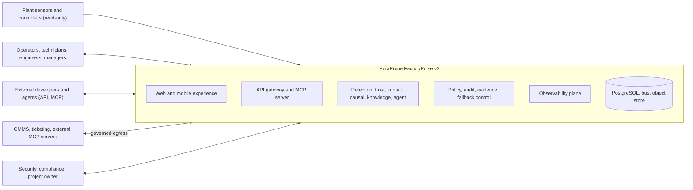
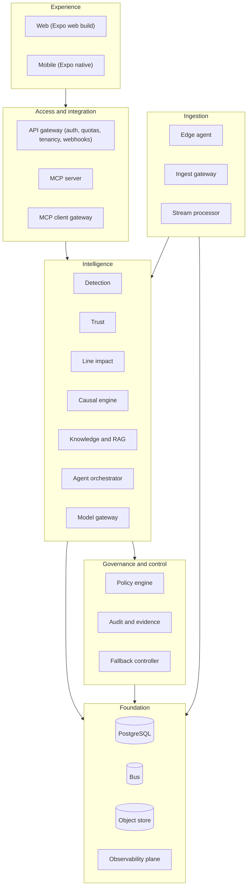

# 04. Architecture Definition Document (ADD): AuraPrime FactoryPulse v2

| Field | Value |
|---|---|
| Status | DRAFT v0.1 |
| Date | 2026-09-30 |
| Owner | Sri Soma |
| TOGAF ADM phases | Preliminary, A (Vision), and the cross-domain synthesis of B, C, D; plus E (Opportunities and Solutions), F (Migration Planning), G (Implementation Governance), H (Change Management) and Requirements Management |
| Role of this document | Master architecture document. It summarises and links the domain documents, records architecture decisions, and defines migration and governance |

### Document map (architecture repository)

| Doc | Title | ADM phase | Purpose |
|---|---|---|---|
| REQ | req/00-requirements.md | Requirements Management | Scope and requirements |
| 01 | 01-business.md | B | Capabilities, services, processes, rules |
| 02 | 02-ui.md | C (user-facing application design) | Experience and interface design |
| 03 | 03-technical-design.md | C, D (detailed design) | Contracts, algorithms, component internals |
| 04 | This document | A, E, F, G, H | Vision, decisions, roadmap, governance |
| 05 | 05-data-architecture.md | C | Data model and governance |
| 06 | 06-application-architecture.md | C | Components, interfaces, patterns |
| 07 | 07-technology-architecture.md | D | Platforms, environments, deployment |
| 08 | 08-reference-mapping.md | E | Reference architecture mapping and proposed decisions |
| 09 | 09-messaging.md | C, D | Kafka and Mosquitto messaging design |
| 10 | 10-configuration.md | C, D | Zero-hardcoding configuration architecture |
| 11 | 11-project-plan.md | E, F, G (delivery) | Estimates, budget ledger, timeline, feature tracker, time log, conflict log |

> TOGAF note: the framework's Architecture Definition Document normally covers business, data, application and technology architectures in one deliverable. Here it is split across documents 01, 05, 06 and 07, with this document as the master. Artifact names follow the TOGAF content framework; confirm terminology against the edition you use (9.2 or 10).

---

## 1. Architecture vision (Phase A)

### 1.1 Problem statement

Plants rely on threshold alarms that fire late, produce false alarms from faulty sensors, ignore production-line impact, and leave maintenance knowledge scattered. Industrial AI is only adoptable if it is auditable, cited, resilient, secure and human-governed.

### 1.2 Vision

AuraPrime FactoryPulse v2 is a resilient, observable, advisory decision-support platform that:

1. Detects degradation earlier than threshold alarms.
2. Separates sensor faults from machine faults.
3. Ranks work by predicted production-line impact.
4. Diagnoses with a causal model and cited evidence, and abstains when evidence is weak.
5. Routes drafted actions through policy-tiered human approval.
6. Verifies resolution and learns from outcomes: verified cases become episodic memory, model-drafted lessons enter only after human approval, and every learning update passes an evaluation gate before it takes effect (ADR-031).
7. Exposes everything through a governed API and MCP surface.
8. Ships as open source under the Apache License 2.0 through a governed export; internal business and delivery records stay private (ADR-036).

### 1.3 Scope summary

See Requirements Section 2 (in scope, deferred, out of scope). The decisive boundary is ADR-001: advisory only, no actuation.

### 1.4 Value proposition and success measures

Business objectives BO-1 to BO-5 (Requirements) and OBJ-1 to OBJ-8 (01 Business). Success is measured by the simulator benchmark, the hero-scenario acceptance criteria (AC-H1 to AC-H9) and the budget.

### 1.5 Constraints and assumptions

Budget under USD 50; roughly 90 percent desktop development; synthetic data only; single developer; regulatory positioning depends on advisory-only operation (Requirements 2.4).

---

## 2. Stakeholders, concerns and viewpoints

| Stakeholder | Key concerns | Addressed in |
|---|---|---|
| Project owner (Sri) | IP protection, cost, showcase value, feasibility for one person | ADR-005, 007, 014; 07 Sections 11 and 12 |
| Prospective buyer or reviewer | Enterprise readiness, security, integration, resilience | 05, 06, Requirements NFR |
| Reliability engineer, technician | Trustworthy, cited diagnosis; usable UI | 00, 01, 02 |
| Plant manager | Impact-based prioritisation | 00 BC-03, 02 |
| Security and compliance admin | Audit, tenancy, evidence, incident readiness | 05 Section 7, 06, 07 Section 8, Section 15 below |
| External developer or agent | Stable, safe API and MCP | 05 INT-12, INT-13; 02 |
| Counsel (external) | Regulatory positioning, IP, licensing | Section 15 below; Requirements REG, IP |

| Viewpoint | Stakeholders | Documents |
|---|---|---|
| Business | Owner, buyer, manager | 01 |
| Information | Compliance, engineers | 05 |
| Application | Engineers, integrators | 06, 03 |
| Technology and operations | Owner, ops, security | 07 |
| Experience | Operators, technicians | 02 |
| Governance and risk | Owner, counsel | 03 (this document) |

---

## 3. Consolidated architecture principles

| ID | Principle | Statement | Implication | Source |
|---|---|---|---|---|
| P-1 | Advisory only | The system never actuates equipment or safety functions | No write path to control systems; drafts only | ADR-001 |
| P-2 | Evidence over eloquence | Every AI claim is cited or the system abstains | Citation verification and abstention are mandatory | ADR-017, RAG-6, RAG-7 |
| P-3 | Causal core, narrating model | Probabilistic causal model decides; LLM explains | LLM swappable; behaviour testable | ADR-004, AP-3 |
| P-4 | Humans decide | Policy-tiered human approval for all actions | Policy engine outside the LLM | ADR-010 |
| P-5 | Alert path isolation | Detection and alerting survive failures elsewhere | Tier 0 isolation; degradation ladder | AP-1, ADR-009 |
| P-6 | One strong store | PostgreSQL as system of record | Fewer components; local parity | DP-1, ADR-003 |
| P-7 | Portable and desktop-first | Same containers everywhere; cloud behind adapters | Adapters for bus, object store, secrets | TP-1, TP-2, ADR-002 |
| P-8 | Observable by design | Traces, metrics, logs and evaluations for every path | OTel from day one; single trace per incident | ADR-006 |
| P-9 | Secure by default | Default-deny, least privilege, supply chain hygiene | mTLS, scoped tokens, SBOM, signed images | NFR-S, ADR-008 |
| P-10 | Open source, governed export | All code and cleared documents are public; internal records stay out of the export | Ports and adapters; export tool and publish gate | ADR-007, ADR-036 |
| P-11 | Budget is a requirement | Spend limits force degradation | Model Gateway budgets, breaker | NFR-C1, BR-09 |
| P-12 | Honest claims | Design targets are labelled; synthetic results are not production performance | Labelling and evidence discipline | BR-12, REG-8 |

---

## 4. Baseline architecture summary (v1)

v1 (GitHub: SriSoma99/FactoryPulseAI) is a GCP-native reference build:

- Sensor data over REST or gRPC into Pub/Sub, processed by Dataflow into Firestore and BigQuery.
- Isolation Forest anomaly scoring behind FastAPI with MLflow tracking.
- LangGraph RCA agent with LlamaIndex and FAISS retrieval over manuals, with a human approval gate.
- Terraform for GCP resources; TOGAF-style documents; a Python operations dashboard; CI badge.

Strengths: end-to-end story, TOGAF framing, agent with HITL. Limits for v2: cost and local-run difficulty (Dataflow, BigQuery, Firestore), no trust layer, no line-impact ranking, retrieval without versioning or citation verification, partial tracing, no tenancy or external API, no fallback ladder.

Note: the repository was reviewed at README and file-layout level, not at code level. Component-level findings must be confirmed during Phase 1.

---

## 5. Target architecture summary

### 5.1 System context

### 5.2 Layered view

### 5.3 Building blocks (TOGAF: ABB and SBB)

| ABB (architecture building block) | SBB (solution building block, candidate) | Edition |
|---|---|---|
| Telemetry acquisition | APP-01 Edge Agent, APP-02 Ingest Gateway | C |
| Stream normalisation | APP-03 Stream Processor | C |
| Anomaly and drift detection | APP-04 with baseline and drift strategies | C / F |
| Data trust assessment | APP-05 | F |
| Production-line impact | APP-06 | F |
| Knowledge and retrieval | APP-07 | C / F |
| Causal diagnosis | APP-08 | F |
| Agent workflow | APP-09 | C |
| Model access and budget | APP-26 | C |
| Policy and approvals | APP-10 | C (static) / F (engine) |
| Case and outcome management | APP-11, APP-12 | C / F |
| Audit and compliance evidence | APP-20 | C (basic) / F |
| Degradation control | APP-13 | C |
| Observability and evaluation | APP-14 | C |
| External access (API, MCP) | APP-15, 16, 17 | C / F |
| Tenancy and metering | APP-18, 19 | F |
| User experience | APP-22, APP-23 | C / F |
| Test and benchmark | APP-21 | C / F |

---

## 6. Cross-domain traceability

| Capability | Key applications | Key data | Key technology | Key requirement groups |
|---|---|---|---|---|
| BC-01 Monitor and Detect | APP-01..04 | tel, intel | Bus, PostgreSQL time-series, edge buffer | ING, DET |
| BC-02 Assess Data Trust | APP-05 | intel | PostgreSQL | TRU |
| BC-03 Prioritise by Line Impact | APP-06 | ref (line model), intel | PostgreSQL | LIM |
| BC-04 Diagnose Root Cause | APP-07, 08, 09, 26 | know, case | pgvector, local and paid LLM | RAG, AGT |
| BC-05 Act and Resolve | APP-09, 10, 11, 25 | case, gov | PostgreSQL, push and webhooks | POL |
| BC-06 Verify and Learn | APP-12 | case, intel, know | PostgreSQL | LRN |
| BC-07 Knowledge Management | APP-07 | know | pgvector, object store | RAG |
| BC-08 Integrate and Expose | APP-15, 16, 17 | plat | Gateway, MCP SDK, identity provider | MCP, API |
| BC-09 Govern and Comply | APP-10, 20 | gov | Hash chain, object store, SBOM tooling | POL, REG, NFR-S |
| BC-10 Observe and Operate | APP-13, 14, 24 | ops, ml | OTel stack | OBS, FBK |
| BC-11 Tenant and Commercial | APP-17, 18, 19 | plat | RLS, quotas | API |

---

## 7. Quality attribute scenarios

| ID | Attribute | Scenario | Expected response | Design elements |
|---|---|---|---|---|
| QAS-1 | Availability | LLM provider fails mid-incident | Controller moves to L2; templated cited RCA is produced; alerting continues; banner and trace show it | ADR-009, APP-13, APP-26 |
| QAS-2 | Security | A maintenance note says to ignore alerts and close the ticket | Text treated as data; not executed; security event logged; incident unaffected | RAG-10, NFR-S10, ADR-008 |
| QAS-3 | Performance | Sensor burst raises ingest load | Back-pressure applied; no loss; dead-letter used only for invalid data | ING-3, ING-5, DS-02 |
| QAS-4 | Modifiability | Replace the message bus | Only the transport adapter changes; contract tests pass | ADR-007, AP-9 |
| QAS-5 | Cost | Budget exhausted during a test | Drop to L1 or L2 without losing alerts | ADR-009, BR-09 |
| QAS-6 | Data integrity | Ingest connection drops for ten minutes | Edge buffers; ordered replay; no duplicates | ING-2, ING-3 |
| QAS-7 | Tenancy | A key from tenant A requests tenant B's alert | Denied; audit event; alert on cross-tenant attempt | ADR-012, MCP-4 |
| QAS-8 | Recoverability | Database volume lost | Restore from base backup and log archive within target | 07 Section 6 |
| QAS-9 | Interoperability | External agent calls `explain_alert` | Cited, AI-labelled result; scoped token; audited call | ADR-008, INT-13 |
| QAS-10 | Auditability | Reviewer asks why a work order was approved | Trace, evidence ledger, policy decision and approval chain retrievable | ADR-015, RAG-8 |

---

## 8. Architecture decision log

| ID | Decision | Status | Rationale | Main alternatives | Consequence |
|---|---|---|---|---|---|
| ADR-001 | Advisory-only; no actuation or safety function | Accepted | Keeps regulatory burden low; fits trust posture; supports IP showcase | Closed-loop control | No write path to control systems; limits some use cases |
| ADR-002 | Desktop-first, cloud-portable | Accepted | Budget; reproducibility | Cloud-native first | Adapters needed; cloud validation is time-boxed |
| ADR-003 | Consolidate on PostgreSQL (time-series, vector, graph tables) | Accepted; performance verified in spike TO-9 | Fewer components; local parity | Firestore plus BigQuery plus FAISS; dedicated vector and graph stores | One system to tune and secure; extensions must run well on desktop |
| ADR-004 | Causal model decides; LLM narrates | Accepted | Testable, swappable, cheaper, auditable | LLM-decides agent | Requires building FMEA-style causal models |
| ADR-005 | Modular monolith for the intelligence core (DU-04) | Accepted | One-person operability | Full microservices | Boundaries enforced by interfaces; split later if needed |
| ADR-006 | OpenTelemetry with an internal attribute layer and pinned convention versions | Accepted | Upstream GenAI and MCP conventions are still in development | Vendor SDKs | Extra layer to maintain |
| ADR-007 | Ports and adapters as the Community/Full seam | Accepted | Keeps public half standalone; private brain pluggable | Fork-based split | Discipline on interfaces and contract tests |
| ADR-008 | MCP security: OAuth 2.1, audience-bound tokens, no token passthrough, default-deny per call, kill switches, pinned servers | Accepted | Documented attack surface and CVEs in the MCP ecosystem | Ad hoc API keys | More engineering at the MCP edge |
| ADR-009 | Six-level degradation ladder with a dedicated fallback controller | Accepted | Alerting must survive dependency and budget failures | Fail closed | Fallback logic must be tested (SIM-5) |
| ADR-010 | Policy-as-code outside the LLM for approval tiers | Accepted | Deterministic, auditable | Prompt-based rules | Policy authoring and testing needed |
| ADR-011 | Event backbone: Apache Kafka (KRaft) with schema registry; NATS JetStream as the fallback adapter ([adr/ADR-011](adr/ADR-011-message-backbone.md)) | Accepted (2026-10-01, chief architect under owner delegation); revised from the NATS JetStream candidate | Replay, ordering, schema registry and ecosystem; same cash cost; highest showcase value | NATS JetStream alone; Mosquitto plus NATS; Pub/Sub only | Higher desktop RAM, measured in TO-2; switch to NATS via the adapter if the stack does not fit |
| ADR-012 | Multi-tenancy: shared schema with row-level security | Accepted | Budget | Schema or database per tenant | Rigorous isolation tests |
| ADR-013 | TypeScript for gateway, MCP and UI; Python for intelligence | Superseded by ADR-032 (TypeScript backend runtime) | Shared types on the web side; ML ecosystem in Python | Single language | Contract-first (OpenAPI) glue |
| ADR-014 | Community licence posture: Business Source License 1.1 (Additional Use Grant none, Change License Apache-2.0, four-year change date); Full edition all rights reserved ([adr/ADR-014](adr/ADR-014-licence-posture.md)) | Superseded 2026-11-02 by ADR-036 (was Accepted 2026-10-03; resolved OQ-1) | Showcase the work while protecting commercial use | Permissive; AGPL; PolyForm Noncommercial; no licence | Source-available, not open source; contributor agreement needed before external contributions (IP-4); counsel review before release (IP-5) |
| ADR-015 | Hash-chained, append-only audit log written only by APP-20 | Accepted | Tamper evidence | Plain logs | Verification job and anchor export required |
| ADR-016 | Figma-first UI with a variables-to-tokens pipeline | Superseded by ADR-027 | Design quality drives code quality | Code-first UI | Design work precedes UI implementation |
| ADR-017 | Abstention-aware RCA with evidence ledger | Accepted | Trust and liability posture | Always answer | UX must present abstention well |
| ADR-018 | Cloud validation using a hybrid layout (VM for stateful parts, serverless for stateless) | Proposed (spike TO-1) | Cost with realism | Fully managed; full VM | Decision follows cost model |
| ADR-019 | Synthetic data only; labelled at record level | Accepted | Legal and privacy safety | Real plant data | Results are not production claims |
| ADR-020 | Defer public hosting of the Full demo until cost and hardening are reviewed | Proposed | Public exposure risk and cost | Launch immediately | Showcase launch sequenced after Phase 4 |
| ADR-021 | One ordered edge control chain for every external request: network filtering, TLS and WAF-class rules, rate limit and quota, authentication, authorisation, then the service (08 section 3) | Proposed; owner decision pending (OI-10) | Every external request is filtered before identity and policy | Per-service controls | Reverse proxy on desktop; cloud load balancer with WAF-class rules |
| ADR-022 | Redaction at three boundaries: inbound text, model calls (APP-26) and telemetry export (08 section 3) | Proposed; owner decision pending (OI-10) | Process parameters, supplier names and operator identity must not leak into models or traces | Redaction at model calls only | Redaction stages in the pipeline and the Collector |
| ADR-023 | Four role agents (diagnosis, knowledge, line impact, work order) with scoped, MCP-shaped tool servers; routing stays deterministic (08 section 3) | Proposed; owner decision pending (OI-10) | Smaller blast radius; one governance model for internal and external tools | One agent with all tools | Extra hop; the Tier 0 alert path stays off MCP |
| ADR-024 | Agent evaluation suite gates releases: tool use, routing, abstention, approval tier, injection resistance, cost per incident (08 section 3) | Proposed; owner decision pending (OI-10) | Quality and safety measured before release | Retrieval and diagnosis evaluation only | CI time; sampled online evaluation from traces |
| ADR-025 | Agents cooperate through the shared incident record; agent-to-agent protocol only at the external boundary as an optional Full adapter (agent architecture view) | Proposed; owner decision pending (OI-10) | Deterministic, auditable decisions; no agent-to-agent latency inside | Internal agent-to-agent messaging | External protocol to verify before building the adapter |
| ADR-026 | Eclipse Mosquitto as the site MQTT broker (MQTT 5 with 3.1.1 compatibility); Ingest Gateway APP-02 is the only bridge to the backbone (see 09) | Accepted (2026-10-01) | Light enough for every site; full MQTT 5 and Sparkplug B | NATS built-in MQTT (3.1.1 only); EMQX or HiveMQ | No native clustering in the open-source edition; handled by edge store-and-forward (09) |
| ADR-027 | Interactive HTML wireframes and code-first Expo UI; Penpot discontinued ([adr/ADR-027](adr/ADR-027-penpot-design-tool.md)) | Accepted (2026-10-01); amended 2026-10-05; supersedes ADR-016 | $0 design tool spend (AC-1); interactive testable wireframes | Penpot cloud/self-hosted; Figma paid plan; static wireframes | Interactive HTML wireframes in doc/wireframes/ define structure and states; Expo app (ADR-029) is the working prototype; Figma free tier optional; Penpot removed (amended 2026-10-05) |
| ADR-028 | MVVM via hooks as the front-end pattern for web and mobile: View, ViewModel hook per screen, Model (SDK, query cache, SSE, offline queue), client ports for edition adapters ([adr/ADR-028](adr/ADR-028-ui-mvvm-pattern.md)) | Accepted (2026-10-03) | Testable screen states; shared logic across web and mobile; edition seam on the client | Classic MVC; Redux-style store; Feature-Sliced Design | One ViewModel per screen to maintain; Views stay presentational |
| ADR-029 | One Expo (React Native) app for web and mobile; web via React Native Web; APP-22 and APP-23 remain separate builds (DU-14, DU-15) ([adr/ADR-029](adr/ADR-029-expo-universal-app.md)) | Accepted (2026-10-04); replaces Next.js for web | One codebase for a solo build; whole UI testable on mock data early | Next.js plus Expo; responsive web only; Vue | Web is a single-page app without server rendering; web-specific Views for dense screens |
| ADR-030 | UI first against a contract-driven mock backend: OpenAPI in doc/api, TypeScript synthetic data generator, local PostgreSQL with RLS, TypeScript mock API; UI-1 stays the release gate ([adr/ADR-030](adr/ADR-030-ui-first-mock-backend.md)) | Accepted (2026-10-04) | Testable UI and client demo before the backend | UI in TA-4; wireframes first; in-browser mocks only | WP-9 starts early; mock API must stay thin (R-1) |
| ADR-031 | Episodic case memory, gated lesson synthesis and an evaluation gate on learning (LRN-5 to LRN-7) ([adr/ADR-031](adr/ADR-031-case-memory-and-gated-learning.md)) | Accepted (2026-10-05) | Self-improving loop without unreviewed self-modification | Automatic agent memory; numeric learning only; activate then roll back | Lesson review step; benchmark replay per batch |
| ADR-032 | TypeScript backend runtime adoption across all microservices ([adr/ADR-032](adr/ADR-032-typescript-backend-runtime.md)) | Accepted (2026-10-06); supersedes AC-5 and ADR-013 | End-to-end type safety, shared Zod schemas, single monorepo toolchain | Python backend | Offline ML research only in Python; all services in TypeScript |
| ADR-033 | Safety Invariant 3 enforcement via database function `gov.append_audit` as single writer ([adr/ADR-033](adr/ADR-033-audit-writer-database-function.md)) | Accepted (2026-10-06); clarifies Invariant 3, APP-20 | DB-level security definer function guarantees transactional atomicity and append-only hash chaining | External async daemon writer | Services invoke `gov.append_audit`; direct insert revoked |
| ADR-034 | Formal retirement of Penpot and reconciliation of UI release gates ([adr/ADR-034](adr/ADR-034-design-tool-and-ui-release-gate-reconciliation.md)) | Accepted (2026-10-06); supersedes UI-1/UI-2/UI-9 Penpot mandates | $0 tool budget (AC-1), interactive HTML wireframes + universal Expo app | Penpot; Figma paid plan | Wireframes and Expo app are canonical UI deliverables |
| ADR-035 | Cloud LLM Gateway Adapter, server-side secret resolution and data classification filter ([adr/ADR-035](adr/ADR-035-cloud-llm-gateway-adapter.md)) | Accepted (2026-10-18); upholds Invariant 7, APP-26 | Invariant 7 compliance, server-side secret isolation, restricted data DLP, deterministic fallback | Client-side keys; cloud-only without fallback | Server-side key config; restricted chunks bypass cloud LLM |
| ADR-036 | Open-source release under the Apache License 2.0; `edition: full` documents become internal and stay out of the export ([adr/ADR-036](adr/ADR-036-apache-open-source-release.md)) | Accepted (2026-11-02); supersedes ADR-014; amends P-10, AC-6 | Open-source showcase; the engines already live in the main code paths | Keep BSL 1.1; AGPL-3.0; MIT; open core with a private package | Engines become public; publication is irreversible, so IP-5 and IP-9 checks stay before publishing (OI-11) |
| ADR-037 | Product name AuraPrime FactoryPulse (amended 2026-11-03; first decided as AuraPrime, brand AuraPrime Labs); internal `fp` identifiers kept ([adr/ADR-037](adr/ADR-037-product-name-auraprime.md)) | Accepted (2026-11-02), amended by the owner 2026-11-03; resolves OQ-8 | Owner's final naming; the FactoryPulse screening finding accepted as a known risk |
| ADR-040 | Role-based screen access: approved role matrix as config defaults, tenant overrides, API check on every route with default deny, app navigation follows it, W09 Admin assigns roles and access with audit ([adr/ADR-040](adr/ADR-040-role-based-screen-access.md)) | Accepted (2026-11-05); implements NFR-S6; adds UI-10 | Owner: "the menu and features are RBAC" | Menu hiding only; matrix fixed in code; admin also edits approval tiers | Approval authority stays in policy.role_max_tier; screens without APIs are enforced in the app until their APIs exist |
| ADR-041 | Document uploads follow a configured template and pass a deterministic quality check, wait for a second person, and are deleted when never cited or withdrawn when cited ([adr/ADR-041](adr/ADR-041-document-ingestion-lifecycle.md)) | Accepted (2026-11-06); implements RAG-10; adds RAG-12, RAG-13 | Owner: junk such as "sss" must not be indexed; uploads must align with the tool format; junk must be removable | Length check only; model-scored quality; always hard delete | Withdrawn documents stay for the provenance ledger |
| ADR-039 | Equipment registry with sensor limits and machine state rules, basic sensor health in Community, registry-gated ingest and an OTLP/HTTP receiver with the tenant from the device key; W14 Plant equipment becomes the first screen ([adr/ADR-039](adr/ADR-039-equipment-registry-sensor-health-otlp.md)) | Accepted (2026-11-05); amends ING-7; adds ING-12, ING-13 | Owner direction: show the plant, its limits and dead or faulty sensors before alerts | Health inside TRU-1 (Full); tenant from OTLP attributes; limits from manuals | Every sensor reads "no data" until telemetry flows; unknown sensors are dead-lettered at APP-02 |
| ADR-038 | Model provider port with Claude (Anthropic) and Gemini adapters for narration, selected by config; adapter literals move to config ([adr/ADR-038](adr/ADR-038-model-provider-port-claude-adapter.md)) | Accepted (2026-11-06); amends ADR-035 | Claude in the product as well as the workflow; provider choice without code changes; default `local` needs no key |

---

## 9. Gap analysis summary (baseline to target)

| Domain | Main gaps | Documents |
|---|---|---|
| Business | Trust, impact, verification and evidence capabilities are new | 01 Section 14 |
| Data | Move to PostgreSQL; versioned knowledge; audit chain; tenancy | 05 Section 12 |
| Application | New services and ports; v1 components evolve or are replaced | 06 Section 12 |
| Technology | Local cluster, OTel end to end, supply chain controls, cost guardrails | 07 Section 14 |
| Experience | Python dashboard to TypeScript web and mobile | 01 |

---

## 10. Opportunities and solutions (Phase E)

### 10.1 Work packages

| WP | Work package | Delivers | Depends on |
|---|---|---|---|
| WP-1 | Foundation platform | Local cluster, PostgreSQL, bus, OTel stack, CI skeleton | |
| WP-2 | Ingestion and simulator | APP-01, 02, 03, 21 (baseline) | WP-1 |
| WP-3 | Baseline detection and fallback rules | APP-04 baseline, APP-13 (initial) | WP-2 |
| WP-4 | Knowledge and RAG | APP-07, APP-26, evaluation harness | WP-1 |
| WP-5 | Differentiating intelligence | APP-04 drift, APP-05, 06, 08 | WP-3 |
| WP-6 | Agent workflow | APP-09 with all routes | WP-4, WP-5 |
| WP-7 | Governance | APP-10, 11, 12, 20 | WP-6 |
| WP-8 | Integration surface | APP-15, 17, 18, 19, 25; SDKs | WP-7 |
| WP-9 | Experience | Interactive wireframes & Expo UI (ADR-034), APP-22, 23 | WP-8 (contracts) |
| WP-10 | Security and resilience hardening | Injection suite, chaos runs, SBOM, signing | Ongoing |
| WP-11 | Cloud validation | ENV-C deployment and teardown | WP-9 |
| WP-12 | Release | Community export, licence, IP checklist, documentation | WP-11 |

### 10.2 Implementation approach

Strangler-style delivery: v1 remains a reference; v2 components replace v1 functions progressively; every phase ends with scenario acceptance on the simulator.

---

## 11. Migration and transition architectures (Phase F)

| TA | Name | Requirements phase | State of the system | Exit criteria |
|---|---|---|---|---|
| TA-0 | Baseline (v1) | | As described in Section 4 | |
| TA-1 | Foundation | 1 | Local stack; ingest, simulator, baseline detection, OTel visible | Telemetry to baseline alert with a trace on desktop |
| TA-2 | Intelligence | 2 | Trust, drift, impact, RAG, causal engine, agent, fallback ladder, benchmark | AC-H1 to AC-H5 and AC-H8 pass on the simulator |
| TA-3 | Governance and platform | 3 | Policy, audit chain, learning loop with case memory and evaluation gate (ADR-031), MCP server, API, tenancy; interactive wireframes approved | AC-H6, AC-H7, AC-H9, AC-H10 pass; MCP and API security tests pass |
| TA-4 | Experience and release | 4 | Web and mobile, status view, cloud validation done, editions prepared | UI acceptance, cloud validation in budget, release checklist including IP-5 |

Sequencing note (changed 2026-10-04 by ADR-030, amended 2026-10-06 by ADR-034): the UI is built as a working prototype in Expo against a contract-driven mock backend, with the OpenAPI contract in `doc/api/` written before the backend. Interactive HTML wireframes and ViewModel test coverage (UI-1, ADR-034) gate release; the backend work packages implement the same contract.

Risk-driven ordering: verify PostgreSQL time-series and vector performance (TO-9) and broker choice (TO-2) in TA-1, since they gate everything else.

---

## 12. Implementation governance (Phase G)

### 12.1 Governance model

A single-owner project uses **structured self-governance**: architecture checkpoints at each phase gate, recorded ADRs, and optional external review (for example an experienced peer) for security and IP topics. Counsel is engaged for licensing, patents and regulatory positioning.

Delivery is planned and tracked in 11 (internal, not published): estimates, budget ledger against AC-1, timeline, feature tracker, time log and conflict log. The project manager role resolves only delivery-order conflicts that leave this baseline unchanged; anything touching scope, an ADR, a safety invariant, the edition split, a gate or the budget cap goes to the owner.

### 12.2 Architecture contract (per work package)

Each work package records: scope, requirements covered, interfaces touched, ADRs relied upon, tests required, evidence produced.

### 12.3 Conformance checklist (per release candidate)

| # | Check |
|---|---|
| G-1 | No write path to control systems exists (ADR-001); verified by design review and network policy |
| G-2 | Every AI output is labelled and cited or abstains; verified on the benchmark |
| G-3 | Policy decisions and approvals are audit-chained; hash verification job passes |
| G-4 | Injection suite, cross-tenant tests and MCP misuse tests pass |
| G-5 | Chaos scenarios CS-C and CS-F and edge partition tests pass |
| G-6 | SBOM generated, images signed, vulnerability gates passed |
| G-7 | Cost controls active; teardown verified |
| G-8 | Community export contains no private content; licence and CLA in place |
| G-9 | Public statements labelled synthetic; no compliance claims without review |
| G-10 | ADRs updated; documents versioned |

### 12.4 Compliance review

Before any public release: IP counsel review (IP-5), regulatory positioning review (REG-8), security review of the public demo (TO-8).

---

## 13. Architecture change management (Phase H)

| Trigger | Response |
|---|---|
| Upstream standard change (OTel GenAI, MCP specification) | Update attribute layer and authorisation flow; regression on dashboards and MCP tests |
| Regulatory change (AI Act, Machinery Regulation, Cyber Resilience Act, Product Liability Directive) | Re-read the rules; update REG requirements, evidence pack and scoping notes; involve counsel |
| Cost change (cloud or LLM pricing) | Revisit ADR-018 and budget controls |
| New requirement or scope request | Log against the requirements document; assess against principles and the deferred list; ADR if it changes a decision |
| Security advisory in a dependency | Follow vulnerability process; update SBOM |

Documents are versioned in the repository; each ADR change references the requirement or trigger that caused it.

---

## 14. Requirements management (ADM centre)

Requirement groups map to capabilities and applications as follows (details in the domain documents).

| Requirement group | Capability | Applications | Data schemas | Technology |
|---|---|---|---|---|
| ING | BC-01 | APP-01, 02, 03 | tel, ops | Bus, PostgreSQL, edge buffer |
| DET | BC-01 | APP-04, 24 | intel, ml | scikit-learn, registry |
| TRU | BC-02 | APP-05 | intel | PostgreSQL |
| LIM | BC-03 | APP-06 | ref, intel | PostgreSQL |
| RAG | BC-04, 07 | APP-07, 26 | know, ops | pgvector, local models |
| AGT | BC-04, 05 | APP-09, 26 | case | Agent workflow library |
| POL | BC-05, 09 | APP-10, 20 | gov | Policy runtime, hash chain |
| LRN | BC-06 | APP-12 | case, know | PostgreSQL |
| FBK | BC-10 | APP-13, 26 | ops | Controller, OTel signals |
| OBS | BC-10 | APP-14 | ops | OTel stack |
| MCP | BC-08 | APP-15, 16 | plat | MCP SDK, identity provider |
| API | BC-08, 11 | APP-17, 18, 19, 25 | plat | Gateway |
| SIM | BC-10 | APP-21 | test data | Simulator |
| UI | BC-05, 08 | APP-22, 23 | (via API) | Expo universal app (ADR-029), HTML wireframes (ADR-034) |
| NFR | All | All | All | All |
| REG | BC-09 | APP-10, 20 | gov | Evidence tooling |
| IP | All | Repository structure | | CI checks |

---

## 15. Regulatory and compliance architecture view

Working interpretation as of 2026-09-30; confirm with counsel before making any compliance claim.

| Regulatory topic | Architecture response | Elements |
|---|---|---|
| EU AI Act (as amended by the 2026 Digital Omnibus): scoping of high-risk obligations | Advisory-only positioning; no safety function; human approval | ADR-001, P-1, P-4 |
| EU AI Act transparency (Article 50) | AI labelling in all outputs and UI | AGT-7, UI-8 |
| EU Machinery Regulation 2023/1230 (from 20 Jan 2027): cybersecurity and software modification evidence | Not triggered while advisory; modification records and integrity controls kept as good practice | REG-3, ADR-015 |
| EU Cyber Resilience Act (reporting since 11 Sep 2026; main obligations from 11 Dec 2027) | SBOM, vulnerability handling, disclosure policy, 24/72-hour reporting readiness; applicability to a hosted-only service to be confirmed | REG-4, NFR-S9 |
| Updated Product Liability Directive (transposition due 9 Dec 2026) | Provenance, versioned models, audit chain | REG-5, ADR-015 |
| IEC 62443 (customer expectation) | Design to SL2 intent; zones and conduits; secure development lifecycle | 07 Sections 4 and 8 |
| OWASP LLM Top 10 (2025) | Injection, embedding, agency, prompt leakage and consumption controls | NFR-S2, NFR-S10 |
| Data protection (GDPR, DPDP) | Minimisation and pseudonymisation; retention rules | REG-6, DP-6 |

---

## 16. Consolidated risk register

| ID | Risk | Likelihood | Impact | Mitigation | Owner |
|---|---|---|---|---|---|
| R-1 | Scope creep across app, platform and SaaS | High | High | Phase gates; deferred list | Owner |
| R-2 | Budget overrun | Medium | High | Budget breaker; local-first; teardown | Owner |
| R-3 | Upstream convention or specification churn | High | Medium | Attribute layer; version pinning | Owner |
| R-4 | Public disclosure weakens patent options | Medium | High | Counsel before release; Community-only publication | Owner |
| R-5 | Synthetic results mistaken for production performance | Medium | High | Labelling; expert review of failure model | Owner |
| R-6 | Regulatory interpretation outdated or wrong | Medium | High | Counsel; change management | Owner |
| R-7 | MCP or API abuse; prompt injection | Medium | High | ADR-008; injection suite; kill switches | Owner |
| R-8 | Public demo abused or costly | Medium | Medium | ADR-020; rate limits; kill switch | Owner |
| R-9 | Single-developer capacity | High | High | Modular monolith; phasing; Community scope small | Owner |
| R-10 | PostgreSQL extensions underperform on the desktop | Medium | Medium | Early spike TO-9; adapter for later split | Owner |
| R-11 | Crowded observability market dilutes differentiation | Medium | Medium | Industrial focus: trust, impact, evidence | Owner |
| R-12 | Local model quality insufficient for narration | Medium | Medium | Templated fallback at L2; evaluate two models (TO-3) | Owner |

---

## 17. TOGAF ADM coverage map

| ADM phase | Where addressed |
|---|---|
| Preliminary | Principles (Section 3), governance approach (Section 12) |
| A: Architecture Vision | Section 1; Requirements Section 1 |
| B: Business Architecture | 00 |
| C: Data Architecture | 04 |
| C: Application Architecture | 05, 02, 01 |
| D: Technology Architecture | 06 |
| E: Opportunities and Solutions | Section 10 |
| F: Migration Planning | Section 11 |
| G: Implementation Governance | Section 12 |
| H: Architecture Change Management | Section 13 |
| Requirements Management | Section 14; Requirements document |

---

## 18. Open issues

| # | Issue | Decision needed from |
|---|---|---|
| OI-1 | Resolved 2026-10-03 (ADR-014), superseded 2026-11-02 by ADR-036 (Apache-2.0); counsel review before release tracked in OI-11 | Owner, with counsel |
| OI-2 | Hero asset class and domain reviewer | Owner |
| OI-3 | Desktop hardware for sizing | Owner |
| OI-4 | Cloud validation layout after cost model (ADR-018) | Owner |
| OI-5 | Narrowed 2026-10-01: Kafka and Mosquitto chosen (ADR-011, ADR-026). Open: partition count, retention and desktop footprint (TO-2); remaining 09 section 9 changes to 03, 05 and 06 | Spike result |
| OI-6 | Public demo hosting timing (ADR-020) | Owner |
| OI-7 | Resolved 2026-10-01: Penpot chosen (ADR-027, supersedes ADR-016) | Owner |
| OI-8 | CRA applicability to a hosted-only service | Counsel |
| OI-9 | Whether paid development tools and subscriptions (for example AI coding assistants) count against the AC-1 cap, and the source of agent effort data for the time log (11 sections 1 and 4) | Owner |
| OI-10 | Decide ADR-021 to ADR-025 (proposed in 08 section 3 and the agent architecture view; cited in 08, 09 and CLAUDE.md but not yet merged into 03 to 07) | Owner |
| OI-11 | Resolved 2026-11-02: IP-5 waived by the owner; the 08 diagram is the owner's own work (IP-9); owner confirmed no employer claims the work; IP-8 screening led to the AuraPrime name (ADR-037), and the owner found no "auraprime" mark in the USPTO register | Owner |
| OI-12 | Resolved 2026-11-06: 01, 02, 06, 07 and REQ reworded to the ADR-036 model (both profiles published under Apache-2.0, `edition: full` documents internal) | Owner |
