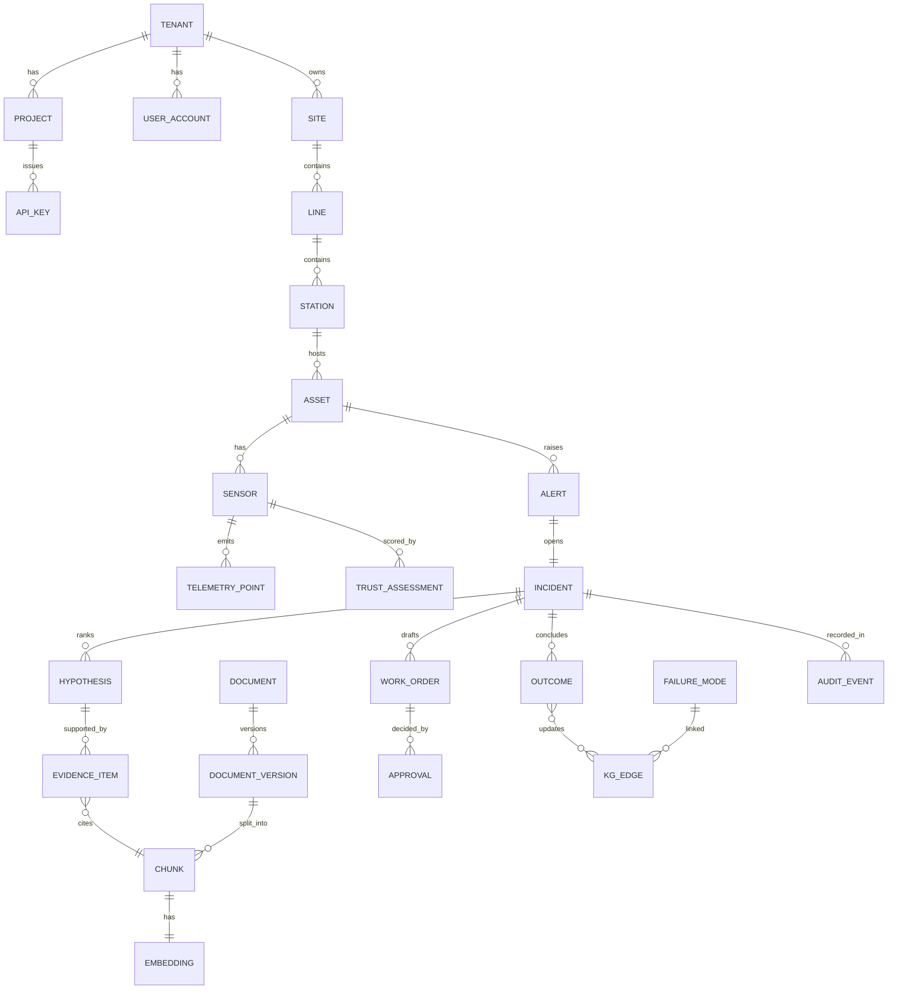
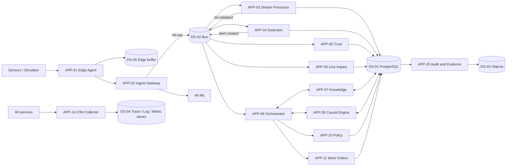

# 05. Data Architecture: AuraPrime FactoryPulse v2

| Field | Value |
|---|---|
| Status | DRAFT v0.1 |
| Date | 2026-09-30 |
| Owner | Sri Soma |
| TOGAF ADM phase | Phase C: Information Systems Architecture (Data) |
| Inputs | 01 Business Architecture (information concepts, rules); Requirements document |
| Related | 06 Application (CRUD ownership); 07 Technology (stores, sizing); 03 Technical Design (schemas, events) |

> Scope note: this is a logical and physical-intent design with no code. Table and column names are indicative. Retention and volume figures are initial targets to be validated on the desktop reference setup.

---

## 1. Data architecture principles

| ID | Principle | Rationale |
|---|---|---|
| DP-1 | One strong system of record: PostgreSQL (with time-series and vector extensions) for relational, time-series, vector and graph-like data | Replaces v1's Firestore, BigQuery and FAISS split; runs identically on desktop and cloud; fewer moving parts within the budget |
| DP-2 | Every record carries tenant and provenance | Tenancy isolation (BR-10) and evidence (REG-5, RAG-8) |
| DP-3 | Telemetry is immutable once validated; corrections are new records | Auditability |
| DP-4 | Safety values and limits are reference data, never retrieved from documents | BR-13, RAG-11 |
| DP-5 | Trace ID is the lineage key across data, events and audit records | OBS-2 |
| DP-6 | Personal data is minimised and pseudonymised where possible | REG-6 |
| DP-7 | Schemas are versioned and events are backward-compatible | Independent deployability |
| DP-8 | Storage adapters hide vendor specifics (bus, object store) | NFR-C3 |
| DP-9 | Derived knowledge (priors, graph edges, cases, lessons) is versioned and reversible, and activates only through a learning batch that passed the evaluation gate | LRN-4, LRN-7 |
| DP-10 | Synthetic data is labelled at the record level | BR-12 |

---

## 2. Data store catalog (TOGAF: Data Component catalog)

| ID | Store | Candidate technology | Holds | Edition |
|---|---|---|---|---|
| DS-01 | Primary relational and time-series store | PostgreSQL with TimescaleDB and pgvector | All structured data, telemetry, vectors, graph tables, audit chain, outbox | C and F |
| DS-02 | Message bus | Apache Kafka (KRaft) with schema registry; NATS JetStream as fallback adapter; Pub/Sub via adapter in cloud (ADR-011) | Events and telemetry streams, dead-letter topics | C and F |
| DS-03 | Object store | MinIO locally; Cloud Storage in cloud | Raw documents, evidence packs, model artifacts, exported reports | C and F |
| DS-04 | Telemetry backends | Tempo, Loki and Prometheus-class stores behind the OTel Collector | Traces, logs, metrics | C and F |
| DS-05 | Edge buffer | Embedded on-disk queue on the edge node | Store-and-forward telemetry | C and F |
| DS-06 | Cache and rate-limit state | In-process plus DS-01; optional Valkey-class cache | Token buckets, short-lived cache | C and F |

Decision recorded as ADR-003 (see 04 ADD): consolidate on PostgreSQL. Alternatives considered: keep Firestore and BigQuery (rejected: cost, local-run difficulty), dedicated vector database (rejected: extra operational surface for a solo build), dedicated graph database (deferred; recursive queries over relational tables are sufficient at this scale; revisit if graph queries dominate).

---

## 3. Conceptual data model (TOGAF: Conceptual Data diagram)

Rendered view with the data stores, schema groups and key relationships: [diagrams/data-architecture.html](diagrams/data-architecture.html). The Mermaid source above stays the source of truth; update both together.

---

## 4. Logical data model: entity catalog (TOGAF: Data Entity catalog)

Schema groups in DS-01: `ref`, `tel`, `intel`, `know`, `case`, `gov`, `plat`, `ops`, `ml`.

### 4.1 Reference data (`ref`)

| Entity | Key attributes | Owner app | Classification |
|---|---|---|---|
| Tenant, Site, Line, Station | id, tenant_id, name, hierarchy path, timezone | APP-18 (tenant), APP-06 (line/station model) | Internal |
| Asset | id, station_id, asset_class, criticality, manufacturer, model | APP-06 | Internal |
| Sensor | id, asset_id, measurement type, unit, sampling rate, valid range, calibration date | APP-02 | Internal |
| LineModel | line_id, station graph edges, cycle times, buffers, version | APP-06 | Internal |
| LimitSpec | asset_id, parameter, limit values, source, effective date, approver | APP-06 | Internal; authoritative for limits (DP-4) |

### 4.2 Telemetry (`tel`)

| Entity | Key attributes | Owner app | Notes |
|---|---|---|---|
| TelemetryEnvelope (raw) | message_id, tenant_id, sensor_id, source_ts, ingest_ts, payload, schema_version, is_synthetic | APP-02 | Immutable; short retention |
| TelemetryPoint (validated) | sensor_id, ts, value, quality_flag, trust_at_ingest | APP-03 | Time-series hypertable, partitioned by time (and tenant) |
| TelemetryAggregate | sensor_id, bucket, min, max, mean, stddev, count | APP-03 | Continuous aggregates (1 min, 15 min, 1 h) |
| DeadLetter | message_id, reason, raw pointer, replay status | APP-02 | Replay tooling |

### 4.3 Intelligence (`intel`)

| Entity | Key attributes | Owner |
|---|---|---|
| FeatureWindow | asset_id, window, features, model_input_version | APP-04 |
| Alert | id, asset_id, type, contributing signals, lead_time_estimate, status, trace_id | APP-04 |
| TrustAssessment | sensor_id, ts, trust_score, checks (staleness, flatline, noise, range, cross-sensor), verdict (machine, sensor, undetermined) | APP-05 |
| ImpactEstimate | alert_id, throughput_delta, reject_risk, cascade_path, model_version, rank | APP-06 |
| AssetPrior | asset_id, failure_mode_id, prior, version | APP-12 |

### 4.4 Knowledge (`know`)

Case memory and lessons (ADR-031) are listed under Cases (4.5).

| Entity | Key attributes | Owner |
|---|---|---|
| Document | id, tenant_id, title, type (manual, SOP, FMEA, 8D, ticket, note), asset scope, classification | APP-07 |
| DocumentVersion | id, document_id, version, effective_from, effective_to, status (draft, approved, superseded), checksum, ingestion approval, injection-scan result | APP-07 |
| Chunk | id, version_id, ordinal, text, section path, acl | APP-07 |
| Embedding | chunk_id, model_id, model_version, vector | APP-07 |
| FailureMode | id, name, component, effects, detection cues | APP-07, APP-08 |
| KgNode / KgEdge | node types: Fault, Component, Procedure, WorkOrder; edge types: caused_by, resolved_by, precedes; weight, provenance, version | APP-07, APP-12 |

### 4.5 Cases (`case`)

| Entity | Key attributes | Owner |
|---|---|---|
| Incident | id, alert_id, state, opened_at, closed_at, fallback_level_at_open, trace_id | APP-09 |
| Hypothesis | incident_id, failure_mode_id, probability, rank, model_version | APP-08 |
| EvidenceItem | hypothesis_id, chunk_id or signal ref, document_version_id, relevance, verified_citation flag | APP-07 |
| EvidenceLedger | incident_id, confidence, falsifiers, abstained flag, provenance summary | APP-09 |
| WorkOrder | id, incident_id, type (sensor, machine, inspection), draft body, tier, status | APP-11 |
| Approval | work_order_id, approver_id, decision, ts, policy_decision_id | APP-10 |
| Outcome | incident_id, finding, readings, action, technician, verified flag, good_cycle_count | APP-12 |
| CaseRecord | incident_id, asset_class, signal_pattern, trust_verdicts, hypotheses, discriminating_check, confirmed_failure_mode, action, outcome, verified_at, embedding ref | APP-12 (write), APP-07 (index) |
| Lesson | case_id, text, status (draft, approved, rejected), drafted_by_model_version, approver_id, decided_at | APP-12 |
| LearningBatch | id, updates (priors, graph edges, ranking, cases, lessons), benchmark_result, golden_set_result, status (staged, active, rejected, reverted) | APP-12 |

### 4.6 Governance (`gov`)

| Entity | Key attributes | Owner |
|---|---|---|
| PolicyVersion | id, rules hash, effective date | APP-10 |
| PolicyDecision | id, subject, action, tier, rule ids, rationale | APP-10 |
| AuditEvent | id, tenant_id, ts, actor, action, object, payload hash, prev_hash, hash, trace_id | APP-20 |
| EvidencePack | id, deployment, generated_at, object pointer, contents manifest | APP-20 |
| SbomRecord | component, version, licence, vulnerability status | APP-20 |
| ModelRegisterEntry | model_id, version, training data ref, metrics, approval | APP-24 |

### 4.7 Platform (`plat`)

| Entity | Key attributes | Owner |
|---|---|---|
| Project, UserAccount, RoleAssignment | ids, tenant, role | APP-18 |
| ApiKey | id, project_id, key hash, scopes, expiry, last used | APP-17 |
| UsageEvent | tenant, project, meter, quantity, ts, trace_id | APP-19 |
| WebhookEndpoint, WebhookDelivery | url, secret ref, attempts, status | APP-25 |
| ToolGrant | principal, tenant, mcp tool, allow or deny, expiry | APP-15 |

### 4.8 Operations (`ops`)

| Entity | Key attributes | Owner |
|---|---|---|
| OutboxMessage | id, aggregate, payload, status | each producing app |
| IdempotencyRecord | key, scope, result hash, expiry | APP-02, APP-17 |
| FallbackEvent | ts, from_level, to_level, reason, trace_id | APP-13 |
| CostLedger | ts, scope, provider, tokens, cost, budget window (built as `ops.cost_ledger`, migration 0016: tenant, time, provider, model, input and output tokens, cost, purpose; row-level security) | APP-26 |
| EvalRun | id, suite, version, metrics, pass or fail | APP-14 |
| RetrievalLog | incident_id, query, top-k ids and scores, rerank, citation check result | APP-07 |

### 4.9 ML metadata (`ml`)

| Entity | Notes |
|---|---|
| ModelVersion | Artifacts in DS-03; metadata here; links to ModelRegisterEntry |
| DriftMetric | Input and score drift per model version |

---

## 5. Data flow (TOGAF: Data Dissemination diagram)

### 5.1 Event and topic catalog

| Topic | Producer | Consumers | Payload (summary) | Delivery |
|---|---|---|---|---|
| tel.raw.{tenant}.{site} | APP-02 | APP-03 | Validated envelope | At-least-once, ordered per sensor |
| tel.validated | APP-03 | APP-04, 05, 06 | Normalised point and quality flag | At-least-once |
| tel.dlq | APP-02, 03 | Replay tooling | Envelope and reason | Persistent |
| alert.created | APP-04 | APP-05, 06, 09 | Alert id, signals, lead time | At-least-once |
| trust.updated | APP-05 | APP-09 | Sensor verdicts | At-least-once |
| impact.updated | APP-06 | APP-09, UI | Rank and cascade | At-least-once |
| incident.state | APP-09 | UI, APP-25 | State transitions | At-least-once |
| wo.drafted | APP-11 | APP-10, APP-25 | Draft and tier | At-least-once |
| approval.decided | APP-10 | APP-09, APP-11, APP-20 | Decision | At-least-once |
| outcome.recorded | APP-12 | APP-09, APP-20 | Finding and verification | At-least-once |
| kb.doc.changed | APP-07 | APP-07 (reindex) | Version event | At-least-once |
| fallback.level | APP-13 | All | Level and reason | Retained last-value |
| usage.event | APP-17, 15 | APP-19 | Meter event | At-least-once |
| audit.event | All | APP-20 | Auditable action | At-least-once |

All events carry: event_id, tenant_id, trace context, schema_version, produced_at, is_synthetic.

---

## 6. Data zones and lifecycle (medallion-style)

| Zone | Content | Store | Retention target (initial) | Mutability |
|---|---|---|---|---|
| Raw | Telemetry envelopes as received | DS-01 (short) and DS-03 (archive) | Days | Immutable |
| Validated | Schema-valid, deduplicated points with quality flags | DS-01 hypertable | Weeks, compressed | Immutable |
| Curated | Aggregates, feature windows, alerts, trust and impact | DS-01 | Months | Append and supersede |
| Knowledge | Documents, versions, chunks, embeddings, graph | DS-01, DS-03 | Life of document plus history | Versioned |
| Evidence | Incidents, ledgers, approvals, audit chain, evidence packs | DS-01, DS-03 | Long (compliance-driven; SBOM documentation for ten years per the CRA) | Append-only |
| Telemetry (observability) | Traces, logs, metrics | DS-04 | Short to medium | Sampled, expiring |

Retention figures are placeholders; confirm against regulatory and customer requirements before any commitment.

---

## 7. Data security and privacy (TOGAF: Data Security diagram)

| Control | Design |
|---|---|
| Classification | Public (Community docs), Internal, Confidential (tenant data), Restricted (secrets, keys, audit chain) |
| Tenant isolation | Row-level security on every tenant table; tenant_id in every event; per-tenant object prefixes; default-deny |
| Access | RBAC plus attribute-based rules; permission-aware retrieval filters chunks by tenant, site and role before ranking |
| Encryption | TLS in transit; encryption at rest for DS-01, DS-03; embeddings treated as sensitive and encrypted |
| Secrets | Held in a secrets manager; never in repositories or config; API keys stored as hashes |
| Injection defence | Ingested documents are scanned; retrieved text is treated as untrusted data; tag names and ticket text sanitised |
| Personal data | Operator and technician identity minimised; pseudonymous IDs in telemetry and traces; content capture in traces is opt-in and redacted |
| Audit integrity | Hash-chained AuditEvent; periodic anchor hash exported to DS-03 |
| Data export | No export of models, prompts or private-edition datasets through APIs |

---

## 8. Data quality and governance

| Topic | Design |
|---|---|
| Ownership | Each entity has one owning application (Section 4); others read through APIs or events |
| Quality rules | Schema validation, range and unit checks, duplicate detection, timestamp skew checks, staleness detection; failing records go to dead-letter |
| Data quality metrics | Freshness, completeness, drop rate, dead-letter rate exported via OBS-7 |
| Master data | Asset and sensor registry is authoritative; LimitSpec is the only source of limits |
| Lineage | trace_id and document_version_id propagate from source to evidence |
| Schema evolution | Versioned schemas; additive changes preferred; consumers tolerate unknown fields |
| Synthetic data | is_synthetic flag on envelopes and points; UI labels synthetic sources |
| Model and data registry | Model versions link to the dataset version used |

---

## 9. Multi-tenancy strategy

| Option | Assessment |
|---|---|
| Shared schema with row-level security (selected for v2.0) | Cheapest, fits budget; isolation enforced by policy; needs rigorous testing |
| Schema per tenant | Stronger isolation, more operational overhead |
| Database per tenant | Strongest, too costly for scope |

Isolation tests (cross-tenant read, write, retrieval, MCP call) are part of the security test suite (NFR-S10 extended).

---

## 10. Physical design intent for DS-01

| Concern | Intent |
|---|---|
| Time-series | Hypertables for `tel.telemetry_point`; time-based chunks; compression policy; continuous aggregates for dashboards and feature windows |
| Vectors | pgvector with an approximate index; embedding rows keyed by model and version; filtered search combining tenant, site and role predicates |
| Text search | Native full-text index on chunks combined with vector score (hybrid, see 03 Technical Design) |
| Graph | KgNode and KgEdge tables with recursive queries; version columns for reversible learning |
| Audit chain | Append-only table; writes only via APP-20; triggers block update and delete |
| Outbox and idempotency | Tables in `ops`; polling relay to the bus |
| Partitioning | By time first; tenant as a secondary key or partition for large tenants |
| Backups | Base backup plus write-ahead log archiving to DS-03; restore drill on desktop (NFR-R4) |
| Migrations | Versioned migration tool in CI; forward-only in production |

---

## 11. CRUD matrix (TOGAF: Application/Data matrix)

C = create, R = read, U = update, D = delete (soft only, except retention jobs).

| Entity group | APP-02 | APP-03 | APP-04 | APP-05 | APP-06 | APP-07 | APP-08 | APP-09 | APP-10 | APP-11 | APP-12 | APP-15/17 | APP-18 | APP-20 |
|---|---|---|---|---|---|---|---|---|---|---|---|---|---|---|
| Registry and limits | R | R | R | R | CRU | R | R | R | R | R | R | R | R | |
| Telemetry raw and DLQ | C | R | | | | | | | | | | | | |
| Telemetry validated and aggregates | | C | R | R | R | | | R | | | | R | | |
| Alerts and features | | | CRU | R | R | | R | R | | | R | R | | |
| Trust assessments | | | R | CRU | R | | R | R | | | | R | | |
| Impact estimates | | | R | | CRU | | | R | | | | R | | |
| Documents, chunks, embeddings, KG | | | | | | CRU | R | R | | | U (edges, versioned) | R | | |
| Incidents, hypotheses, evidence | | | | | | R | CRU | CRU | R | R | R | R | | R |
| Work orders and approvals | | | | | | | | R | CRU | CRU | R | R | | R |
| Outcomes and priors | | | | | | | R | R | | | CRU | R | | R |
| Policy and decisions | | | | | | | | R | CRU | | | | | R |
| Audit and evidence packs | | | | | | | | | | | | | | CR |
| Tenants, keys, usage | | | | | | | | | | | | CRU | CRU | R |

Only APP-20 writes the audit chain; other apps emit `audit.event`.

---

## 12. Data migration from v1

| v1 data | v2 target | Approach |
|---|---|---|
| Firestore operational state | `tel` and `case` tables | Not migrated; regenerated from the simulator (all data is synthetic) |
| BigQuery audit and medallion tables | `tel`, `gov` | Schema mapping documented; no production data to migrate |
| FAISS index over manuals | `know` chunks and embeddings | Re-ingest documents through the new versioned pipeline; re-embed |
| MLflow registry | `ml` metadata plus DS-03 artifacts | Keep MLflow as a registry front-end if retained (see ADR list) |
| Golden dataset | SIM scenario and scoring assets | Convert to the scenario format |

Because all v1 data is synthetic, migration reduces to schema and pipeline conversion.

---

## 13. Data resilience

| Concern | Design |
|---|---|
| Loss | Edge buffer (DS-05); durable bus streams; write-ahead log archiving; tested restore |
| Duplication | Idempotency records and unique message ids |
| Ordering | Ordered per partition key (tenant and asset); late arrival window handled by aggregates |
| Outage | Bus and database adapters behind interfaces; fallback ladder (L3 to L5) defined in 03 Technical Design |
| Corruption | Checksums on documents and evidence packs; hash chain verification job |
| Recovery objectives | RPO and RTO are stated per environment in 07 Technology; validated by restore drill on desktop |

---

## 13a. Data volume sizing (indicative, to validate)

| Item | Assumption | Note |
|---|---|---|
| Sensors in reference simulation | 50 to 500 | Enough to exercise drift and cascades |
| Sample rate | 1 to 10 Hz per sensor | Higher rates handled by edge aggregation |
| Ingest stress target | 5,000 messages per second (NFR-P2) | Desktop reference |
| Storage growth | Estimate after first run; compression expected | Measure, do not assume |

---

## 14. TOGAF artifact coverage (Data)

| TOGAF artifact | Where |
|---|---|
| Data Entity/Data Component catalog | Sections 2 and 4 |
| Conceptual Data diagram | Section 3 |
| Logical Data diagram | Section 4 (attributes) |
| Data Dissemination diagram | Section 5 |
| Data Security diagram | Section 7 |
| Data Migration diagram | Section 12 |
| Data Lifecycle diagram | Section 6 |
| Application/Data matrix (CRUD) | Section 11 |
| Data Entity/Business Function matrix | Business capability ownership in Section 4 and 01 Section 9 |

---

## 15. Open items

| # | Item |
|---|---|
| DO-1 | Resolved 2026-10-01: Kafka backbone (ADR-011); tuning in TO-2 |
| DO-2 | Decide whether MLflow stays or is replaced by lightweight registry tables |
| DO-3 | Set retention values after measuring storage growth |
| DO-4 | Decide whether a dedicated graph engine is ever needed |
| DO-5 | Confirm privacy obligations (GDPR, DPDP) with counsel |
