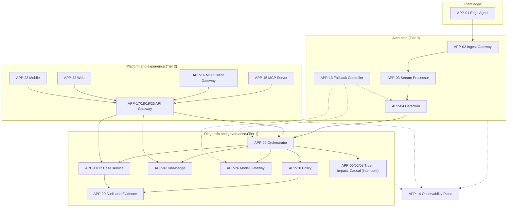
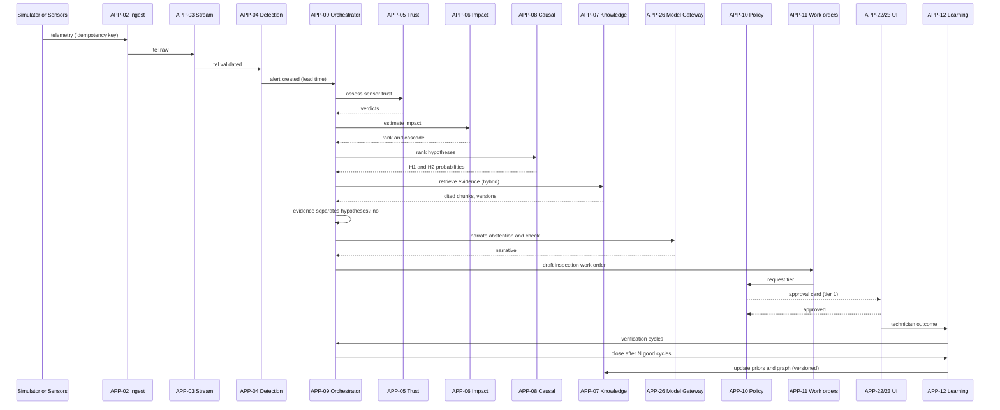
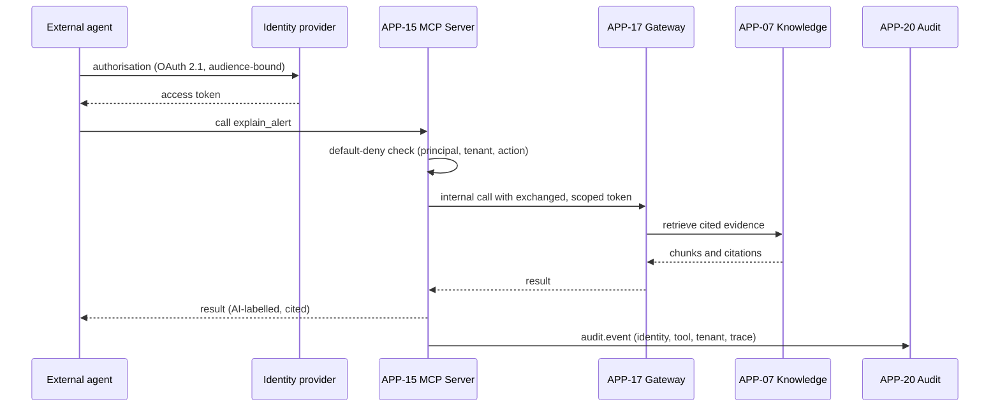
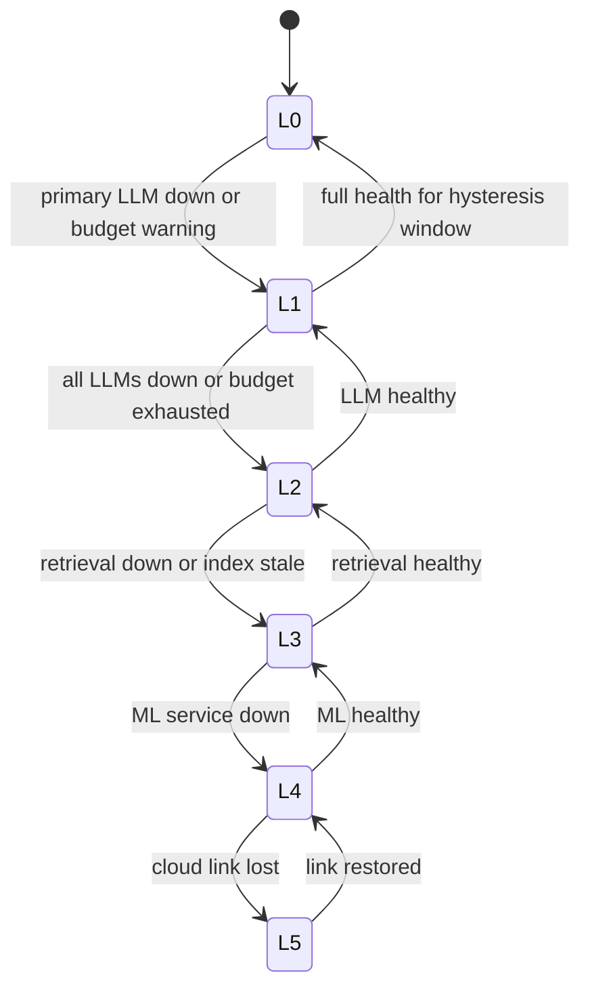

# 06. Application Architecture: AuraPrime FactoryPulse v2

| Field | Value |
|---|---|
| Status | DRAFT v0.1 |
| Date | 2026-09-30 |
| Owner | Sri Soma |
| TOGAF ADM phase | Phase C: Information Systems Architecture (Application) |
| Inputs | 01 Business Architecture; 05 Data Architecture; Requirements document |
| Related | 07 Technology (deployment); 03 Technical Design (component internals, contracts) |

---

## 1. Application architecture principles

| ID | Principle | Consequence |
|---|---|---|
| AP-1 | The alert path is isolated from the diagnosis path | A failing LLM, retriever or UI must never stop detection and alerting (bulkheads, criticality tiers) |
| AP-2 | The intelligence brain is replaceable through ports | Enables the Community/Full edition split via extension points |
| AP-3 | The causal model decides; the LLM narrates | LLM is confined to APP-26 and to narration nodes |
| AP-4 | Agents draft; humans decide | No write path to equipment exists (BR-01, BR-02) |
| AP-5 | Governance sits outside the model | Policy, audit and fallback are separate deployables |
| AP-6 | Every service is observable and degradable | OTel from day one; each has a defined fallback |
| AP-7 | Contract first | OpenAPI and event schemas precede implementation; SDKs generated |
| AP-8 | Modular by default, split when justified | Modular monolith for the intelligence core to keep a solo build operable (ADR-005) |
| AP-9 | Cloud specifics behind adapters | Bus, object store and secrets are interfaces (NFR-C3) |
| AP-10 | Least privilege between components | mTLS, scoped service identities, default-deny |

---

## 2. Application portfolio catalog (TOGAF: Application Portfolio catalog)

Criticality tier: **T0** = alert path (must keep working); **T1** = diagnosis and governance; **T2** = platform and experience.

| ID | Application component | Responsibility | Tier | Edition | Language / runtime | Key requirements |
|---|---|---|---|---|---|---|
| APP-01 | Edge Agent | Protocol adapters (OPC UA, Sparkplug B, REST), local buffering, ordered replay | T0 | C | Python or Go (spike) | ING-1, ING-2 |
| APP-02 | Ingest Gateway | REST, gRPC, MQTT and OTLP/HTTP JSON endpoints; validation; sensor registry check; idempotency; DLQ; back-pressure (ADR-039) | T0 | C | TypeScript (Node 22, ADR-032) | ING-1, 3, 4, 5, 6, 7, 13 |
| APP-03 | Stream Processor | Normalise, enrich, route, aggregate, write validated telemetry | T0 | C | TypeScript (Node 22, ADR-032) | ING-6, ING-7 |
| APP-04 | Detection Service | Baseline (Isolation Forest) and drift detection; lead time; threshold fallback | T0 | C (baseline) / F (drift) | TypeScript (Node 22, ADR-032; Python offline research) | DET-1..5 |
| APP-05 | Trust Service | Per-sensor trust scoring and verdict | T1 | F | TypeScript (Node 22, ADR-032) | TRU-1..4 |
| APP-06 | Line Impact Service | Line model, cascade and impact estimates, ranking | T1 | F | TypeScript (Node 22, ADR-032) | LIM-1..4 |
| APP-07 | Knowledge Service | Ingestion, versioning, hybrid retrieval, knowledge graph, citation verification, provenance; similar-case retrieval (LRN-5) | T1 | C (basic) / F (advanced) | TypeScript (Node 22, ADR-032, ADR-035) | RAG-1..11, LRN-5 |
| APP-08 | Causal Engine | FMEA-style probabilistic hypothesis ranking; discriminating-check proposal | T1 | F | TypeScript (Node 22, ADR-032) | AGT-2, AGT-3 |
| APP-09 | Agent Orchestrator | Stateful workflow (detect to learn), budgets, routing | T1 | C | TypeScript (Node 22, ADR-032) | AGT-1, 5..8 |
| APP-10 | Policy Engine | Policy-as-code decisions for approval tier | T1 | F (engine) / C (static tiers) | TypeScript (Node 22, ADR-032) | POL-1, POL-2 |
| APP-11 | Work-Order Service | Drafts, saga state, CMMS adapter | T1 | C | TypeScript (Node 22, ADR-032) | AGT-4, POL-2 |
| APP-12 | Learning and Verification | Outcome capture, verification counters, priors and graph updates; case memory, gated lessons and the learning evaluation gate (ADR-031) | T1 | F | TypeScript (Node 22, ADR-032) | LRN-1..7 |
| APP-13 | Fallback Controller | Health inputs, degradation state machine, budget signal, hysteresis | T0 | C | TypeScript (Node 22, ADR-032) | FBK-1..4 |
| APP-14 | Observability Plane | OTel Collector, backends, evaluation pipeline, attribute layer, dashboards, status | T0 | C (core) / F (status page) | OSS stack plus TypeScript (Node 22, ADR-032) | OBS-1..11 |
| APP-15 | MCP Server | MCP tools and resources with governed access | T2 | C (read-only) / F (full) | TypeScript | MCP-1..7, 9 |
| APP-16 | MCP Client Gateway | Egress-controlled connection to external MCP servers | T2 | F | TypeScript | MCP-8 |
| APP-17 | API Gateway and BFF | Public API, auth, rate limits, quotas, real-time streams | T2 | C (core) / F (quotas, tenancy features) | TypeScript | API-1, 3, 4, 6 |
| APP-18 | Tenant and Identity Service | Tenants, projects, users, roles, keys | T2 | F | TypeScript (Node 22, ADR-032) | API-2, 3 |
| APP-19 | Metering Service | Usage events and aggregation (test mode) | T2 | F | TypeScript (Node 22, ADR-032) | API-5 |
| APP-20 | Audit and Evidence Service | Hash-chained audit; evidence pack; SBOM ingest | T1 | F (chain, pack) / C (basic log) | PostgreSQL function gov.append_audit + TypeScript (ADR-032, ADR-033) | POL-3, NFR-S8, REG-7 |
| APP-21 | Simulator and Benchmark | Fault injection; scenarios; scoring; chaos | T2 | C (baseline) / F (extended) | TypeScript (Node 22, ADR-032) | SIM-1..5 |
| APP-22 | Web App | Operations UI | T2 | C shell / F full | TypeScript (Expo web build, ADR-029) | UI-3, UI-4, 6..9 |
| APP-23 | Mobile App | Technician UI | T2 | C | TypeScript (Expo native build, ADR-029) | UI-5..8 |
| APP-24 | Model Registry | Model versions, metrics, approvals, artifacts | T1 | C | MLflow-class (decision open) | DET-5 |
| APP-25 | Notification Service | Push and webhook delivery with retry | T2 | C | TypeScript (Node 22, ADR-032) | API-6, POL-4 |
| APP-26 | Model Gateway | LLM and embedding provider abstraction; budgets; caching; redaction; local and paid models. Narration port with `local`, `anthropic` (Claude) and `gemini` adapters selected by `model.provider` (ADR-038) | T1 | C | TypeScript (Node 22, ADR-032, ADR-035) | AGT-6, FBK-3, NFR-C4 |

---

## 3. Deployable units (physical grouping)

| DU | Contains | Rationale |
|---|---|---|
| DU-01 edge-agent | APP-01 | Runs at the plant edge |
| DU-02 ingest-gateway | APP-02 | Scales with ingest load |
| DU-03 stream-processor | APP-03 | Stateful stream work |
| DU-04 intel-core | APP-04, 05, 06, 08 (modular) | Shares features and models; one container keeps ops simple |
| DU-05 knowledge-svc | APP-07 | Heavier dependencies; independent scaling |
| DU-06 agent-orchestrator | APP-09 | Isolated so LLM stalls cannot affect T0 |
| DU-07 case-svc | APP-11, 12 | Case state and learning |
| DU-08 governance-svc | APP-10, 20 | Independent of the model path; guards approvals and audit |
| DU-09 fallback-controller | APP-13 | Small and highly reliable |
| DU-10 model-gateway | APP-26 | Single choke point for model spend and redaction |
| DU-11 api-gateway | APP-17, 18, 19, 25 (modules) | One TypeScript service for the public surface |
| DU-12 mcp-server | APP-15 | Separate attack surface, separate scaling |
| DU-13 mcp-client-gateway | APP-16 | Egress control isolation |
| DU-14 web | APP-22 | Web build of the shared Expo app (ADR-029) |
| DU-15 mobile | APP-23 | Native builds of the same app; shipped separately |
| DU-16 observability | APP-14 | OSS stack |
| DU-17 model-registry | APP-24 | |
| DU-18 simulator | APP-21 | Not deployed with production-like tenants |

Decision ADR-005: modular monolith for the intelligence core (DU-04) and a small number of services elsewhere, instead of 26 microservices. This is a deliberate trade-off between demonstrating distributed design and staying operable by one person within the budget. Boundaries between modules are enforced by internal interfaces so a module can be split later.

---

## 4. Application communication diagram (TOGAF: Application Communication diagram)



Solid lines are runtime calls or events; dotted lines are control signals and telemetry.

Rendered view with tiers, editions, interface IDs, topics and the safety invariants: [diagrams/application-architecture.html](diagrams/application-architecture.html). The Mermaid source above stays the source of truth; update both together.

---

## 5. Interface catalog (TOGAF: Interface catalog)

| ID | Interface | Provider | Consumers | Style | Notes |
|---|---|---|---|---|---|
| INT-01 | Telemetry ingest | APP-02 | APP-01, external sources, APP-21 | REST, gRPC, MQTT, OTLP/HTTP JSON | Idempotency key mandatory; OTLP tenant from the device API key only (ADR-039) |
| INT-02 | Event bus topics | Various | Various | Publish and subscribe | See 05 Data Section 5.1 |
| INT-03 | Detection scoring | APP-04 | APP-09, APP-03 | Internal gRPC or REST | Threshold fallback when unavailable |
| INT-04 | Trust query | APP-05 | APP-09, APP-22 | Internal | |
| INT-05 | Impact query | APP-06 | APP-09, APP-17 | Internal | |
| INT-06 | Knowledge search (hybrid, cited) | APP-07 | APP-09, APP-15, APP-17 | Internal | Returns chunks with version, score, citation handle |
| INT-07 | Hypothesis ranking | APP-08 | APP-09 | Internal | Returns ranked hypotheses with probabilities |
| INT-08 | Model Gateway | APP-26 | APP-09, APP-07 | Internal | LLM and embeddings; enforces budgets and redaction |
| INT-09 | Policy decision | APP-10 | APP-09, APP-11 | Internal | Deterministic; auditable |
| INT-10 | Work-order API | APP-11 | APP-09, APP-17 | Internal | Draft-only writes |
| INT-11 | Fallback level | APP-13 | All | Bus topic and query | Retained last value |
| INT-12 | Public REST API v1 | APP-17 | APP-22, APP-23, external apps | REST with OpenAPI | Versioned; scoped keys and OAuth |
| INT-13 | MCP server interface | APP-15 | External agents and hosts | MCP | OAuth 2.1; per-call authorisation. Built 2026-11-07: MCP over streamable HTTP (official SDK, config `mcp.*`), platform bearer tokens until OAuth 2.1 (MCP-3) exists |
| INT-14 | MCP client egress | APP-16 | External MCP servers | MCP client | Allow-listed, pinned servers |
| INT-15 | Webhooks | APP-25 | External apps | HTTPS, signed | Retries, idempotency |
| INT-16 | Audit emit | APP-20 | All services | Bus and API | Only APP-20 writes the chain |
| INT-17 | OTLP | APP-14 | All services | OTLP | Trace context propagation |
| INT-18 | Simulator control | APP-21 | Test harness, CI | REST | Not exposed publicly |
| INT-19 | CMMS adapter | External CMMS | APP-11 | Adapter pattern | Reference stub in v2.0 |
| INT-20 | UI real-time stream | APP-17 | APP-22, APP-23 | SSE or WebSocket | Alerts, queue, fallback banner |

---

## 6. Application interaction matrix (TOGAF: Application Interaction matrix)

Rows call columns (C = synchronous call, E = event, blank = none).

| From \ To | 02 | 03 | 04 | 05 | 06 | 07 | 08 | 09 | 10 | 11 | 12 | 13 | 20 | 26 |
|---|---|---|---|---|---|---|---|---|---|---|---|---|---|---|
| 01 Edge | C | | | | | | | | | | | | | |
| 02 Ingest | | E | | | | | | | | | | | E | |
| 03 Stream | | | E | E | E | | | | | | | | | |
| 04 Detection | | | | E | E | | | E | | | | | | |
| 05 Trust | | | | | | | | E | | | | | | |
| 06 Impact | | | | | | | | E | | | | | | |
| 09 Orchestrator | | | C | C | C | C | C | | C | C | | | E | C |
| 10 Policy | | | | | | | | E | | | | | E | |
| 11 Work orders | | | | | | | | E | C | | | | E | |
| 12 Learning | | | | | | C | | E | | | | | E | |
| 07 Knowledge | | | | | | | | | | | | | E | C |
| 13 Fallback | | | E | | | | | E | | | | | E | E |

Health signals to APP-13 come from the observability plane and service probes (not listed).

---

## 7. Key interaction sequences

### 7.1 Hero scenario (sensor drift to verified closure)



Every arrow is a span under one trace ID (OBS-2). Audit events are emitted at approval, policy decision, closure and learning updates (not drawn).

### 7.2 External agent calls an MCP tool



The server never passes the external token downstream (no token passthrough); it exchanges it for an internal, narrowly scoped one.

### 7.3 Degradation state machine (APP-13)



Transitions can skip levels; recovery steps up one level at a time after a hysteresis window (FBK-4).

---

## 8. Extension-point architecture (Community and Full editions)

The core defines **ports** (interfaces). The Community profile selects the baseline adapters and the Full profile selects the advanced ones; both are published under Apache-2.0 (ADR-036) and configuration chooses between them (ADR-007). The Community profile builds and runs without any Full adapter (IP-2).

| Port | Community implementation | Full implementation |
|---|---|---|
| DetectionStrategy | Isolation Forest plus thresholds | Multivariate drift with lead time |
| TrustProvider | Simple range and staleness checks | Full trust scoring and verdicts |
| ImpactProvider | Rank by machine severity | Line-impact and cascade engine |
| HypothesisEngine | Retrieval-only ranking | Causal (FMEA-style probabilistic) engine |
| RetrievalStrategy | Hybrid keyword and vector | Graph-enhanced retrieval, provenance ledger, abstention tuning |
| PolicyProvider | Static tier table | Policy-as-code engine with hash-chained decisions |
| LearningProvider | Outcome logging only | Priors, graph updates, reversible versions |
| EvidenceGenerator | Basic audit log export | Compliance evidence pack |
| TenancyProvider | Single tenant | Multi-tenant, quotas, metering |
| ScenarioLibrary | Baseline scenarios | Extended failure library |

Rules: every port has contract tests that both adapters pass; configuration selects the adapter; the Community profile has no runtime dependency on a Full adapter.

---

## 9. Application patterns and cross-cutting concerns

| Concern | Pattern |
|---|---|
| Service structure | Hexagonal (ports and adapters); domain logic isolated from transport and storage |
| Messaging | Event-driven with outbox and idempotent consumers |
| Long-running work | Saga for work orders and approvals; workflow state persisted per incident |
| Resilience | Timeouts, retries with jitter, circuit breakers, bulkheads on every outbound call |
| Consistency | Eventual across services; strong within a service transaction |
| Read models | CQRS-lite: projections for the UI queue and line map |
| Security | mTLS, service identities, default-deny policies, scoped tokens |
| Observability | OTel auto and manual spans; attribute layer for GenAI and MCP conventions |
| Configuration | Environment-driven; feature flags for edition adapters |
| Versioning | Semantic versions for APIs, events and models |
| Cost control | All model calls via APP-26; budgets and caching there |

---

## 10. Application and business mapping (TOGAF: Application/Function matrix)

| Capability | Primary applications | Supporting |
|---|---|---|
| BC-01 Monitor and Detect | APP-01, 02, 03, 04 | APP-13, 14 |
| BC-02 Assess Data Trust | APP-05 | APP-03 |
| BC-03 Prioritise by Line Impact | APP-06 | APP-04 |
| BC-04 Diagnose Root Cause | APP-07, 08, 09, 26 | APP-24 |
| BC-05 Act and Resolve | APP-09, 10, 11, 25 | APP-22, 23 |
| BC-06 Verify and Learn | APP-12 | APP-07 |
| BC-07 Knowledge Management | APP-07 | APP-26 |
| BC-08 Integrate and Expose | APP-15, 16, 17 | APP-25 |
| BC-09 Govern and Comply | APP-10, 20 | APP-14 |
| BC-10 Observe and Operate | APP-13, 14, 24 | APP-21 |
| BC-11 Tenant and Commercial | APP-17, 18, 19 | |

### 10.1 Role to application matrix

| Role | UI apps | Other access |
|---|---|---|
| Line operator | APP-22 | |
| Technician | APP-23, APP-22 | |
| Shift lead, Reliability engineer | APP-22, APP-23 | |
| Plant manager | APP-22 | |
| Security and compliance admin | APP-22 | APP-20 exports |
| External developer or agent | | APP-17 API, APP-15 MCP |
| Project owner | APP-22 (control tower) | APP-14, APP-21 |

---

## 11. Software engineering view (TOGAF: Software Engineering diagram)

Single monorepo with clear ownership and publish boundaries.

```
auraprime-factorypulse/
  apps/
    app/                  Expo universal app: web (APP-22) and mobile (APP-23), ADR-029
    api-gateway/          TypeScript (APP-17, 18, 19, 25)
    mcp-server/           TypeScript (APP-15)
    ingest-gateway/       TypeScript (APP-02, ADR-032)
    stream-processor/     TypeScript (APP-03, ADR-032)
    intel-core/           TypeScript (APP-04, 05, 06, 08, ADR-032)
    knowledge-svc/        TypeScript (APP-07, APP-26, ADR-032, ADR-035)
    case-svc/             TypeScript (APP-11, 12, ADR-032)
    governance-svc/       TypeScript (APP-10, 20, ADR-032, ADR-033)
    mock-api/             Fastify TypeScript mock API (ADR-030)
    simulator/            TypeScript (APP-21, ADR-032)
  packages/
    ports/                Public interfaces and contract tests (Community)
    core-adapters/        Baseline implementations (Community)
    otel-attributes/      Attribute layer for GenAI and MCP conventions (Community)
    schemas/              Event and API schemas (Community)
    sdk-ts/  sdk-py/      Generated clients (Community)
    ui-tokens/  ui-kit/   Design tokens and components (Community)
  adapters-full/         Full-profile adapters (published, Apache-2.0)
    scenarios-extended/   Failure library
    tuned-assets/         Prompts, thresholds, models, datasets
  deploy/                 IaC, Helm or Kustomize, local cluster config
  docs/                   Architecture and design documents
```

Publish rule: the export tool publishes the code and the documents marked `edition: community`; `edition: full` documents are internal and excluded, and the export leak scan verifies it (IP-2, IP-6, ADR-036).

---

## 12. Application migration view (v1 to v2)

| v1 component | v2 fate |
|---|---|
| `src/ingest_service.py`, `ingest_service_grpc.py` | Evolve into APP-02 (add idempotency, DLQ, back-pressure, MQTT) |
| `dataflow_pipeline.py` | Replaced by APP-03 (no Dataflow dependency locally); Beam optional as cloud adapter |
| `pubsub_firestore_processor*.py` | Replaced by APP-03 writing to DS-01 |
| `prediction_service.py` | Becomes baseline strategy in APP-04 |
| `train_model.py` | Feeds APP-24 registry |
| `agent/graph.py`, `nodes.py`, `state.py` | Rebuilt as APP-09 with new nodes and routes |
| `agent/rag_pipeline.py` (FAISS) | Replaced by APP-07 (hybrid, versioned) |
| `agent/evaluation/*` | Feeds OBS-4 and SIM-4 benchmark |
| `app.py` dashboard | Replaced by APP-22 and APP-23 |
| `terraform/` | Rebuilt for local cluster and cloud validation |
| `client*.py` | Replaced by APP-21 simulator |

Strangler approach: keep v1 running as reference; deliver v2 phase by phase (see 04 ADD Section 12).

---

## 13. Application quality attributes and tactics

| Attribute | Tactics |
|---|---|
| Availability | T0 isolation; edge buffer; health probes; fallback controller; redundant replicas in design (single replica in the budget deployment) |
| Performance | Async ingestion; aggregates for dashboards; caching in APP-26; bounded workflow budgets |
| Security | See 03 Technical Design Section 9 and 07 Technology Section 8 |
| Modifiability | Ports and adapters; contract tests; schema versioning |
| Testability | Simulator with ground truth; deterministic policy engine; contract tests per port |
| Observability | Uniform instrumentation; trace per incident |
| Interoperability | OpenAPI, MCP, Sparkplug and OPC UA adapters, webhooks |
| Cost efficiency | Model Gateway budgets; scale to zero; local-first |

---

## 14. TOGAF artifact coverage (Application)

| TOGAF artifact | Where |
|---|---|
| Application Portfolio catalog | Section 2 |
| Interface catalog | Section 5 |
| Application/Function matrix | Section 10 |
| Role/Application matrix | Section 10.1 |
| Application Interaction matrix | Section 6 |
| Application Communication diagram | Section 4 |
| Application Use-Case and Process/Application Realization diagrams | Section 7 (sequences) and 01 Section 7 |
| Software Engineering diagram | Section 11 |
| Application Migration diagram | Section 12 |
| Application/Technology matrix | 07 Technology Section 9 |

---

## 15. Open items

| # | Item |
|---|---|
| AO-1 | Edge agent language (Python vs Go) after a footprint spike |
| AO-2 | Policy engine: custom rules module or an existing policy runtime |
| AO-3 | Tenant and identity module: within gateway or separate service |
| AO-4 | Retain MLflow-class registry or use lightweight tables (ties to DO-2) |
| AO-5 | Confirm modular monolith boundaries for DU-04 after first profiling |
