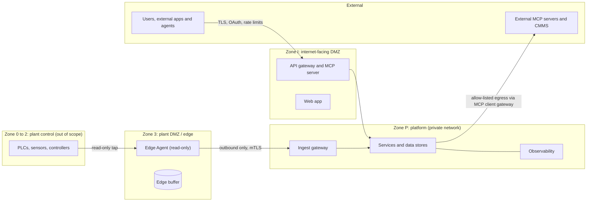
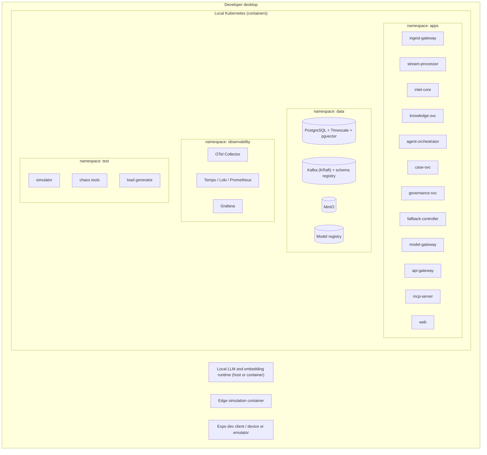
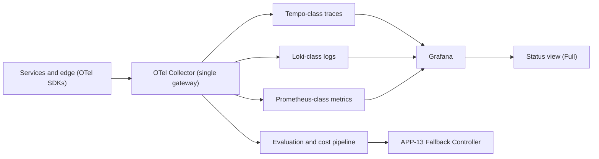
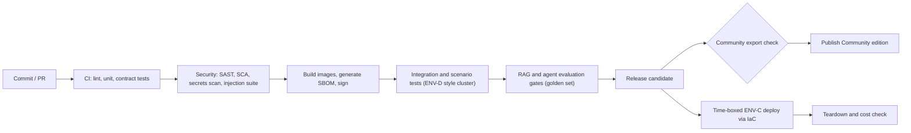

# 07. Technology Architecture: AuraPrime FactoryPulse v2

| Field | Value |
|---|---|
| Status | DRAFT v0.1 |
| Date | 2026-09-30 |
| Owner | Sri Soma |
| TOGAF ADM phase | Phase D: Technology Architecture |
| Inputs | 05 Data; 06 Application; Requirements (NFR, cost, resilience, security) |
| Related | 04 ADD (ADRs, migration); 03 Technical Design (configuration, pipelines) |

> Products named here are **candidates** unless marked selected. Selection is confirmed by time-boxed spikes (see Section 13). No prices or version numbers are asserted; verify current pricing and versions before committing. All figures are initial targets.

---

## 1. Technology architecture principles

| ID | Principle | Consequence |
|---|---|---|
| TP-1 | Desktop-first: about 90 percent of build and test runs locally in containers | Everything must run on a single developer machine |
| TP-2 | Portable by construction | Cloud services sit behind adapters; the same images run everywhere |
| TP-3 | Open standards over proprietary services | OpenTelemetry, OpenAPI, MCP, OCI images, SQL |
| TP-4 | Budget is a design constraint | Scale to zero; time-boxed cloud windows; budget circuit breaker |
| TP-5 | Reproducible everything | Infrastructure as code; pinned versions; lock files; SBOM |
| TP-6 | Secure supply chain | Signed images, dependency and image scanning in CI |
| TP-7 | Failure is a first-class test input | Chaos tooling in the desktop cluster |
| TP-8 | Fewer components beat more | Consolidate stores; avoid tools that add operational load without a requirement |

---

## 2. Technology environment catalog (TOGAF: Environments and Locations diagram)

| ID | Environment | Purpose | Share of effort |
|---|---|---|---|
| ENV-D | Developer desktop (local Kubernetes cluster in containers) | Build, integration, scenario, chaos, security and performance tests | About 90 percent |
| ENV-E | Edge simulation (separate container or VM on the same machine) | Edge agent, store-and-forward, network partition tests | Part of ENV-D |
| ENV-C | Cloud validation (Google Cloud, time-boxed) | Deploy via IaC, smoke and scenario runs, OTel export, LLM API check, cost verification | About 10 percent |
| ENV-P | Public showcase hosting (Full demo on personal website; Community repository) | Demonstration | Later phase; not part of the initial budget scope unless the cost is confirmed |

ENV-P needs its own cost and hardening review before launch: public exposure adds abuse, scraping and availability concerns (see IP-7, RK-8).

---

## 3. Technology standards catalog (TOGAF: Technology Standards / TRM catalog)

Status: **S** = selected, **C** = candidate (pending spike), **R** = rejected for v2.0.

### 3.1 Platform and runtime

| Category | Choice | Status | Rationale |
|---|---|---|---|
| Container format | OCI containers | S | Portability |
| Local orchestration | Lightweight Kubernetes distribution in containers (k3d or kind class) | C | Cloud-parity with low overhead |
| Package and deploy | Helm or Kustomize | C | Repeatable deploys |
| Backend language | TypeScript (Node 22, Fastify, pnpm monorepo); Python retained for offline ML research only | S | ADR-032; supersedes AC-5 |
| Frontend and gateway language | TypeScript | S | AC-5 |
| Web and mobile framework | Expo (React Native) with Expo Router; web via React Native Web (ADR-029) | S | One codebase for web, iOS and Android |
| Monorepo tooling | pnpm workspaces (Turborepo optional later) | S | Shared packages; in use since ADR-030 |
| Configuration validation | zod schemas in `packages/config`, generated key reference | S | doc/10, ADR-030 |
| Mock backend for UI-first work | Fastify (TypeScript) serving the OpenAPI contract from local PostgreSQL | S | ADR-030; replaced by the real API gateway later |
| UI end-to-end testing | Playwright on web build, desktop and phone viewports | S | ADR-030, UI-AC-1 |

### 3.2 Data and messaging

| Category | Choice | Status | Rationale |
|---|---|---|---|
| Primary store | PostgreSQL with TimescaleDB and pgvector | S | ADR-003 |
| Message bus | Apache Kafka (KRaft mode) | S | ADR-011: replay, per-key ordering, ecosystem; NATS JetStream is the fallback adapter |
| Site MQTT broker | Eclipse Mosquitto (MQTT 5, 3.1.1 compatible) | S | ADR-026; inbound only; APP-02 is the only bridge |
| Schema registry | Kafka-compatible schema registry (Avro or Protobuf) | S | 09 contracts; product to confirm in TO-2 |
| Cloud bus | Google Pub/Sub via adapter | S (adapter) | Continuity with v1, validation only |
| Object store | MinIO (local) and Cloud Storage (cloud) | S | Adapter |
| Stream processing | Custom lightweight TypeScript processor | S | ADR-032; replaces Dataflow; Beam kept as optional cloud adapter |
| Vector store | pgvector | S | DP-1 |
| Graph engine | Relational tables with recursive queries | S (v2.0) | Dedicated graph DB deferred |
| Cache | In-process plus PostgreSQL; optional Valkey-class cache | C | Only if measured need |

### 3.3 AI and ML

| Category | Choice | Status | Rationale |
|---|---|---|---|
| Agent workflow | LangGraph-class stateful graph | S | v1 continuity |
| Local LLM runtime | Ollama-class local runtime | C | Zero marginal cost in ENV-D |
| Paid LLM API | One provider behind APP-26 | C | Only in ENV-C, with hard token cap |
| Embedding model | Small local embedding model | C | Cost |
| Reranker | Small local cross-encoder | C | Quality within budget |
| Classical ML | scikit-learn (baseline); additional statistical methods for drift | S | v1 continuity |
| Model registry | MLflow-class | C | DO-2 |
| RAG evaluation | Ragas or DeepEval-class metrics | C | v1 continuity |

### 3.4 Observability

| Category | Choice | Status | Rationale |
|---|---|---|---|
| Instrumentation | OpenTelemetry SDKs and Collector | S | OBS-1 |
| Traces | Tempo-class | S | Open source |
| Logs | Loki-class | S | Open source |
| Metrics | Prometheus-class | S | Open source |
| Dashboards | Grafana | S | Local and cloud |
| GenAI and MCP conventions | Via internal attribute layer, versions pinned | S | OBS-9 (upstream still in development) |
| Alerting | Grafana alerting rules plus fallback controller signals | C | |

### 3.5 Security and delivery

| Category | Choice | Status | Rationale |
|---|---|---|---|
| Service identity and mTLS | Certificate manager and a service mesh or library-level mTLS | C | Complexity vs benefit spike |
| Secrets | Secrets manager (local: sealed or encrypted files; cloud: Secret Manager) | S | NFR-S3 |
| Policy engine runtime | Rules module or existing policy runtime | C | AO-2 |
| SBOM | CycloneDX or SPDX generation in CI | S | REG-4 |
| Image signing and scanning | Sigstore-class signing; vulnerability scanner in CI | S | NFR-S5 |
| SAST and SCA | Language-appropriate scanners in CI | S | MCP and API hardening |
| CI/CD | GitHub Actions | S | v1 continuity |
| IaC | Terraform or OpenTofu | S | v1 continuity (Terraform) |
| Chaos and fault injection | Network fault proxy plus Kubernetes pod-kill tooling | C | NFR-R6 |
| Load testing | Open-source load generator plus simulator | C | NFR-P1, NFR-P2 |

### 3.6 Rejected or deferred

| Item | Decision | Reason |
|---|---|---|
| Google Dataflow (as the primary processor) | R | Cost and desktop parity |
| Firestore and BigQuery as primary stores | R | Cost and local-run difficulty |
| FAISS as the vector store | R | No versioning, filtering or tenancy |
| Dedicated graph database | Deferred | Not needed at v2.0 scale |
| Multi-region and multi-zone cloud deployment | Deferred | Cost; proven by failure injection instead |
| Managed Kubernetes in the cloud | Deferred | Cost; use a small VM or serverless containers for validation |

---

## 4. Network and zone architecture (TOGAF: Network and Communications diagram)

Zones are inspired by the Purdue model and IEC 62443 zones and conduits. The platform reads from the plant; it does not write control commands back.

Rendered view with the zones, the five conduits and the desktop decomposition from section 5.1: [diagrams/technology-architecture.html](diagrams/technology-architecture.html). The Mermaid source above stays the source of truth; update both together.

| Conduit | Rules |
|---|---|
| Plant to edge | Read-only; no inbound connections from the platform |
| Edge to platform | Outbound-initiated only, mutual TLS, ordered replay after outage |
| Internet to gateway | TLS, OAuth 2.1 or scoped keys, rate limits, WAF-class filtering where available |
| Platform to external systems | Only via APP-16 with an allow-list, egress policy and pinned servers |
| Inside the platform | Default-deny network policies; service identities; mTLS |

---

## 5. Platform decomposition (TOGAF: Platform Decomposition diagram)

### 5.1 Desktop environment (ENV-D)

### 5.2 Cloud validation environment (ENV-C)

Options to be decided after cost verification (DO/TO-1):

| Option | Description | Pros | Cons |
|---|---|---|---|
| C1: single small VM with a lightweight Kubernetes distribution | Reproduces ENV-D on one VM; stateless services optionally on serverless containers | Cheapest and closest to desktop; easy teardown | Self-managed database and bus; not managed-service realism |
| C2: serverless containers for stateless services plus a managed small database | Tests scale-to-zero and managed services | Realistic managed path | Managed database may consume a large share of the budget; verify |
| C3: hybrid (recommended starting point for the spike) | VM for stateful pieces (database, bus); serverless containers for gateway, MCP, web; Pub/Sub tested through the adapter | Covers the interesting cloud behaviours at low cost | Slightly more moving parts |

Cloud components (whichever option): container registry, secrets manager, object storage, IAM service accounts with least privilege, budget alerts with a hard cap and a teardown script, logging and monitoring export via OTLP.

---

## 6. Resilience and availability mapping

| Requirement | Technology mechanism | Where proven |
|---|---|---|
| Edge store-and-forward (ING-2) | On-disk queue plus ordered replay | ENV-E partition tests |
| Idempotent ingest (ING-3) | Idempotency table plus unique message ids | Integration tests |
| Durable messaging | Kafka idempotent producers with acks=all, consumer offsets committed after processing, retention and replay, dead-letter topics | ENV-D chaos |
| Database durability (NFR-R4) | Continuous write-ahead log archiving to object store; scheduled base backups; restore drill | ENV-D restore drill |
| Circuit breakers and bulkheads (NFR-R2) | Client libraries and per-service resource limits; separate deployables per tier | ENV-D fault injection |
| Health and readiness (NFR-R5) | Kubernetes probes plus application health endpoints | Every environment |
| Graceful degradation (FBK) | Fallback controller reading probe and OTel signals | ENV-D scenarios CS-C, CS-F |
| Multi-zone design (NFR-R1) | Replica counts, anti-affinity and pod disruption budgets defined in manifests (single replica in budget runs) | Simulated by pod-kill and node-drain tests |
| Rollback | Versioned images and migrations; Helm rollback | CI |

### 6.1 Recovery objectives (initial targets, to validate)

| Environment | RPO target | RTO target |
|---|---|---|
| ENV-D | Minutes (log archive interval) | Under 30 minutes via documented restore |
| ENV-C | Not a production commitment; document the design targets | Teardown and redeploy from IaC |

Availability claims are stated as **design targets** (NFR-R1: 99.9 percent for the core alert path). Only what was deployed and measured is claimed as demonstrated.

---

## 7. Observability technology architecture

| Concern | Design |
|---|---|
| Sampling | Tail-based sampling keeps all error, abstention, fallback and security-event traces; samples routine traffic |
| Attribute layer | Internal package maps GenAI and MCP attributes; versions pinned; upgrade tested against dashboards |
| Content capture | Off by default; opt-in and redacted in Collector processors |
| Cost signal | APP-26 emits cost metrics; Collector exposes them to APP-13 |
| Retention | Short local retention; export selected traces as evidence where needed |
| Meta-monitoring | The pipeline monitors its own lag, drops and Collector health |

---

## 8. Security technology architecture

| Layer | Controls |
|---|---|
| Identity | OAuth 2.1 and OpenID Connect through a delegated identity provider (local dev provider in ENV-D); API keys hashed; service identities with short-lived certificates |
| Transport | TLS everywhere; mTLS between services; outbound-only edge connections |
| Authorisation | Gateway scopes; MCP per-call default-deny; policy engine for approvals; Postgres row-level security |
| Secrets | Secrets manager; no secrets in Git, images, prompts or traces |
| Network | Default-deny network policies; separate namespaces; egress allow-list for APP-16 |
| Workload | Non-root containers, read-only root filesystems, resource limits, seccomp defaults |
| Supply chain | Pinned dependencies; SBOM per image; signed images; vulnerability scanning gates; MCP server pinning |
| LLM safety | Prompt-injection test suite; output schema enforcement; retrieved text treated as data; budget limits (OWASP LLM 2025 controls) |
| Detection and response | Security-event spans; alerts on tool denial spikes, cross-tenant attempts, injection detections; vulnerability disclosure policy; incident runbook with 24-hour and 72-hour reporting readiness (NFR-S9) |
| Public exposure | Rate limits, quotas, abuse detection, hard budget kill switch, terms of use (IP-7) |

Target: design to IEC 62443 SL2 intent; no certification claimed (NFR-S1).

---

## 9. Application to technology matrix (TOGAF: Application/Technology matrix)

| Application | Runtime | Data stores used | Bus | Special dependencies |
|---|---|---|---|---|
| APP-01 Edge Agent | Container or native binary | DS-05 | Publishes to ingest | Protocol libraries |
| APP-02 Ingest | TypeScript (Node 22) container | DS-01 (idempotency), DS-02 | Publishes | gRPC, MQTT |
| APP-03 Stream | TypeScript (Node 22) container | DS-01 | Consumes, publishes | |
| APP-04, 05, 06, 08 (DU-04) | TypeScript (Node 22) container | DS-01 | Consumes, publishes | Numerical libraries (offline Python ML) |
| APP-07 Knowledge | TypeScript (Node 22) container | DS-01, DS-03 | Consumes | Embedding model, reranker via APP-26 (ADR-035) |
| APP-09 Orchestrator | TypeScript (Node 22) container | DS-01 | Consumes, publishes | Stateful workflow engine |
| APP-11, 12 | TypeScript (Node 22) container | DS-01 | Consumes, publishes | |
| APP-10, 20 | TypeScript (Node 22) container + gov.append_audit | DS-01, DS-03 | Consumes | Policy engine runtime, audit function |
| APP-13 | Small container | DS-01 (events), reads OTel | Publishes | |
| APP-26 Model Gateway | TypeScript (Node 22) container | DS-01 (cost ledger) | | Local runtime and cloud LLM adapter (ADR-035) |
| APP-17, 18, 19, 25 | Node container | DS-01 | Consumes | Identity provider |
| APP-15 MCP Server | Node container | (via gateway) | | MCP SDK |
| APP-16 MCP Client Gateway | Node container | | | Egress policy |
| APP-22 Web | Node container or static and edge hosting | | | |
| APP-23 Mobile | Expo build | Device local store | | Push service (deferred) |
| APP-14 Observability | Collector plus OSS stack | DS-04 | | |
| APP-24 Registry | Container | DS-01 or own store, DS-03 | | |
| APP-21 Simulator | TypeScript (Node 22) container | DS-01 (test tenant) | Publishes | |

---

## 10. Desktop reference sizing (to be confirmed, OQ-4)

| Resource | Working assumption | Reason |
|---|---|---|
| CPU | 8 or more cores | Cluster plus simulator and load tests |
| RAM | 32 GB preferred; 16 GB minimum with reduced scenario size | Database, bus, observability stack, cluster overhead, local model |
| Disk | Several hundred GB free SSD | Container images, telemetry, models |
| GPU | Optional | Speeds a local LLM; the design must work CPU-only with a small model |

If the desktop is smaller, reduce simulated sensors and use a smaller local model; no design change is required because sizing is configuration.

---

## 11. CI/CD and delivery architecture

| Concern | Design |
|---|---|
| Environments as code | Terraform or OpenTofu for ENV-C; Helm or Kustomize and cluster config for ENV-D |
| Community export check | The export leak scan verifies that no `edition: full` document, secret or personal path reaches the public export (IP-2, IP-6, ADR-036) |
| Release evidence | SBOM, test and evaluation reports, and model register archived as an evidence pack input |
| Rollback | Versioned images; database migrations forward-only with tested restore |
| Cost gate | ENV-C deploy requires budget alert configuration and a teardown step verified in the pipeline |

---

## 12. Cost control architecture

| Control | Mechanism |
|---|---|
| Total budget | Under USD 50 out of pocket (NFR-C1) |
| Cloud | Billing alerts (for example at 50 percent and 90 percent), a hard cap where the platform supports it, teardown script tested locally first |
| LLM | Local model in ENV-D; paid API only in ENV-C with per-day and per-incident token caps in APP-26; response caching |
| Runtime | Scale to zero on serverless components; VM stopped when idle |
| Visibility | CostLedger table and dashboard; cost signal to APP-13 |
| Behaviour on exhaustion | Automatic drop to L1 or L2 rather than failing alerting (BR-09) |

Cost estimates are intentionally not stated here; produce them from the cloud provider's pricing calculator in the spike (TO-1) and record them in an ADR.

---

## 13. Technology risks and spikes

| ID | Risk or question | Spike or mitigation |
|---|---|---|
| TO-1 | Cloud cost realism (VM vs managed database vs serverless) | One-day cost model and a small trial run with alerts |
| TO-2 | Kafka and Mosquitto tuning and failure behaviour (ADR-011, ADR-026) | Measure throughput, RAM footprint and failure behaviour on the desktop; set partition count and retention; if the full stack does not fit the reference desktop, switch the backbone adapter to NATS JetStream |
| TO-3 | Local model quality and speed for narration and reranking | Evaluate two small models on the golden set |
| TO-4 | mTLS approach (mesh vs library) | Compare complexity and overhead |
| TO-5 | Styling library that works on Expo web and native (see 02 UI, ADR-029) | One-day spike |
| TO-6 | Edge agent footprint and language | Compare Python and Go prototypes |
| TO-7 | Upstream OTel GenAI and MCP convention changes | Pin versions; attribute layer; regression dashboards |
| TO-8 | Public hosting of the Full demo (cost, hardening, abuse) | Separate review before ENV-P |
| TO-9 | Timescale and pgvector operations on modest hardware | Load test with the simulator |
| TO-10 | Availability of local tooling on the actual desktop OS | Verify in the first setup task |

---

## 14. Technology delta from v1

| Area | v1 | v2 |
|---|---|---|
| Ingest transport | Pub/Sub | Broker abstraction (local bus; Pub/Sub adapter) |
| Stream processing | Dataflow | Lightweight Python processor |
| Operational store | Firestore | PostgreSQL |
| Analytics store | BigQuery | PostgreSQL with time-series extension |
| Vector store | FAISS | pgvector |
| Serving | Cloud Run services | Containers on a local cluster; serverless in ENV-C |
| Tracing | Cloud Trace on some services | OpenTelemetry end to end |
| IaC | Terraform for GCP | Terraform or OpenTofu plus local cluster manifests |
| UI | Python dashboard | TypeScript web and mobile |

---

## 15. TOGAF artifact coverage (Technology)

| TOGAF artifact | Where |
|---|---|
| Technology Standards catalog | Section 3 |
| Technology Portfolio catalog | Sections 3 and 5 |
| Application/Technology matrix | Section 9 |
| Environments and Locations diagram | Sections 2 and 5 |
| Platform Decomposition diagram | Section 5 |
| Processing diagram | 06 Application Section 7 (sequences) and Section 6 above |
| Networked Computing/Hardware diagram | Sections 4, 5 and 10 |
| Network and Communications diagram | Section 4 |
| Technology gap analysis | Section 14 |
