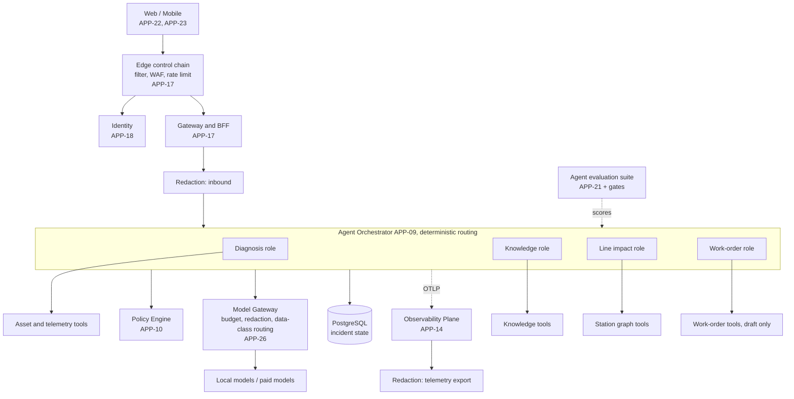

# AuraPrime FactoryPulse v2: Reference Architecture Mapping

**Status:** Draft for review. Companion to documents 00–07 (TOGAF ADM Phase E input).
**Reference used:** "Agentic AI architecture for banking, Step 14: Edge Layer Security" (the project owner's own diagram, confirmed under IP-9 on 2026-11-02).
**Purpose:** Use the banking reference as a pattern source. Identify what v2 already covers, what is worth adopting, what does not transfer, and what changes are proposed. Nothing here has been merged into documents 00–07 yet.

---

## 1. What the reference shows

A layered agentic system for a bank:

1. Chat UI, then an **Edge layer** (WAF, DDoS, rate limits, API gateway), with **authentication** delegated to the bank's identity provider.
2. An **API**, with **PII redaction** applied to data leaving the agent boundary.
3. A **Coordinator agent** that consults **Authorisation** and routes to specialist agents (Accounts, Transaction, Service).
4. Each specialist agent calls its own **domain MCP server**, which fronts the real business functions (balance enquiry, statement request, KYC update).
5. Shared platform services: **LLM pool** (self-hosted or third-party), **Session store** (conversation history and inter-agent shared state), **Agent evaluation suite**, **Cost tracker**, and a two-part **Observability** block (prompts, agent calls and tool calls; plus CPU, memory and disk).

## 2. Component mapping

| Reference component | v2 equivalent | Status | Note |
|---|---|---|---|
| Chat UI | APP-22 Web, APP-23 Mobile | Different | v2 is alert and case centred, not chat first (see section 4) |
| Edge layer (WAF, DDoS, rate limits, gateway) | APP-17 API Gateway and BFF | Partial | Rate limits and quotas covered; WAF is a passing mention; DDoS is not covered; no ordered control chain |
| Authentication (IdP) | APP-18 Tenant and Identity; OIDC | Covered | Approvals already require a human session; keys and agent tokens cannot approve |
| Authorisation | APP-10 Policy Engine; per-tool default deny | Covered | Stronger in v2: policy-as-code outside the LLM (AP-3) |
| PII redaction | APP-26 Model Gateway (redaction) | Partial | Redaction exists only at the model boundary |
| Coordinator and specialist agents | APP-09 Agent Orchestrator (LangGraph-class) | Partial | v2 has one workflow with nodes; no explicit role separation or per-role tool scope |
| Domain MCP servers | APP-15 MCP Server (external); internal tools | Partial | v2 MCP is outward facing; internal tools are not governed through the same contract |
| LLM pool (self-hosted, third-party) | APP-26 Model Gateway | Covered | Add data-class routing rule (section 3, item 5) |
| Session store | Per-incident workflow state in PostgreSQL | Partial | No conversation-session entity found in the data architecture |
| Agent evaluation suite | RAG golden dataset (03 section 7.6); APP-21 Simulator scoring | Partial | Retrieval and diagnosis are scored; agent behaviour (tool use, routing, policy tier) is not |
| Cost tracker | Budget breaker in APP-26; APP-19 Metering; W06 budget burn | Covered | Add per-role attribution |
| Observability: prompts, agent and tool calls | APP-14 OTel plane; OBS-1..11 | Covered | |
| Observability: CPU, memory, disk | APP-14 infrastructure metrics | Covered | |

## 3. Adopt, adapt, reject

### Adopt or adapt

1. **Explicit edge control chain (proposed ADR-021).** Define one ordered chain for every external request: network filtering and DDoS absorption, then TLS and WAF-class rules, then rate limit and quota, then authentication, then authorisation, then the service. Desktop: reverse proxy with rate limiting and a bot or abuse filter. Cloud: Google Cloud load balancing with Cloud Armor in front of the gateway. Gateway-level kill switch already exists for the public demo (ADR-020).
2. **Redaction at three boundaries, not one (proposed ADR-022).** (a) Inbound user and API text, before it reaches any agent. (b) Outbound to any model, in APP-26 (exists). (c) Telemetry and trace export, so prompts or sensitive fields do not leak into observability backends (aligns with opt-in content capture in 04). Factory-specific classes to redact: operator and technician identity, customer and supplier names, proprietary process parameters and recipes, credentials. Process parameters matter to an OEM buyer more than personal data does.
3. **Role-separated agents with scoped tool servers (proposed ADR-023).** Keep one orchestrator and deterministic routing, but name four roles with least-privilege tools:

   | Role | Tool namespace | Access |
   |---|---|---|
   | Diagnosis | Asset and telemetry tools; causal engine | Read |
   | Knowledge | Knowledge retrieval tools | Read |
   | Line impact | Station graph tools | Read |
   | Work order | Work-order tools | Draft only (AGT-4) |

   Expose these through MCP-shaped contracts so the internal tool plane and the external MCP server (APP-15) share one governance model: default deny, per-call audit, kill switch. Benefit: smaller blast radius per role and one place to test tool authorisation. Cost: extra hop and latency, so the T0 alert path stays off MCP entirely.
4. **Agent evaluation suite as a release gate (proposed ADR-024).** Extend 03 section 7.6 beyond retrieval and diagnosis to cover: tool-call correctness, route and trajectory correctness (AGT-8 conditions), abstention correctness, policy-tier correctness, prompt-injection resistance, and cost per incident. Run in CI against simulator scenarios and sample online from traces. Failing a gate blocks release (OBS-4).
5. **Data-class model routing.** In APP-26, route by data classification: restricted classes only to local or self-hosted models; paid third-party models for unrestricted classes only. This is the practical answer to an OEM buyer's data-residency question and fits the existing fallback ladder.
6. **Cost attribution per role.** Tag token and compute cost by agent role and tool on spans, so W06 can show budget burn by role.

### Reject or not applicable

- **Customer-facing chat as the primary interface.** v2 users act on alerts and cases. A conversational copilot may be an optional later feature, not the core.
- **Transactional agents.** Banking agents change money and records. v2 is advisory only and has no actuation (AGT-4), so its authorisation model is stricter on writes, not richer.
- **LLM-driven coordinator routing.** Routing stays deterministic, driven by evidence, trust and policy conditions. The causal engine decides; the LLM narrates (AP-3).
- **Bank regulatory assumptions.** The regulatory view in 03 stays as written.

## 4. Open question: conversation sessions

The reference has a session store for conversation history and inter-agent shared state. v2 persists workflow state per incident (03 section 9.1) and resumes after restart (03 section 9.5), which already covers inter-agent shared state. It has no conversation history entity because it has no chat feature.

If you want an operator copilot ("why is Weld Cell 4 flagged?"), it needs a new `case.conversation` entity under row-level security, with retention, redaction and citation rules, and the answers must come from the same evidence ledger. Recommendation: defer to a later phase; keep v2.0 alert and case centred.

## 5. Reference-aligned view of v2

## 6. Proposed changes (not yet merged)

| Target | Change |
|---|---|
| 04 ADD, ADR log | Add ADR-021 to ADR-024 (section 3); status Proposed |
| 06 Application | Add role-to-tool table to APP-09; add internal tool-plane note to APP-15; add redaction stages to INT list |
| 07 Technology | Add edge control chain table for desktop and cloud; Cloud Armor on cloud path |
| 03 Technical Design | Extend 7.6 into an agent evaluation design; add redaction at three boundaries; data-class routing in Model Gateway |
| 05 Data | Add trace-export redaction rule; `case.conversation` only if the copilot is approved |
| Requirements | Add requirements for edge control chain, three-boundary redaction, role-scoped tools, agent evaluation gates |

## 7. Decisions needed

1. Merge ADR-021 to ADR-024 into documents 03–07 as written, or revise first?
2. Operator copilot: defer past v2.0 (recommended) or include?
3. Data-class routing: should restricted classes be local-model only by default?
