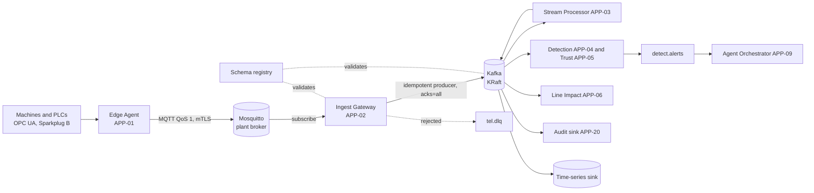

# AuraPrime FactoryPulse v2: Messaging Architecture (Kafka and Mosquitto)

**Status:** Draft for review. Addendum to documents 00–08.
**Decision:** Apache Kafka as the event backbone and Eclipse Mosquitto as the MQTT broker, recorded as ADR-011 (revised) and ADR-026 on 2026-10-01 by the chief architect under delegation from the owner. NATS JetStream is the fallback backbone adapter. The evaluation is in `adr/ADR-011-message-backbone.md`.
**Claims marked "verify" are from general knowledge and have not been checked against current releases.**

---

## 1. Decision summary

| Layer | Technology | Role |
|---|---|---|
| Plant edge | Eclipse Mosquitto (MQTT 5, with MQTT 3.1.1 compatibility) | Receives telemetry from edge agents, gateways and devices, close to the machines |
| Platform backbone | Apache Kafka (KRaft mode, no ZooKeeper) | Durable, replayable event log between all platform services |
| Boundary | Ingest Gateway (APP-02) | Subscribes to MQTT, validates, stamps idempotency keys, produces to Kafka |
| Contracts | Schema registry (Avro or Protobuf) | Versioned, compatibility-checked event schemas |
| Cloud | Google Pub/Sub adapter (optional) | Kept only behind the transport abstraction (ING-6), not the default |

Why this fits: MQTT is what plant devices and Sparkplug B gateways speak, and Mosquitto is light enough to run at each site. Kafka gives ordered per-asset streams, retention and replay, which the simulator, benchmark runs and outcome learning all need. Replay is a stronger match for the evidence and audit story than a transient queue.

Costs accepted: Kafka is heavier than NATS on a desktop; Mosquitto open source has no native clustering. Both are handled below.

## 2. Topology

One-way rule (NFR-S4): the Mosquitto bridge and subscriptions carry data inward only. No topic carries commands back to the plant. The platform stays advisory.

Rendered view with Kafka topics, consumer groups, the back-pressure chain and trace propagation: [diagrams/messaging-architecture.html](diagrams/messaging-architecture.html). The Mermaid source above stays the source of truth; update both together.

## 3. MQTT design (Mosquitto)

| Aspect | Design |
|---|---|
| Namespace | Native Sparkplug B (`spBv1.0/<group>/<message type>/<edge node>/<device>`) where gateways speak it; otherwise `fp/v1/<tenant>/<site>/<line>/<station>/<asset>/telemetry` |
| QoS | QoS 1 for telemetry and events (at least once); QoS 0 only for heartbeats |
| Sessions | Persistent sessions with clean-start off for edge clients; bounded queue per client |
| Identity | TLS 1.2+ with client certificates; one identity per edge node; per-client topic ACLs (publish only to own subtree) |
| Persistence | Broker persistence enabled; periodic autosave; broker restarts must not lose queued QoS 1 messages |
| Trace context | W3C `traceparent` carried in MQTT 5 user properties |
| Availability | Single broker per site (no OSS clustering). Resilience comes from edge-side buffering with ordered replay (ING-2), client auto-reconnect, and an optional warm standby broker with client failover. Treat as a known limit. |
| Shared subscriptions | For scaling APP-02 consumers across instances; verify support and behaviour in the chosen Mosquitto version |

## 4. Kafka design

### 4.1 Topic catalogue (names are working proposals)

Pattern: `fp.<env>.<domain>.<name>.v<major>`.

| Topic | Key | Cleanup | Notes |
|---|---|---|---|
| `tel.raw.v1` | tenant + asset | delete | Validated envelopes as received; ordering preserved per asset |
| `tel.features.v1` | tenant + asset | delete | Windowed features from the stream processor |
| `detect.alerts.v1` | tenant + asset | delete | Detection and trust results that open incidents |
| `case.events.v1` | incident id | delete | State-change events from the workflow, written through the outbox |
| `gov.audit.v1` | tenant | delete | Feeds the hash-chained audit writer (only APP-20 writes the chain) |
| `asset.state.v1` | tenant + asset | compact | Latest known state for fast lookup |
| `tel.dlq.v1` | original key | delete | Rejected or poison messages with reason and source offset. Reasons: `invalid_topic`, `malformed_json`, `schema_validation_failed`, `timestamp_skew_exceeded`, `unknown_sensor` (not registered at the named place, ING-7), `tenant_missing` and `tenant_mismatch` (OTLP, ING-13); ADR-039 |
| `*.retry.<delay>` | original key | delete | Tiered retry topics before the DLQ |
| `know.ingest.v1` | document id | delete | Knowledge ingestion jobs |
| `learn.events.v1` | tenant | delete | Case recorded, lesson drafted or decided, learning batch staged, activated, rejected or reverted (ADR-031); asynchronous, Tier 1 only |

Partitioning: key by tenant and asset so one asset's readings stay ordered. Desktop uses a small partition count; the count is a spike output (TO-2) and cannot shrink later.

### 4.2 Delivery and correctness

- **Producers:** idempotent, `acks=all`, bounded retries, linger and batching tuned by spike.
- **Consumers:** at-least-once with manual commit after processing; idempotent handlers deduplicate on the idempotency key stored in PostgreSQL (DS-01).
- **Workflow events:** the transactional outbox pattern. Incident state changes are written to PostgreSQL and relayed to Kafka by a poller (Debezium is an optional upgrade), so state and events cannot diverge.
- **Exactly-once:** used only inside Kafka read-process-write stages that need it, not as a platform-wide promise.
- **Contracts:** schema registry with backward-compatible evolution, enforced in CI. Verify licensing of the chosen registry (Apicurio or Karapace are open-source candidates).
- **Retention:** placeholders until sizing is measured. Replay for the simulator and benchmarks relies on retention or an archived copy in object storage.

### 4.3 Consumer groups

`stream-processor`, `detection`, `trust`, `line-impact`, `audit-sink`, `timeseries-sink`, `orchestrator-trigger`. Consumer lag per group is a first-class health signal feeding the fallback controller.

## 5. Back-pressure and failure behaviour

| Condition | Behaviour |
|---|---|
| Kafka slow or full | APP-02 stops pulling from MQTT; Mosquitto queues up to its limit; edge agents spill to local disk buffers; metrics and alerts fire |
| Kafka unavailable | APP-02 spools to a bounded local disk queue and returns retry-after; edge keeps detecting with local thresholds; platform shows the degraded level (existing ladder) |
| Poison message | Fails validation or schema check, goes to `tel.dlq.v1` with reason; never blocks the partition |
| Consumer crash | Group rebalance; uncommitted work is reprocessed; idempotency prevents double effects |
| Mosquitto down | Edge agents buffer and replay in order on reconnect (ING-2) |
| Buffers exhausted | Defined loss policy: drop lowest-priority telemetry first, never drop alerts; loss is counted and surfaced |

## 6. Security

- Mosquitto: client certificates, per-client ACLs, publish-only to own subtree, no anonymous access, no public exposure.
- Kafka: internal network only; mTLS or SASL/SCRAM per service; topic ACLs per service identity; encryption in transit.
- Redaction applies at ingest (ADR-022) and again before any trace export, so message contents do not leak into observability.
- Zone and conduit view: Mosquitto sits at the site or DMZ boundary; Kafka sits inside the platform zone; the only conduit between them is APP-02.

## 7. Observability

- OpenTelemetry context flows MQTT user properties, then Kafka headers, then consumers, so one trace follows a reading from edge to alert.
- Broker metrics: Kafka through JMX or an exporter to Prometheus; Mosquitto through its `$SYS` topics via an exporter.
- Dashboards and alerts: consumer lag, partition skew, DLQ depth, producer error rate, MQTT connected clients, queued messages, dropped messages, end-to-end alert latency against the 5 s p95 target.

## 8. Environments and budget

| Environment | Layout |
|---|---|
| Desktop (about 90 percent) | Docker Compose: one Mosquitto, one Kafka broker in KRaft mode (replication factor 1), one schema registry. A three-broker profile is available for chaos tests if memory allows. Plan roughly 1 GB for Kafka and under 100 MB for Mosquitto before measuring (verify in spike). |
| Cloud validation (about 10 percent) | Self-hosted Kafka and Mosquitto containers on the validation VM. A managed Kafka service is likely to exceed the USD 50 budget (verify current pricing), so it is not the default. Pub/Sub is exercised only through the adapter. |
| Community edition | Same stack through Compose; both brokers are open-source. Full edition adds multi-tenant topic ACL automation and richer replay tooling. |

## 9. Changes this causes in other documents

| Document | Change |
|---|---|
| 04 ADD | ADR-011 becomes Kafka backbone (Accepted, replaces NATS candidate). New ADR-026: Mosquitto as site MQTT broker with APP-02 as the only bridge. Open issue OI-5 narrows to tuning. |
| 05 Data | DS-02 becomes Kafka; "subjects" in the event catalogue become topics with keys; add schema registry as a store; DO-1 resolved |
| 06 Application | APP-02 gains the MQTT subscriber and Kafka producer roles, DLQ and spooling; add deployable units for Mosquitto, Kafka and schema registry; INT-01 transport detail |
| 07 Technology | Standards rows for Kafka, Mosquitto and schema registry; resilience mapping rows; desktop sizing; cloud layout note; TO-2 reframed as Kafka and Mosquitto tuning and failure spike |
| 03 Technical Design | Ingestion section uses MQTT then Kafka; add topic, partition and retry design; add back-pressure table |
| Requirements | ING-6 reworded: Kafka default, Pub/Sub optional adapter. New requirements for MQTT security, DLQ, replay and trace propagation |

**Progress (2026-10-01).** Applied: ADR-011 revised and ADR-026 added in 04, OI-5 narrowed; DS-02 and DO-1 in 05; subjects renamed to topics in 03, 05 and 06; ING-6 reworded; 07 standards rows, platform diagram, resilience row and TO-2. Pending, tracked under OI-5: APP-02 roles, deployable units and INT-01 detail in 06; ingestion, topic, partition, retry and back-pressure design in 03; schema registry as a store in 05; new requirements for MQTT security, DLQ, replay and trace propagation; desktop sizing rows in 07.

## 10. Open items

1. Schema registry product and schema format (Avro or Protobuf).
2. Bridge approach: in-process in APP-02 (recommended, keeps validation and back-pressure in one place) or Kafka Connect MQTT source.
3. Partition counts and retention, from measurement.
4. Mosquitto version features: MQTT 5 user properties and shared subscriptions (verify).
5. Whether to keep the Pub/Sub adapter at all, given the budget.
6. Whether a warm standby Mosquitto is worth the complexity for the showcase.
